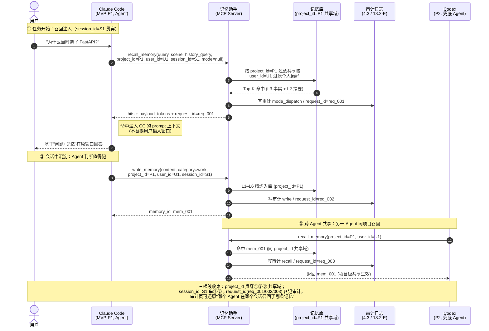

# 多 Agent 记忆助手 - 需求规格书

**版本**: v1.0  
**日期**: 2025-07-16  
**状态**: 设计评审版

> **2026-10-30 拍板结论（批次9固化，本文档为准）**
>
> 1. **L0 必须加密落盘**：AES-256-GCM；L0 不参与查重/向量/召回/prompt，仅授权查阅。
> 2. **L0 授权查阅**：管理员指定账号 + 指定一次性授权密码；指定账号凭指定密码解锁；查阅会话必须连续，**5 分钟无操作自动锁定并作废该授权**；再次查阅须重新申请。默认仅管理员可用管理密码直接查阅；非管理员即使被授权仍须输入授权密码。
> 3. **L1–L6 逐层生成、逐层查重**：每生成一层立即按该层查重；命中 → **分支嫁接**并停止，不再生成下一层；未命中 → 继续下一层，直到 L6。
> 4. **五维查重权重全层统一**：语义 35% / 关键词 20% / 实体 15% / 结构 10% / LLM 仲裁 20%；无真实 LLM 时四维归一化；各层阈值见 §6.1。
> 5. **LLM 逐层调用**：L2–L6 每层一次（最多 5 次），输入必须是上一层；**L0 原文永不送 LLM**；无真实 LLM 只落 L1（`refined_by='stub'`）。
> 6. **后台写入 L0 写密钥**：管理员本次会话解锁一次，主进程内存缓存；未解锁 → `E_L0_LOCKED`，**不落明文、不降级**。
>
> 详见 §2.2、§4.1/§4.4、§6.1/§6.2、§16.1、§19.11；API 见《需求规格书_内核API契约》§4。

---

## 一、产品概述

### 1.1 产品定位
多 Agent 记忆助手是一个具备**自净化、自生长**能力的智能记忆系统，支持跨会话、跨 Agent 的记忆共享与个性化偏好学习，为多租户（个人/团队/企业）提供安全、高效的记忆管理服务。

### 1.2 核心价值
- **记忆延续性**：打破单会话限制，实现跨会话知识积累
- **个性化适配**：学习用户偏好，主动适配 Agent 行为
- **安全隔离**：严格的多租户数据隔离与权限控制
- **自动化治理**：自净化去重、自生长优化、遗忘机制

### 1.3 目标用户
- **个人用户**：日常对话记忆、偏好学习
- **团队用户**：团队协作记忆、代码规范共享
- **企业用户**：企业知识库、合规要求、跨团队协作

---

## 二、核心功能设计

### 2.1 L1-L6 六层记忆架构

**L0/L1 访问边界（公共不变，所有召回模式共用）**：

- **L0 原始层**：AES-256-GCM 加密存储，**除脱敏审计用途外禁止任何在线访问**；不解密、不回灌、不进 prompt。
- **L1 清洗脱敏层**：已完成姓名/电话/邮箱/证件号/裸 IP/API Key/服务地址等敏感信息脱敏，是**唯一允许进入 prompt 的原始内容形态**；默认不回灌，仅在「用户强需求」或「相关性单项 ≥0.9」时以**脱敏版**回灌用于溯源核验。
- L2-L6 为提炼层，按 §2.4.2 公共规则与 §2.4.3 模式规则参与召回。

```
┌─────────────────────────────────────────────────────────────────┐
│  L0: 原始对话（加密存储）                                        │
│  - AES-256-GCM 加密                                              │
│  - 用途：审计/恢复/证据                                          │
│  - 访问：仅管理员解密                                            │
└─────────────────────────────────────────────────────────────────┘
                            ↓
┌─────────────────────────────────────────────────────────────────┐
│  L1: 清洗脱敏（不限长度）                                        │
│  - 去除：姓名、电话、邮箱、证件号、裸 IP、任意协议服务地址、       │
│    API Key/Token、Authorization/Cookie 头等敏感信息              │
│  - 替换为占位符：[姓名]、[电话]、[邮箱]、[证件号]、[IP]、         │
│    [API_KEY]、[服务地址]、[密钥]                                  │
│  - 保留：技术内容、代码、逻辑推理（含版本号如 v1.2.3.4）          │
└─────────────────────────────────────────────────────────────────┘
                            ↓
┌─────────────────────────────────────────────────────────────────┐
│  L2: 摘要提取 + 元数据（≤300字，~150-200 Token）                │
│  - 时间戳、来源、类型标签                                        │
│  - 核心内容摘要（3-5句话）                                       │
│  - 领域分类标签                                                  │
└─────────────────────────────────────────────────────────────────┘
                            ↓
┌─────────────────────────────────────────────────────────────────┐
│  L3: 总结得失（≤200字，~100-120 Token）                          │
│  - 成功点：做对了什么                                            │
│  - 失败点：哪里出了问题                                          │
│  - 经验教训：可复用的经验                                        │
└─────────────────────────────────────────────────────────────────┘
                            ↓
┌─────────────────────────────────────────────────────────────────┐
│  L4: 模式归纳（≤120字，~60-80 Token）                            │
│  - 从 L3 的得失中提炼规律                                        │
│  - 跨事件的重复模式                                              │
└─────────────────────────────────────────────────────────────────┘
                            ↓
┌─────────────────────────────────────────────────────────────────┐
│  L5: 洞察提炼（≤60字，~30-40 Token）                             │
│  - 对 L4 模式的升华，更本质的理解                                │
│  - 具有普遍适用性的洞察                                          │
└─────────────────────────────────────────────────────────────────┘
                            ↓
┌─────────────────────────────────────────────────────────────────┐
│  L6: 关键字萃取（≤30个，~50-80 Token）                           │
│  - 格式：{"keywords": [...], "projections": [...]}              │
│  - 投影：L1-L5 相关内容 + relevance 评分                         │
│  - 用于快速索引和检索                                            │
└─────────────────────────────────────────────────────────────────┘
```

> **批次40 两条口径修订（上图的字数区间是「上限」，不再是「配额」）**：
>
> 1. **L1 是准入层，不是「脱敏后一律入库」**：`checkL0ToL1Quality`（质量门 **v3**）在脱敏之后加一道短料门槛——有效字 `< 30`（`MIN_MEANINGFUL_WITHOUT_FACTS`）**且**既无硬事实**又**无具体技术证据时，**在 L0→L1 这一步就拒**并记码 `short_low_signal`，不等后台精炼才发现「首层就没有产出」。写页 / MCP / 采集器 / 补炼队列四处共用同一份判定。
> 2. **这一行该炼到第几层由 L1 自己的料量决定**（`depthCapFor`：≥240→L5 / ≥120→L4 / ≥60→L3 / ≥30→L2 / `<30`→**停在 L1，仍可正常检索**），每层的字数区间改由**源文长度按压缩比现算**（`layerBand`：下限 = 源文 × `minRatio`，上限 = `min(maxChars, 源文长度)`）——摘要是压缩不是扩写，产物比源长直接判废。L6 是**独立通道**（检索索引，任何深度都能单独产出），所以「有 L6」不代表炼得深，行上的深度由 `headlineLayer` 判。详见 §16.1 与 §19.24。

### 2.2 写入流程（逐层精炼 + 逐层查重 + 命中嫁接）

> 2026-10-30 拍板：**废弃“一次 LLM 调用完成 L2/L4/L5/L6”**。§6.2 要求每生成一层立即查重、命中即停止；一次调用无法在中途停止，因此改为逐层调用（L2–L6 最多 5 次）。无真实 LLM 时只生成 L1。

```
L0 原文（只在内存中短暂存在，立即加密落盘）
    ↓
L1 清洗脱敏（本地规则，不经 LLM；不限长度）
    ↓
L0→L1 质量门（噪声/无意义 → filtered，不落库；门禁在查重之前）
    ↓
L1 查重（阈值 0.70）──命中──→ 分支嫁接@L1 → 停止
    │未命中
L2 会话摘要（LLM，输入 L1）→ L2 查重（0.75）──命中──→ 分支嫁接@L2 → 停止
    │未命中
L3 得失分析（LLM，输入 L2）→ L3 查重（0.80）──命中──→ 分支嫁接@L3 → 停止
    │未命中
L4 模式归纳（LLM，输入 L3）→ L4 查重（0.85）──命中──→ 分支嫁接@L4 → 停止
    │未命中
L5 洞察提炼（LLM，输入 L4）→ L5 查重（0.90）──命中──→ 分支嫁接@L5 → 停止
    │未命中
L6 投影索引（LLM，输入 L1–L5 + relevance）→ L6 查重（0.90）──命中──→ 分支嫁接@L6 → 停止
    │未命中
  建图 / 写入完成
```

**写入不变量（代码必须按此实现）**

1. **L0 原文永不送 LLM**；L2–L6 每层输入必须是上一层（L2←L1、L3←L2、L4←L3、L5←L4），L6 输入 L1–L5 + relevance。
2. **每层生成后先校验该层规格**（§16.1）；不合规 → 该层不落 + 停止更深层；`layer` = 最高连续层，`content` = 最深有效层。
3. **每层查重命中 → 分支嫁接并停止**，不再生成下一层；未命中 → 继续。嫁接语义见 §6.2。
4. **无真实 LLM → 只落 L1**（`refined_by='stub'`）；L1 查重照常执行，不因无 LLM 跳过。
5. **质量门在查重之前**；噪声规则对**脱敏后**文本匹配；有效长度排除占位符/标点；过滤审计只存遮罩预览。噪声覆盖：纯寒暄/客套、纯身份或能力询问、助手自我介绍/能力清单/免责声明、**助手过程旁白与进度自述**（批次35）等**无可用信息**的元对话。实质证据口径（批次35 收紧）：**判定前先剥离 Markdown 装饰**（`**加粗**` 的 `*` 不算代码符号）、英文技术词先摘掉厂商/通用 IT 停用词再看符号、空格分隔的排版符号不算证据；「身份自述段 / 能力清单段 / 旁白段」在**全段无硬事实**（错误码、带单位数值、`key=0.767` 这类实测值、函数/命令行、带扩展名的文件名路径）时整段拦截，**身份自述与过程旁白不给证据豁免**（「我是 Claude Haiku 4.5」里的 `4.5` 是自述不是事实）；过程旁白按**整句**判定——同一行只要另一句仍是描述或要求就放行，且「请/务必/不要/必须/确保/尽量」开头的句子按要求放行。
6. **查重候选** = 同 `project_id`、未删除、**存有该层 `content_lk`** 的记忆；不是只比对 `memory.layer === level`（深层记忆也含浅层内容）。
7. **语义向量从 L1 生成**；L0 不进向量、不进召回、不参与查重。
8. **审计逐条记录**：每层的生成/校验/查重（层、分数、阈值、候选数、命中、动作）、嫁接目标、LLM 调用次数、规格违规、`l0_encrypted=true`。
9. **同一质量门不得有旁路（批次10）**：手动编辑记忆（`coreMemoryOps.coreUpdateContent`）与自动摘要合并（`buildSummary`）都必须过 `checkL0ToL1Quality`——编辑不达标拒绝写入并审计 `filtered_l0_to_l1`；摘要成员或聚合文本不达标则跳过合并（原文不降级、不删除），周期审计记 `summaries_filtered` 与拦截原因。
10. **会话采集按角色白名单准入（批次35）**：源缺省**只采 `user`**（`DEFAULT_COLLECT_ROLES`），助手消息在算哈希/查重之前就被挡下并计 `ScanResult.roleSkipped`——因为质量门是启发式，**无法凭措辞区分用户与助手**，而「我先看一下…/更新 HANDOVER。/B3 完成。」这类入库噪声的主体恰好是助手消息。源可显式声明 `roles` 扩档，本机唯一例外是 WorkBuddy（`roles:['assistant']`：其日志整篇是 `##` 任务分块，属 Agent 工作记录而非对话旁白）；`isMeta:true` 的宿主注入消息整条不解析。拦截量不是丢失量：`applyScanToStore` 对 `new/duplicate/filtered` 三态分别计数，三类都写审计。
11. **历史噪声只能整库重来（批次35）**：质量门收紧只约束**此后**的写入，已落库的旧口径行不会自动消失，故提供「记忆库清空重采」（`ledgerReset.ts` + `ledger:resetPreview`/`ledger:resetRecollect`）。硬约束：预览只读；执行需管理员 + 逐字确认口令；**强制先备份**（含 `collector-cursor.json`），备份失败一律拒绝清空；`backup_confirmed` 缺失即抛错；清空只动记忆行与进程内向量索引，不动 L0 密钥环、审计历史与账号数据；清空后游标与去重指纹归零、后台按新规则连续追采（单轮仍钳 50 条，未采完由 5 分钟周期补齐）。

### 2.3 两级唤醒召回机制

```
用户提问
    ↓
[第 0 级：意图预分类]
    本地规则 + 小模型（0 次 LLM 调用）
    判定 scene：default | task_start | history_query | critical
    决定召回深度、预算档位与 LLM 重排开关（见 2.4.1 场景化预算）
    ↓
[第 1 级：硬过滤 + 双路粗召回]
    硬过滤：租户边界（enterprise_id/team_id/user_id）+ 在线层
            （decay_class IN hot/warm，archived/cold 默认排除）
            + status ≠ deleted + confidence > 0.05
    双路并行：
      a. L6 关键词路（主路）：l6_index 倒排 → memory_id
         精确词/实体/错误码/配置项命中走此路
      b. 向量路（辅路）：hot/warm 全量向量 + warm 倒排
         泛化语义类查询走此路
    融合：RRF；pinned=true 的记忆免检直接进候选集（见 17.8）
    取并集 Top-10 候选
    ↓
[第 2 级：注意力过滤（触发式，非必经）]
    默认走 17.8 轻量打分排序（0 次 LLM 调用）
    仅当闸门开启时（scene=critical 且候选 ≤ 10 且会话内
    LLM 调用未达阈值）才调用 LLM 重排，从 Top-5~10 选 1-3 条
    高频低价值场景默认关闭；失败时回退到轻量打分结果
    重排的 LLM 消耗记入 pipeline_llm_tokens，不计入 payload 预算
    ↓
[按需回灌层级]
    默认 L5/L4；需要细节升 L3；需要复盘升 L2（带老化提示）
    L0/L1 一律禁止进入在线召回上下文（L1 与 L0 同级禁止，
    仅允许审计/恢复用途）；裁剪顺序见 2.4.1
    ↓
[组装 Prompt]
    程序记忆（固定）→ 工作记忆 → 语义记忆 → 情景记忆（按需）
    ↓
[Token 预算控制]
    软上限 1500 → 告警 2000 → 硬熔断 3000（见 2.4.1 三档预算）
```

### 2.4 分层 Prompt 组装策略

| 层级 | 内容 | Token 占比 | 加载策略 |
|------|------|-----------|----------|
| **程序记忆** | 内置系统规则 | ~200（固定） | 始终加载 |
| **工作记忆** | 最近5轮对话摘要 + 近期活跃记忆 | ~300-500 | 始终加载 |
| **语义记忆** | L5/L4/L3 原子事实（优先！） | ~100-300/条 | **优先加载** |
| **情景记忆** | L2 会话摘要 | ~200-400/条 | **按需加载** |
| **原始记忆** | L1/L0 完整内容 | ~1000+/条 | **绝不加载**（仅审计） |

**加载优先级**：语义记忆 > 情景记忆（按需）> 原始记忆（禁止）

### 2.4.1 召回预算控制（三档预算 + 场景化分配）

**预算口径**：`payload_tokens` 指单次 recall 请求返回、进入宿主 Agent 上下文的记忆 payload；`pipeline_llm_tokens` 指召回链路自身（LLM 重排、注意力过滤）消耗的 LLM 调用。两者分开计量（见 7.1）。

**三档预算**：

| 档位 | 阈值 | 行为 |
|------|------|------|
| 软上限 | 1500 | 超限触发裁剪顺序（下表） |
| 告警 | 2000 | 监控告警（见「十、监控告警体系」） |
| 硬熔断 | 3000 | 拒绝本次召回，降级为「无记忆」响应，记审计 |

**超支裁剪顺序**：按当前生效模式的「裁剪删除顺序」列执行（§2.4.3 模式表），逐条裁剪（层级分组内按排序分降序，从该模式最低价值层级先删最低分条目，删空一层再进下一层）。公共裁剪兜底动作（适用于所有模式）：

| 动作 | 说明 |
|------|------|
| L2 命中 → 替换为「L2 摘要 ≤200t + 可展开原文」占位符 | 原文不进上下文 |
| L1 默认不回灌 | 仅「用户强需求 / 相关性单项 ≥0.9」例外（§2.4.2 公共规则 1） |
| 仍超软上限 | 标记 `budget_breach`，超支部分只记审计不进上下文，向宿主 Agent 附「证据不足」提示 |

**场景化预算分配**（`scene` 字段驱动，见 13.5；`默认模式`列见 §2.4.4 分流表）：

| scene | 预算 | 默认模式 | 默认回灌深度 | LLM 重排 | 说明 |
|-------|------|----------|--------------|----------|------|
| default | 800 | 极简轻量 | L3+L4 | 关 | 闲聊/高频，最低成本 |
| task_start | 1200 | 顶层洞察优先 | 项目绑定记忆 + 预加载 1 条 L5 | 关 | 开工加载项目上下文 |
| history_query | 2000 | 事件复盘模式 | 允许 L2 占位符 | 候选多时开 | 查历史/复盘 |
| critical | 2500 | 事实优先 | L2 + 校验 | 开 | 安全/资金/合规场景 |

**租户预算隔离**：企业层、团队层、个人层记忆的召回预算互相独立计算，企业知识库的 Top-K 不挤占个人记忆预算；合计 payload 仍受三档上限约束。

### 2.4.2 公共不变基础规则（所有召回模式共用）

以下 5 条为跨模式不变量，任何模式不得覆盖；模式只定义"变"的部分（选取顺序、裁剪顺序、冲突仲裁，见 2.4.3）。

| # | 规则 | 说明 |
|---|------|------|
| 1 | **L0 永不进 prompt** | L0 原始加密层除脱敏审计用途外禁止任何在线访问；不解密、不回灌 |
| 2 | **L1 默认不回灌，三例外** | L1 是清洗脱敏层，为唯一可进 prompt 的原始内容形态；例外：① 用户强需求 ② 相关性**单项** ≥0.9 ③ 溯源核验；回灌一律用**脱敏版**（不含 L0 原文） |
| 3 | **L6 索引统一过滤 deprecated；dormant 默认不召回** | `status=deprecated` 不进 L6 召回、不参与 17.9 自动合并/摘要；`decay_class=dormant`（17.7 Cold 层低分子层）默认不进在线召回，仅①用户显式"找回" ②相关性**单项** ≥0.9 放行（唤醒，见 15.3） |
| 4 | **每层候选内部排序** | 公式结构固定：`score = relevance × (w_f·freshness + w_i·importance + w_c·confidence + w_a·access_boost)`，降序；`freshness` 即 17.5 半衰期新鲜度（统一替代 decay_score/activity_score，后两者标注为派生展示值不进排序）；**access_boost 只统计「召回命中数」（不含 confirm/reinforce），用户认可度走 confidence 通道（confirm → confidence +0.1），两者分家避免互相抵消**；权重向量 (w_f, w_i, w_c, w_a) **按模式可调**（见 2.4.3）；未指定模式的调用用默认向量 (0.35, 0.30, 0.15, 0.20) 兜底并记审计 `action=mode_fallback`；w 向量随模式放配置块 `mode_weights`，7.2 自生长引擎可基于该模式下 confirm/reject 分布每周回归调权重（调参记录进审计）；各项设下限钳制（freshness≥0.05、importance≥0.1、confidence≥0.05）防未打标记忆被排序清零 |
| 5 | **token 超限裁剪** | 从当前模式「裁剪删除顺序」最低价值层级起逐条裁剪（层级分组内按排序分降序，先删最低分条目，删空一层再进下一层），见 2.4.3 |
| 6 | **冲突原则** | 冲突仲裁按**当前模式**的「核心冲突规则」列执行（见 2.4.3）；"高优先级层级"指**该模式内排位更高**的层级（非全局固定 L5 最高）；组装 prompt 时对每对可能冲突的命中条目内置仲裁说明：`[冲突] 条目A(层/来源/时间) vs 条目B(层/来源/时间) → 本模式=X → 裁定以 Y 为准，Z 作参考` |

**规则 4 与 17.8 关系**：本节定义公共公式结构，17.8 的默认权重 (0.35/0.30/0.15/0.20) 为「顶层洞察优先」模式的基准向量；各模式按 2.4.3 微调。

**access_boost 与 reinforce 分家**（规则 4 补充）：

- `access_boost = min(1, 召回命中数 / 10)`——只统计被检索命中次数，不含用户确认/强化
- `reinforce_count`（用户确认/强化次数）单独走 `confidence` 通道：confirm → confidence +0.1，reject → confidence -0.05
- 两者拆开后，「被频繁召回但被反复 reject」的记忆不会 access_boost 拉满又 confidence 压低在公式里互相打架；召回热度（access_boost）与用户认可度（confidence）各占一个权重分量，语义干净

### 2.4.3 召回模式定义与互斥裁决

**五模式表**（权威定义）：

| 模式 | 召回选取优先级 | 裁剪删除顺序 | 会话初始化加载 | 核心冲突规则 | 权重向量 (w_f, w_i, w_c, w_a) | 最佳适用场景 |
|---|---|---|---|---|---|---|
| 顶层洞察优先 | L5>L4>L3>L2 | L2→L3→L4→L5 | 预加载 L5（最多 1 条） | 顶层原则约束下层事实 | (0.20, 0.40, 0.10, 0.30) | 架构设计、项目长期规划、制定规范 |
| 事实优先 | L3>L4>L2>L5 | L5→L2→L4→L3 | 无预加载 | L3 真实事实优先，模式/洞察不能推翻事实 | (0.10, 0.20, 0.40, 0.30) | 调试排错、历史问题复盘、核对历史记录 |
| 事件复盘模式 | L2>L3>L4>L5 | L5→L4→L3→L2 | 无预加载 | 事件时序上下文优先 | (0.40, 0.15, 0.15, 0.30) | 完整会话还原、bug 复现、回顾一整套操作流程 |
| 模式推理模式 | L4>L3>L2>L5 | L5→L2→L3→L4 | 无预加载 | 通用模式优先，L3 作为个案特例 | (0.15, 0.25, 0.10, 0.40) | 同类问题批量处理、标准化流程、举一反三预判问题 |
| 极简轻量模式 | L3>L4（L2/L5 禁用） | L4→L3 | 无预加载 | 仅事实 + 模式，无高层/事件摘要 | (0.10, 0.20, 0.35, 0.35) | 高频短查询、小代码修改，追求低 token、低幻觉 |

**权重向量设计说明**：

- 权重和 = 1.0；每个模式把最大权重给其「骨架层」对应的分量（顶层洞察→importance、事实优先→confidence、事件复盘→freshness、模式推理→access_boost、极简→confidence+access_boost 双骨架）
- 骨架层偏置是任务语义驱动，不是「越重要越高」的通用直觉：例如事实优先把 w_f 压到 0.10，让「半年前的 P0 事故记录」在排错时仍能被召回；模式推理把 w_c 压到 0.10，避免高 trust 的 L4 压过 L3 个案特例
- 未指定模式的调用（纯 API 直调、mode 解析失败）用默认向量 (0.35, 0.30, 0.15, 0.20) 兜底，记审计 `action=mode_fallback`
- w 向量随模式放配置块 `mode_weights: {top_insight: {f:0.20,i:0.40,c:0.10,a:0.30}, fact_first: {f:0.10,i:0.20,c:0.40,a:0.30}, event_replay: {f:0.40,i:0.15,c:0.15,a:0.30}, pattern_reasoning: {f:0.15,i:0.25,c:0.10,a:0.40}, minimal: {f:0.10,i:0.20,c:0.35,a:0.35}}`，可热更新；7.2 自生长引擎基于该模式下 confirm/reject 分布每周回归调权重，调参记录进审计

**模式互斥裁决**（一次 recall 请求只允许一个生效模式）：

```
[请求进入]
    ├─ 1. 用户/宿主显式指定模式（API 参数 mode，见 13.5）→ 直接采用（用户指定 > 自动分流）
    ├─ 2. 自动分流（scene + 关键词，见 2.4.4）
    │      ├─ 候选集内唯一命中 → 采用
    │      ├─ 多模式命中 → 按下表裁决
    │      └─ 零命中 → 该 scene 默认模式（见 2.4.4）
    └─ 3. 生效模式写入响应字段 mode + 审计（action=mode_dispatch）
```

**多模式命中裁决表**（成本敏感 > 任务专属 > 规划类合并 > 事实兜底）：

| 冲突组合 | 裁决结果 | 理由 |
|---|---|---|
| 顶层洞察 + 事实优先 | 事实优先 | 核对/排错任务中 L3 是地基；L5 降级注入 |
| 顶层洞察 + 模式推理 | 顶层洞察 | 同属规划类，L5 原则是 L4 模式的上位约束 |
| 事件复盘 + 模式推理 | 事件复盘 | 复盘要时序还原，模式归纳是复盘的输出而非输入 |
| 事件复盘 + 事实优先 | 事实优先 | 两者都以 L3 为主；事实优先裁剪更狠，token 紧张时胜出 |
| 极简轻量 + 任意（query<30 字） | 极简轻量 | 成本开关，短 query 强制极简，禁止自动升级 |
| 零命中 | 该 scene 默认模式 | 见 2.4.4 分流表 |

**次模式降级注入**（被裁决输掉的模式不完全丢弃）：

- 主模式：决定召回选取顺序 + 裁剪顺序 + 冲突仲裁（完整生效）
- 次模式：仅保留**预加载项** + **1 条约束注入**，不参与召回排序
  1. 次模式最多注入 1 条，且必须是该模式最低层（复盘→L2、推理→L5、洞察→L5）
  2. 注入内容一律占位符形式（≤200t），不展开原文
  3. 注入条带 `secondary_mode_hint` 标注，提示"辅助参考，冲突时以主模式规则为准"
  4. 注入 token 计入 payload_tokens，裁剪时先砍注入条
- **例外：极简轻量为主模式时禁止任何次模式降级注入**（成本与纯度双承诺，次模式完全丢弃）；逃生阀见下。

**极简逃生阀**（L4 零命中或证据质量不足时的兜底，方案 A）：

触发条件（任一满足即触发）：

| # | 条件 | 说明 |
|---|---|---|
| ① | L4 零命中 | 没有可用的模式/规律记忆 |
| ② | 唯一命中的 L3（或 L4.top1）confidence < 0.4 | 有事实但可信度太低（被 reject 过 ≥3 次），证据质量不够，直接返回会把低质证据当主证据，幻觉风险高于「证据不足」 |

执行流程：

```
极简模式装配完成
    │
    ├─ L4 有命中 且 (L4.top1.confidence ≥ 0.4 或 L3.top1.confidence ≥ 0.4)
    │      → 正常返回（evidence_thin=false）
    │
    └─ 触发条件 ① 或 ② 满足
           → 触发 15.3 Cold/dormant 强信号补查
                ├─ 补查命中（Cold: sim≥0.85 / dormant: sim≥0.9）
                │      → 追加 1 条 L2 摘要占位符（≤200t）
                │      → 标注 evidence_thin=true + 该条 secondary_mode_hint={mode:"fact_first", note:"辅助参考"}
                │      → 响应附加提示「证据不足，建议切换事实优先模式重试」
                │      → 审计：action=cold_recall + evidence_thin=true（request_id 串联）
                │
                └─ 补查也未命中
                       → 返回现有 L3/L4（可能为空）
                       → evidence_thin=true + 提示「无可靠记忆证据，建议升级模式或人工确认」
                       → 审计：action=recall_breach + evidence_thin=true
```

三条边界约束：

1. **单次最多追加 1 条**，固定为「Cold/dormant 补查 Top-1」，不做多条堆叠——极简 token 承诺（≤600t）最多 +200t，上限 800t，仍在 default 预算 800 内，不击穿三档
2. **不计入「极简命中数 KPI」**：监控里 `evidence_thin=true` 的极简请求单独统计，占比 > 20% 触发告警（见 12.1，说明极简模式词表/召回深度长期不足，该升级默认模式策略）
3. **与 critical 衔接**：critical scene 本就不许极简（16.5 约束），逃生阀不会在 critical 下出现；若宿主 Agent 收到 `evidence_thin` 且 scene=critical，升级提示强制为「切换事实优先 + 开启 LLM 重排」（critical 重排闸门默认开）

**为什么逃生阀只补证据、不自动切模式**：

- 自动切模式会让同一次请求的裁剪顺序、冲突仲裁、权重向量全变，输出不可预测，宿主 Agent 无法基于稳定语义做后续决策
- 切模式是**下一次请求**的事（用户看到提示后显式带 `mode=fact_first` 重发），保证「一次请求一个模式」的互斥不变量不被破坏
- 审计链路清晰：本次极简 + evidence_thin → 宿主决策 → 下次显式 fact_first，每一步都有 request_id 可追

**优先级衔接**：模式互斥裁决与 17.2 冲突优先级框架共用（见 17.2 第 8 条），不另立山头。

### 2.4.4 模式分流表（scene × 关键词）

**设计原则**：两级分流（scene 定候选集，关键词定唯一模式）；特征词命中 ≥2 算命中该模式（高置信单字词命中 1 即算）；critical scene 禁用极简（合规场景最低召回深度 L3+L4+L2 占位符，见 16.5）。

**模式特征词表**（YAML 可热更新，7.2 自生长引擎可自动补词）：

| 模式 | 特征词（命中≥2 算命中） | 高置信单字词（命中 1 即命中） |
|---|---|---|
| 顶层洞察 | 架构、规范、原则、顶层设计、长期规划、选型、纲领、红线 | — |
| 事实优先 | 报错、堆栈、日志、核对、验证、是否、对不对、实际值、trace、exception | 事故、故障 |
| 事件复盘 | 复现、重现、回顾、流程梳理、时间线、从头、经过、步骤还原 | 复盘 |
| 模式推理 | 同类、批量、通用、举一反三、套路、规律、模板、范式 | 归纳 |
| 极简轻量 | （无特征词，靠 query 长度 <30 字 + scene 候选含极简 触发） | — |

**scene × 关键词 分流矩阵**：

| scene | 候选模式 | 默认（零命中） | 触发"顶层洞察" | 触发"事实优先" | 触发"事件复盘" | 触发"模式推理" | 触发"极简" |
|---|---|---|---|---|---|---|---|
| default | 极简、事实优先 | 极简轻量 | —（候选外） | 报错/核对/日志…≥2 | —（候选外） | —（候选外） | 长度<30 字 |
| task_start | 顶层洞察、模式推理、事实优先 | 顶层洞察 | 架构/规范/原则…≥2 | 报错/核对/验证…≥2 | —（候选外） | 同类/批量/通用…≥2 | 长度<30 且无其他命中 |
| history_query | 事件复盘、事实优先 | 事件复盘 | —（候选外） | 报错/核对/实际值…≥2 | 复现/回顾/时间线…≥2 | —（候选外） | — |
| critical | 模式推理、顶层洞察、事实优先 | 事实优先 | 原则/红线/规范…≥2 | 报错/核对/trace…≥2 | —（候选外） | 同类/批量/范式…≥2 | **禁用** |

**工程约束**：

1. 词表可热更新（YAML 配置，不硬编码），命中阈值 `hit_threshold=2` 可配
2. 每次分流记录审计 `action=mode_dispatch`：`mode / secondary_mode / hit_keywords / request_id`（见 4.3）
3. 误分流反馈闭环：13.7 反馈 reject 且原因为"召回内容不对"时，记入"分流错误样本"，每周 7.2 自生长引擎重拟词表权重
4. 长度阈值按语言配：中文 <30 字、英文 <12 词触发极简；配置块 `mode_dispatch: {min_len_zh: 30, min_len_en: 12, hit_threshold: 2}`
5. critical 禁极简为硬规则（16.5 约束）

**裁决示例走查**：

| query | scene | 命中 | 裁决 | 结果 |
|---|---|---|---|---|
| "为什么当时选了 FastAPI 而不是 Django" | task_start | 零命中 | 默认顶层洞察 | L5"性能优先"原则为骨架 ✅ |
| "上周三那个 NPE 怎么复现，拉出当时步骤" | history_query | 复盘 2 分 > 事实 1 分 | 事件复盘为主，事实降级注入 1 条 L2 占位符（NPE 报错） | 时序还原 + 证据 ✅ |
| "修一下这个空指针"（7 字） | default | 极简（长度<30） | 极简为主，禁止注入 | 只召 L3+L4 ≤600t ✅ |
| "P0 故障，核对昨天发布三模块有没有报错" | critical | 事实 3 分（核对+报错+故障） | 事实优先为主 | L3 证据骨架，裁剪先砍 L5/L2 ✅ |

---

## 三、多租户架构

### 3.1 三层数据隔离

```
┌─────────────────────────────────────────────────────────────────┐
│                         企业（Enterprise）                       │
│  ┌─────────────────────────────────────────────────────────┐   │
│  │                    企业记忆库（Enterprise）               │   │
│  │  - 企业知识库   - 业务流程规范   - 合规要求               │   │
│  │  全员共享，跨团队可见                                     │   │
│  └─────────────────────────────────────────────────────────┘   │
│                                  ↓                              │
│  ┌──────────────┐    ┌──────────────┐    ┌──────────────────┐  │
│  │     团队A     │    │     团队B     │    │     团队C        │  │
│  │              │    │              │    │                  │  │
│  │  团队记忆库   │    │  团队记忆库   │    │  团队记忆库      │  │
│  │  - 技术方案   │    │  - 技术方案   │    │  - 技术方案     │  │
│  │  - 代码规范   │    │  - 代码规范   │    │  - 代码规范     │  │
│  │  - 项目经验   │    │  - 项目经验   │    │  - 项目经验     │  │
│  └──────────────┘    └──────────────┘    └──────────────────┘  │
│                                  ↓                              │
│  ┌──────────┐ ┌──────────┐ ┌──────────┐ ┌──────────┐          │
│  │用户A1    │ │用户A2    │ │用户B1    │ │用户C1    │           │
│  │个人记忆  │ │个人记忆  │ │个人记忆  │ │个人记忆  │            │
│  │个人偏好  │ │个人偏好  │ │个人偏好  │ │个人偏好  │            │
│  └──────────┘ └──────────┘ └──────────┘ └──────────┘           │
└─────────────────────────────────────────────────────────────────┘
```

### 3.2 访问控制矩阵

| 数据类型 | User A | User B | Admin |
|----------|--------|--------|-------|
| 企业记忆（全部） | ✓ | ✓ | ✓ |
| 团队记忆（本团队） | ✓ | ✗ | ✓ |
| 团队记忆（其他团队，已共享） | ✓ | ✓ | ✓ |
| 个人记忆（自己的） | ✓ | ✗ | ✓(审计) |
| 个人记忆（他人的） | ✗ | ✗ | ✗(仅审计日志) |
| 密码哈希 | ✗ | ✗ | ✓(脱敏) |

### 3.3 数据库设计

```sql
-- 组织架构
CREATE TABLE enterprises (enterprise_id TEXT PRIMARY KEY, ...);
CREATE TABLE teams (team_id TEXT PRIMARY KEY, enterprise_id TEXT, ...);
CREATE TABLE users (user_id TEXT PRIMARY KEY, enterprise_id TEXT, team_id TEXT, ...);

-- 企业记忆
CREATE TABLE enterprise_memory (
    id TEXT PRIMARY KEY,
    enterprise_id TEXT NOT NULL,
    category TEXT,
    content TEXT,  -- L1-L6 JSON
    embedding VECTOR(384),
    activity_score REAL,
    trust_score REAL
);

-- 团队记忆
CREATE TABLE team_memory (
    id TEXT PRIMARY KEY,
    enterprise_id TEXT NOT NULL,
    team_id TEXT NOT NULL,
    shared_with_teams TEXT,  -- JSON: 跨团队共享列表
    ...
);

-- 个人记忆
CREATE TABLE personal_memory (
    id TEXT PRIMARY KEY,
    enterprise_id TEXT NOT NULL,
    user_id TEXT NOT NULL,
    l1_text TEXT,
    l2_summary TEXT,
    l3_success TEXT,
    l3_failure TEXT,
    l3_lesson TEXT,
    l4_pattern TEXT,
    l5_insight TEXT,
    l6_keywords TEXT,
    embedding VECTOR(384),
    activity_score REAL DEFAULT 1.0,
    trust_score REAL DEFAULT 0.0,
    dispute_flag BOOLEAN DEFAULT FALSE,
    banned BOOLEAN DEFAULT FALSE
);

-- 个人偏好（严格隔离）
CREATE TABLE personal_preferences (
    id INTEGER PRIMARY KEY AUTOINCREMENT,
    enterprise_id TEXT NOT NULL,
    user_id TEXT NOT NULL,
    category TEXT NOT NULL,
    key TEXT NOT NULL,
    value TEXT NOT NULL,
    confidence REAL DEFAULT 1.0,
    UNIQUE(enterprise_id, user_id, category, key)
);

-- L6 索引（预建加速检索）
CREATE TABLE l6_index (
    keyword TEXT,
    memory_id TEXT,
    l5_ref TEXT,
    l4_ref TEXT,
    l3_ref TEXT,
    PRIMARY KEY (keyword, memory_id)
);

-- 记忆图谱（引用关系）
CREATE TABLE memory_edges (
    from_id TEXT,
    to_id TEXT,
    session_id TEXT,
    relation_type TEXT,  -- similar/entity/quoted_from
    suspended BOOLEAN DEFAULT FALSE,
    PRIMARY KEY (from_id, to_id, session_id)
);
```

---

## 四、安全设计

### 4.1 加密体系

| 层级 | 加密方式 | 密钥管理 |
|------|----------|----------|
| L0 原始数据 | AES-256-GCM（随机 DEK，逐条随机 IV/tag） | 管理密码/授权密码经 PBKDF2-SHA256（100,000 次）派生 KEK，包裹 DEK；**DEK 不落盘** |
| L0 密钥环 | `l0-keyring.json`：`admin_wrap` + 按账号 `grants[]` 的 wrapped DEK | 管理员管理密码包裹 + 每个授权密码独立包裹；授权过期即删除 wrapped DEK |
| 传输层 | TLS 1.3 | 标准 HTTPS |
| 静态存储 | SQLite 文件级加密（可选） | 用户密码 |

### 4.2 密码策略

```yaml
password_policy:
  min_length: 8
  max_length: 64
  require_uppercase: true
  require_lowercase: true
  require_digit: true
  require_special: true
  special_chars: "!@#$%^&*()_+-=[]{}|;:',.<>?/"
  forbidden_patterns: ["password", "123456", "qwerty", "admin"]
  history_count: 5  # 最近5次密码不能重复
```

### 4.3 审计日志

```sql
CREATE TABLE audit_log (
    id INTEGER PRIMARY KEY AUTOINCREMENT,
    enterprise_id TEXT NOT NULL,
    user_id TEXT,
    action TEXT NOT NULL,      -- recall/write/verify/dispute/archive/ban/merge
                                -- 冲突覆盖专用：old_id/new_id 成对记录（见 18.4 约束5）
                                -- 召回链路专用：recall_skip / recall_breach / rerank_on /
                                --              rerank_fallback / cold_recall
                                -- 模式分流专用：mode_dispatch（记录 mode/secondary_mode/
                                --              hit_keywords）、mode_fallback（mode 解析失败用默认向量兜底）、
                                --              evidence_thin（极简逃生阀触发，布尔字段见下）
    evidence_thin BOOLEAN,    -- 极简逃生阀是否触发（L4 零命中 / L3 低置信 / Cold 补查未命中），见 2.4.3
    request_id TEXT,           -- 召回请求ID（E 类，见 18.2），串起同一请求的 mode/cold/rerank/breach 多条审计行
    old_id TEXT,               -- 冲突处理中被覆盖的旧事实 memory_id（C 类）
    new_id TEXT,               -- 冲突处理中新增/替代的新事实 memory_id（C 类）
    resource_type TEXT NOT NULL,
    resource_id TEXT,          -- 普通资源 ID；召回类动作填 memory_id 或 request_id
    old_status TEXT,
    new_status TEXT,
    payload_tokens INTEGER,    -- 本次 recall 返回的记忆 payload token 数
    pipeline_llm_tokens INTEGER, -- 召回链路自身 LLM 消耗（重排等）
    ip_address TEXT,
    device_info TEXT,
    created_at TIMESTAMP DEFAULT CURRENT_TIMESTAMP
);
```

**需审计的操作**：密码变更、记忆写入/读取/删除、权限变更、偏好修改、记忆合并、状态变更。

#### 4.3.1 审计动作枚举（全动作可查，含本次 19.x 新增）

> 本枚举是 `audit_log.action` 的**唯一事实源**，全软件所有动作必须归入下列之一（新增动作先登记于此，再进 18.5 登记表，见 18.1 登记规则）。

| 分组 | action 取值 | 说明 | 出处 |
|---|---|---|---|
| 记忆基础 | `recall` / `write` / `verify` / `dispute` / `archive` / `ban` / `merge` / **`graft`** | 召回/写入/校验/争议/归档/封禁/合并/**分支嫁接** | 4.3 / 6.2 |
| 冲突覆盖 | `old_id`+`new_id` 成对（配合 `dispute`/`merge`） | 冲突处理可回溯 | 18.4 约束5 |
| 召回链路 | `recall_skip` / `recall_breach` / `rerank_on` / `rerank_fallback` / `cold_recall` | 召回链路专用，request_id 串联 | 4.3 |
| 模式分流 | `mode_dispatch` / `mode_fallback` / `evidence_thin` | 生效模式、兜底、极简逃生阀 | 2.4.3 / 2.4.4 |
| 生命周期 | `lifecycle_change` / `weight_tuned` | 衰减调参、自生长权重回归 | 17.5 / 7.2 |
| **登录/会话** | `login` / `logout` / `login_fail` | 登录（必记 `form:<端>`）、登出、登录失败 | §0.3 / 4.2 |
| **团队分配** | `team_assign` | 管理员把 user_id 加入/移出 team_id（用户侧只读） | P12 / 18.2-A |
| **Agent 接入** | `auto_bind` / `unbound` | 一键自动发现绑定 / 撤销（必记 `form` + `signal`） | 19.9 |
| **同步** | `sync_up` / `sync_down` / `sync_reconcile` / `conflict_resolve` / `sync_fail` | 全端同步上行/下行/对账/冲突裁决/失败（必记 `form`） | 19.11 |
| **反代理** | `llm_proxy` / `llm_fallback` | 反代理借用某 Agent 模型（记来源+花费+auto/manual）/ 超限回退本地 | 19.8 / 4.3 |
| **模型配置** | `model_config` | 大模型配置保存（各用途≥1 可用模型） | P13 |
| **L0 授权** | `l0_auth_request` / `l0_auth_grant` / `l0_auth_deny` / `l0_auth_revoke` / `l0_auth_expire` / `l0_auth_fail` | 申请/发放/拒绝/撤销/过期/失败；按账号一次性授权，5min 无操作锁定 | 4.4 |
| **查阅** | `log_view` / `l0_view` | 日志页查阅 / **L0 原始加密对话成功查阅（需授权+密码，每次必记）** | P15 / 4.3 / 4.4 |
| **裁决** | `dispute_resolve` | 9.7 冲突队列人工裁决结果 | 9.7 |

> **红线**：① 上表是 `action` 封闭枚举，新增动作必须先进本表 + 18.5 登记表，不允许散落各章节；② `login`/`auto_bind`/`sync_*`/`llm_proxy`/`l0_view` 必记 `form:<端>`（19.10，可归因哪个端）；③ **`l0_view` 必在 L0 授权+密码通过、且会话未过期时记**；密码错/未授权/过期/换账号/解密失败记 `l0_auth_fail`，**不得用 `l0_view` 冒充失败**；④ **L0 授权按账号一次性发放**；查阅会话必须连续，5 分钟无操作自动锁定并作废该授权，再次查阅须重新申请（4.4）；⑤ 所有 `l0_*` 必带 `form`、`request_id`、`user_id`、`grant_id`/`l0_session_id`（适用时），**绝不记密码/DEK**。

#### 4.3.2 日志与审计的保存位置 & 删除策略（P15 配套红线）

> 回答"软件日志和审计日志单独保存到一个文件夹，审计日志禁止简单删除、需权限"。

| 项 | 规则 |
|---|---|
| **统一目录** | 软件日志（运行 log）与审计日志（audit_log）**同目录独立文件**保存：`<安装根>/logs/` 下 `software.log`（运行日志，P15 数据源）+ `audit.log`（审计日志，只追加）；CLI/Linux 落 `~/.config/memagent/logs/` 或 `/var/log/memagent/`（19.10） |
| **软件日志** | 可滚动/覆盖（按保留期，默认 30 天），**可简单删除**（普通用户即可，记 `action=log_view` 不记删除） |
| **审计日志** | **禁止简单删除**：`audit.log` **append-only（只追加）**，普通用户/界面**无删除按钮**；删除需 **Admin 权限 + 二次确认 + 删除动作本身也写审计（`action=audit_delete`，记录删除者/时间/范围）**，且保留**删除记录**（删除不可"无痕"） |
| **归档** | 超保留期日志/审计转归档（压缩留存），不物理删；审计归档须 Admin 权限 |

> 落点：P15 日志记录页的软件日志区提供"清理过期日志"（普通权限）；审计区**不提供删除**，仅 Admin 见"归档审计（需权限）"入口，删除/归档均写审计（4.3）。

### 4.4 L0 授权查阅与会话锁定（2026-10-30 拍板）

> 本节是 L0 加密、授权、查阅、锁定、后台写入与迁移的**唯一事实源**。任何页面/入口不得各自实现一套 L0 口令或遮罩逻辑。

#### 4.4.1 密钥层级

| 对象 | 生成/来源 | 用途 | 落盘规则 |
|---|---|---|---|
| **DEK** | 首次初始化随机生成 32 字节 | 直接用 AES-256-GCM 加密每条 L0 原文（逐条随机 IV + tag） | **绝不落盘**；只在主进程内存存在 |
| **管理员管理密码** | 管理员首次设置，≥8 位 | PBKDF2-SHA256（100,000 次 + 随机 salt）派生 KEK，包裹 DEK（`admin_wrap`）；用于创建授权、解锁写密钥、管理员直接查阅、迁移/轮换 | 密码不落盘；只存 `admin_wrap` |
| **按账号授权密码** | 管理员为指定账号生成/指定的一次性密码，≥8 位 | PBKDF2 派生 KEK，包裹同一 DEK 的副本；绑定 `grant_id` + `grantee_user_id` + `scope_project_ids` | 只存 wrapped DEK；**授权过期/撤销/使用结束即删除 wrapped DEK** |
| **L0 数据** | `content_l0_enc`（v2 信封） | 每条记忆一份 L0 密文 | `{v:2, alg:'AES-256-GCM', iv, tag, ct}`；无明文、无 `content_orig` 兜底 |

**红线**：密码、DEK、wrapped DEK 的明文内容不得进入日志/审计/URL/导出；审计只记 `grant_id`/`user_id`/动作/结果。

#### 4.4.2 授权申请与发放（按账号、一次性）

```
用户（已登录，非管理员）→ 提交申请：project_ids + 理由
    → 审计 l0_auth_request（request_id / user_id / project_ids）
管理员在安全页审批：
    ├── 拒绝 → l0_auth_deny，申请关闭
    └── 通过 → 指定该账号的一次性授权密码（系统随机生成或管理员指定）
          → 生成 grant_id；用该密码派生 KEK 包裹 DEK
          → 写入 l0-keyring.json 的 grants[]（status=active）
          → 审计 l0_auth_grant（grant_id / grantee / scope / 有效期规则）
          → 管理员线下/安全通道把授权密码交给该账号
```

- **指定账号**：只有 `grantee_user_id` 与当前登录会话 `user_id` 一致时才能解锁；换账号即使拿到密码也不能用。
- **指定密码**：每个 grant 独立密码；管理员可指定，也可让系统生成。密码不落盘、不回显、不进日志。
- **范围**：`scope_project_ids` 由管理员在申请范围内勾选；`["*"]` = 全部项目。L0 查阅只能返回 scope 内的项目。
- **一次性**：一个 grant 只服务一段连续查阅会话；会话结束/中断/锁定即作废，wrapped DEK 删除；再次查阅必须重新申请并由管理员重新发放。
- **管理员直接查阅**：管理员可用管理密码直接解锁，不需要给自己发 grant；仍需遵守 5 分钟连续会话规则，每次 `l0_view` 审计。

#### 4.4.3 连续查阅会话（5 分钟无操作锁定）

| 事件 | 行为 |
|---|---|
| 解锁成功 | 主进程用授权密码解开 wrapped DEK → 创建 `l0_session_id`（仅主进程内存）→ 绑定 `user_id`/`grant_id`/scope → 会话有效期 = 最后一次活动 + 5 分钟 |
| 正常查阅 | 每次 `browse(L0)` 必须带 `l0_session_id`；主进程校验会话归属/scope/未过期后解密；成功写 `l0_view`（form/request_id/user_id/grant_id/session_id/project_id/mem_ids） |
| 心跳 | L0 查阅面板可见且窗口有焦点时每 60s 发一次 `l0:heartbeat`；主进程刷新 `last_activity`；心跳本身不写 `l0_view`，避免审计噪声 |
| 中断 <5min | 页面切走/失焦但未超过 5 分钟：会话仍有效，回来可继续查阅 |
| 中断 ≥5min | 主进程清理会话与 DEK、`grant.status=expired`、删除 wrapped DEK、审计 `l0_auth_expire`（reason=`idle_5min`）；再查必须重新申请 |
| 关闭应用/重启 | 启动时把所有 `status=active` 的 grant 置为 `expired` 并删除 wrapped DEK（连续性已断）；审计 `l0_auth_expire`（reason=`app_restart`） |
| 锁屏/休眠 | 主进程立即清理全部查阅会话与写密钥缓存，作废 active grants；审计 `l0_auth_expire`（reason=`screen_lock`/`suspend`） |
| 主动结束 | 用户点“结束查阅” → 清理会话、作废 grant、删除 wrapped DEK；审计 `l0_auth_expire`（reason=`user_closed`） |
| 密码错误 | 记 `l0_auth_fail`（reason=`bad_password`）；同一账号连续 5 次 → 锁定 15 分钟且**该 grant 立即作废**；解锁后需重新申请 |
| 未授权/过期/换账号 | 直接遮罩；记 `l0_auth_fail`（reason=`no_grant`/`expired`/`wrong_user`），不进入密码校验，不泄露任何明文 |

**全有或全无**：一次 L0 查阅请求中任一命中记忆解密失败 → 整次请求返回 `E_AUTH_L0`，不返回部分明文；审计 `l0_auth_fail`（reason=`decrypt_failed`，只记数量）。

#### 4.4.4 后台写入的 L0 写密钥

- **写路径与查阅路径分离**：主进程缓存 DEK 仅供 `coreWrite` 加密新 L0 使用，**不能**用于返回 L0 明文。
- 管理员在安全页输入管理密码 → `l0_write_unlock` → 主进程解开 `admin_wrap` 并缓存 DEK（仅内存）；审计 `security_change`（detail.op=`l0_write_unlock`）。
- 未解锁时：webhook / 采集器 / MCP / 页面写入一律拒绝 `E_L0_LOCKED`，**不落明文、不降级、不伪造加密标记**；采集器不得推进游标，等解锁后重试。
- 应用退出/锁屏/休眠/管理员手动锁定 → 清空写密钥缓存；审计 `security_change`（detail.op=`l0_write_lock` 或 `screen_lock`）。
- 锁屏/休眠同时清空查阅会话；两者互不替代。

#### 4.4.5 管理员、非管理员与 G3

- **默认仅管理员**可用管理密码直接查阅 L0；非管理员默认恒遮罩 `[L0 已加密 · 需授权]`。
- **被授权的非管理员**：仍需输入该 grant 的授权密码；角色授权不等于免密。
- **G3**：L0 授权查阅是审计例外；L1–L6 的冷/休眠/归档 G3 规则不变（只展示 L2 占位，不展示 L1 原文）。
- 所有 L0 成功查阅必须能按 `request_id` 回查到 `l0_auth_grant` 与 `l0_view`；授权、拒绝、撤销、过期、失败全部可查。

#### 4.4.6 旧数据迁移

| 旧形态 | 迁移规则 |
|---|---|
| `content_orig` 明文 | 管理员解锁写密钥后即可迁移：用 DEK 加密为 v2 信封，写入 `content_l0_enc`，清空 `content_orig`；审计 `security_change`（op=`l0_migrate`） |
| v1 信封（逐条 salt、密码派生） | 需管理员输入旧 L0 密码：解密 → 用 DEK 重加密为 v2 → 清空旧信封；无法解密的条目保留并标记 `l0_migration_pending`，页面显式告警 |
| 新写入 | 只允许 v2；`content_orig` 永不写入；无 DEK → `E_L0_LOCKED` |

迁移必须幂等、可重跑；迁移前自动备份数据根；不得把旧密码/DEK 写入日志或审计。

**入口（批次38，2026-11-02）**：本节能力此前内嵌在「L0 密钥环管理卡」底部，现**单独成卡** `src/web/security/L0MigrateCard.tsx`（挂在安全页「L0 存量拆分迁移卡」之后），通道不变（`l0:migrate`，仅管理员，迁移前 `backupBeforeKernelChange('l0-migrate')`）。三条 UI 口径：① **写密钥没解锁就不给点**（迁移要重新加密；`l0:status` 读不到按「未确认」处理，同样禁用并明说读不到）；② 回执只报计数与备份目录（`扫描 · 明文迁移 · v1 迁移 · 待处理 · 跳过 · 备份 <目录>`），正文与密码一律不出现；③ `待处理 > 0` 时告警并写明**这些行一行没动**，换对旧密码再跑一轮即可（迁移不是顺手清理）。与 4.4.6 之上批次37-C 的分工：37-C 是**换地方存**（信封搬进 `memories.l0.json`），本卡是**换封法**（明文/v1 → v2），**先本卡、后拆分**。

#### 4.4.7 审计动作（新增，必须先登记再使用）

| action | 触发 | 必带字段 |
|---|---|---|
| `l0_auth_request` | 用户申请 L0 查阅 | `request_id` / `user_id` / `project_ids` / `reason` / `form` |
| `l0_auth_grant` | 管理员发放授权 | `grant_id` / `grantee_user_id` / `scope_project_ids` / `admin_user_id` / `form` |
| `l0_auth_deny` | 管理员拒绝申请 | `request_id` / `admin_user_id` / `reason` / `form` |
| `l0_auth_revoke` | 管理员撤销授权 | `grant_id` / `admin_user_id` / `reason` / `form` |
| `l0_auth_expire` | 空闲 5min/重启/锁屏/主动结束 | `grant_id` / `l0_session_id` / `reason` / `form` |
| `l0_auth_fail` | 密码错/无授权/过期/换账号/解密失败 | `grant_id?` / `user_id` / `reason` / `form`；不记密码 |
| `l0_view` | 成功查阅 L0 | `grant_id?` / `l0_session_id` / `user_id` / `project_id` / `mem_ids` / `form` |
| `security_change` | 管理密码设置/轮换、写密钥解锁/锁定、迁移、DEK 轮换 | `admin_user_id` / `detail.op` / `form`；不记密码/DEK |

#### 4.4.8 数据文件与字段

- `l0-keyring.json`（数据根）：`{v:2, admin_wrap:{salt,iv,tag,ct}, grants:[{grant_id,grantee_user_id,scope_project_ids,salt,iv,tag,ct,status,created_at,last_view_at,expires_at}], requests:[{request_id,user_id,project_ids,reason,status,created_at,decided_by,decided_at}], updated_at}`；原子写（temp→rename+fsync）。
- `home-locks.json`：新增 `l0:<user_id>` 锁定项（5 次错误 → 15 分钟）；与登录锁定同文件、不同 key。
- 查阅会话 `l0_session_id` **只存主进程内存**，不落盘；应用重启即失效。
- `memories`：`content_l0_enc` v2；新增嫁接字段 `graft_to` / `graft_layer` / `grafted_from`（见 §6.2）。
- ID：`grant_id`（ULID，grant 范围内唯一）、`l0_session_id`（ULID，进程内唯一）、`request_id`（申请/审计链）；字段规则见 §18。

---

## 五、工程保障

### 5.1 双链路采集兜底

```
Agent A ──┬──→ 主通道（Webhook 优先）──→ RawArchive
          │
          └──→ 补偿通道（API 定时拉取）──→ 5min 对账补齐

对账策略：
- 短周期：每 5 分钟比对主/辅通道 session_id
- 全周期：每日凌晨全量比对，自动补齐丢失对话
```

### 5.2 故障隔离（熔断器）

```
状态机：CLOSED → OPEN → HALF_OPEN → CLOSED

触发条件：
- CLOSED → OPEN: 连续失败次数 ≥ 5
- OPEN → HALF_OPEN: 恢复超时 ≥ 60s
- HALF_OPEN → CLOSED: 测试请求成功
- HALF_OPEN → OPEN: 测试请求失败
```

### 5.3 队列解耦

```
┌─────────────────┐      ┌─────────────────┐      ┌─────────────────┐
│  RawArchive 队列 │ ───→ │  Process 队列   │ ───→ │   死信队列      │
│  （原始加密数据） │      │  （L1-L6 处理） │      │  （失败可重跑） │
└─────────────────┘      └─────────────────┘      └─────────────────┘
      ↓                        ↓                        ↓
   网络抖动                  加工失败                  人工介入
   不影响                    不污染原始                可追溯
   冷藏区
```

### 5.4 保真校验

| 机制 | 实现方式 | 效果 |
|------|----------|------|
| **幂等性** | SHA-256 + hash_index 表 | 同一内容只采集一次 |
| **原子性** | temp → rename + fsync | 无半截文件 |
| **保真** | 逐字节复制，不解析 | 原始内容不丢失 |
| **隔离** | 冷/热分离存储 | 原始证据与可用数据分开 |
| **审计** | hash_index + audit_log | 全链路可追溯 |

---

## 六、自净化机制

### 6.1 逐层查重算法

> 2026-10-30 拍板：五维权重**全层统一**；`get_weights(level)` 返回同一组权重，各层只改阈值。无真实 LLM 仲裁时四维归一化，审计标注 `judge:"unavailable"`。

```python
def calculate_relevance(text_a: str, text_b: str, level: str) -> dict:
    """五维综合评分（同层比对）"""
    semantic = cosine_similarity(embed(text_a), embed(text_b))       # 35%
    keyword = jaccard_similarity(tokenize(text_a), tokenize(text_b)) # 20%
    entity = entity_match(extract_entities(text_a), extract_entities(text_b))  # 15%
    structure = structural_similarity(parse_structure(text_a), parse_structure(text_b))  # 10%
    judge = call_llm_judge_duplicate(text_a, text_b)                 # 20%（仅真实 LLM）

    if judge is None:  # 无真实 LLM / 仲裁失败
        # 四维归一化：35/80, 20/80, 15/80, 10/80
        final = (semantic*0.35 + keyword*0.20 + entity*0.15 + structure*0.10) / 0.80
        judge_state = "unavailable"
    else:
        final = semantic*0.35 + keyword*0.20 + entity*0.15 + structure*0.10 + judge*0.20
        judge_state = "llm"

    return {
        "score": round(final, 3),
        "is_duplicate": final >= thresholds[level],
        "threshold": thresholds[level],
        "judge": judge_state
    }
```

**五维权重（全层统一）**：
| 维度 | 权重 | 实现口径 |
|------|------|----------|
| 语义 | 35% | `cosine(embed(a), embed(b))`，同一向量维度 |
| 关键词 | 20% | 分词后 Jaccard |
| 实体 | 15% | 错误码/状态码/配置项/文件路径/版本号等实体交集 |
| 结构 | 10% | 标题/列表/代码块/JSON 键结构相似度 |
| LLM 仲裁 | 20% | 仅回答“是否重复”；无真实 LLM 时四维归一化 |

**阈值配置**：
| 层级 | 阈值 |
|------|------|
| L1 | 0.7 |
| L2 | 0.75 |
| L3 | 0.8 |
| L4 | 0.85 |
| L5 | 0.9 |
| L6 | 0.9 |

**候选与仲裁规则**：
1. 候选 = 同 `project_id`、未删除、**存有该层 `content_lk`** 的记忆；不是只比对 `memory.layer === level`。
2. 先按四维分数取 Top-3，再对 Top-3 调 LLM 仲裁；最终分最高者若 `>= 阈值` 判重复。候选数/仲裁状态写入审计。
3. 无真实 LLM：四维归一化，阈值不变；审计 `judge:"unavailable"`。分支嫁接对误判安全（新证据完整保留，目标不被污染）。
4. LLM 仲裁只回答“是否重复”；新旧事实矛盾走 §16.2，不用查重分数代替冲突判定。
5. L0 永不进入查重；L1 查重使用 `content_l1`，L2–L6 使用对应 `content_lk`。

### 6.2 逐层短路嫁接（分支嫁接）

> 2026-10-30 拍板：命中重复时采用**分支嫁接**，不把新文本并入目标记忆的 L1–L6。

```
新记忆写入
    ↓
L1 查重 → 命中 → 分支嫁接@L1 → 停止（不生成 L2–L6）
         → 未命中 → 继续 L2
    ↓
L2 查重 → 命中 → 分支嫁接@L2 → 停止
         → 未命中 → 继续 L3
    ...
    ↓
L6 查重 → 未命中 → 建图 / 完成
```

**分支嫁接的数据语义**：
1. 新记忆保留自己的 `content_l0_enc` + `content_l1..content_lk`（k = 命中层）。
2. 新记忆写 `graft_to = target.mem_id`、`graft_layer = k`；目标记忆 `grafted_from += new.mem_id`。
3. 目标记忆的 `content_l0_enc` / `content_l1..L6` **一字不改**；只刷新 `last_access_time`、`confidence`（+1，封顶）和 `grafted_from`。
4. 目标深层 Lk+1..L6 不重算、不失效（命中说明新内容在该层已重复）。
5. 写回执 `dedup.action = "grafted"`，带 `graft_to` / `graft_layer` / `score` / `threshold`。
6. 图谱新增 `graft` 边（新节点 → 目标节点，标注命中层）；首页图谱可筛选/高亮。
7. 审计 `graft`：`new_id` / `target_id` / `layer` / `score` / `threshold` / `request_id`；目标 `grafted_from` 可回查。
8. 不采用“文本并入目标”：单条 `content_l0_enc` 存不下两次原文，且会污染目标深层；如未来需要合并语义，走 §17.9 后台合并，不走本路径。

**与冲突的边界**：查重只判“重复”；新旧事实矛盾走 §16.2 覆盖/争议，审计 `old_id`/`new_id` 成对，不嫁接。无 LLM 仲裁时只做重复判定；即使误判，分支嫁接也完整保留新证据，不污染目标。

---

## 七、自生长机制

### 7.1 反馈指标记录

```python
class RetrievalMetrics:
    """每次检索后自动记录"""
    query: str
    hit_rate: float          # 命中率 0-1
    top_level: str           # L6/L5/L4/L3/L2/none（L1 不进入在线召回）
    candidates: int          # 候选记忆数
    confirmed: int           # 用户确认数
    rejected: int            # 用户拒绝数
    skipped_levels: list     # 跳过的层级
    latency_ms: int          # 检索耗时
    # Token 消耗拆分计量（口径见 2.4.1）：
    payload_tokens: int      # 返回给宿主 Agent 的记忆上下文（进 1500 软上限）
    pipeline_llm_tokens: int # 召回链路自身 LLM 消耗：重排/注意力过滤（单独计量）
    scene: str               # default/task_start/history_query/critical
    mode: str                # 生效的召回模式（2.4.3），如 top_insight/fact_first/...
    secondary_mode: str      # 被裁决输掉的次模式（降级注入用，见 2.4.3）
    budget_breach: bool      # 是否触发裁剪（breach_justified）
    cold_recall: bool        # 是否触发 Cold/dormant 层补查（见 15.3 归一化定义）
    evidence_thin: bool      # 极简逃生阀是否触发（见 2.4.3）
    satisfaction: int        # 用户满意度（可选）
```

### 7.2 自动优化策略

```python
class SelfGrowthEngine:
    """每日自动优化"""
    
    def daily_optimize(self):
        metrics = self.get_7day_metrics()
        
        # 命中率低 → 降低阈值
        if metrics.hit_rate < 0.3:
            self.adjust_threshold("lower")
        
        # L6 命中差 → 优化关键词提取
        if metrics.level_stats.L6 < 0.5:
            self.refine_keyword_extraction()
        
        # 低质量检索多 → 加速遗忘
        if metrics.low_quality_ratio > 0.4:
            self.accelerate_decay()
        
        # 高频查询词 → 预建索引
        top_queries = self.get_top_queries(20)
        self.build_pre_index(top_queries)
        
        # 模式权重回归（每周）：基于各模式下 confirm/reject 分布调 mode_weights
        if self.week_of_mode_weight_tuning:
            self.regress_mode_weights()  # 调参记录进审计（action=weight_tuned）
```

---

## 八、遗忘与进化机制

### 8.1 活跃度评分

```python
activity_score = base_score * time_decay * usage_boost * relevance_penalty

time_decay = 0.99 ^ days_since_last_use  # 每日衰减 1%
usage_boost = 1 + 0.1 * log(1 + usage_count)
relevance_penalty = 0.5 if error_flag else 1.0
```

### 8.2 遗忘触发条件

| 指标 | 条件 | 动作 |
|------|------|------|
| 时间 | > 30 天未使用 | 降权 50% |
| 时间 | > 60 天未使用 | 归档 |
| 使用频率 | 零使用 + 90 天 | 软删除 |
| 错误标记 | 3 次错误 | 标记删除 |
| 争议 | 超过 7 天未裁决 | 强制弹窗 |

### 8.3 重新激活

```
检索命中记忆 → 
    ├── 用户确认使用 → activity_score +0.2
    ├── 用户忽略 → activity_score -0.1
    └── 用户反馈错误 → activity_score -0.5, error_flag=true
```

---

## 九、开发要求与功能规范

### 9.1 跨会话项目上下文保持

**需求**：跨会话记住项目上下文，不用每次重复介绍项目。

**实现方案**：
```python
class ProjectContextManager:
    """项目上下文管理器"""
    
    def __init__(self, project_id: str):
        self.project_id = project_id
        self.context_cache = {}
    
    def load_project_context(self) -> dict:
        """加载项目上下文（跨会话持久化）"""
        
        # 1. 从项目记忆库加载
        context = self.db.query("""
            SELECT * FROM project_context 
            WHERE project_id = ?
            ORDER BY created_at DESC
            LIMIT 10
        """, (self.project_id,))
        
        # 2. 组装上下文
        return {
            "project_name": context[0].project_name if context else None,
            "tech_stack": context[0].tech_stack if context else [],
            "architecture": context[0].architecture if context else None,
            "constraints": context[0].constraints if context else [],
            "recent_decisions": context[:5],  # 最近5个决策
            "key_files": context[0].key_files if context else []
        }
    
    def update_context(self, updates: dict):
        """增量更新项目上下文"""
        # 合并新旧上下文
        ...
```

**项目上下文表结构**：
```sql
CREATE TABLE project_context (
    id TEXT PRIMARY KEY,
    project_id TEXT NOT NULL,
    project_name TEXT,
    tech_stack TEXT,           -- JSON: ["Python", "React", "Docker"]
    architecture TEXT,         -- 架构图描述
    constraints TEXT,          -- JSON: 核心约束
    key_files TEXT,            -- JSON: 关键文件路径
    recent_decisions TEXT,     -- JSON: 最近决策列表
    last_updated TIMESTAMP,
    FOREIGN KEY (project_id) REFERENCES projects(project_id)
);
```

---

### 9.2 个人偏好永久固化（微信式隔离）

**需求**：记住个人偏好，永久固化，不能和普通记忆混一块，分开管理。

**实现方案**：
```python
class PreferenceManager:
    """个人偏好管理器（严格隔离）"""
    
    # 偏好类别
    CATEGORIES = {
        "coding_style": {
            "description": "编码风格",
            "fields": ["indent", "naming", "docstring", "type_hints"]
        },
        "communication": {
            "description": "沟通风格",
            "fields": ["response_length", "tone", "detail_level"]
        },
        "knowledge": {
            "description": "知识背景",
            "fields": ["tech_stack", "expertise_level", "domains"]
        },
        "workflow": {
            "description": "工作流偏好",
            "fields": ["test_first", "comment_style", "commit_style"]
        }
    }
    
    def set_preference(self, category: str, key: str, value: any, permanence: str = "permanent"):
        """
        设置偏好
        permanence: permanent(永久) | temporary(临时，会话内有效)
        """
        self.db.execute("""
            INSERT INTO personal_preferences 
            (user_id, category, key, value, permanence, created_at)
            VALUES (?, ?, ?, ?, ?, now())
            ON CONFLICT(user_id, category, key) DO UPDATE SET
                value = excluded.value,
                permanence = excluded.permanence,
                updated_at = now()
        """, (self.user_id, category, key, json.dumps(value), permanence))
    
    def apply_to_agent(self, agent_config: dict) -> dict:
        """将偏好应用到Agent配置"""
        
        # 加载永久偏好
        prefs = self.get_preferences(permanence="permanent")
        
        # 应用到配置
        for category, values in prefs.items():
            if category == "coding_style":
                agent_config["style_guide"] = values
            elif category == "communication":
                agent_config["response_style"] = values
            elif category == "knowledge":
                agent_config["user_background"] = values
        
        return agent_config
```

**偏好表结构**：
```sql
CREATE TABLE personal_preferences (
    id INTEGER PRIMARY KEY AUTOINCREMENT,
    user_id TEXT NOT NULL,
    category TEXT NOT NULL,      -- coding_style/communication/knowledge/workflow
    key TEXT NOT NULL,
    value TEXT NOT NULL,         -- JSON
    permanence TEXT DEFAULT 'permanent',  -- permanent/temporary
    confidence REAL DEFAULT 1.0,
    source_session TEXT,
    created_at TIMESTAMP DEFAULT CURRENT_TIMESTAMP,
    updated_at TIMESTAMP DEFAULT CURRENT_TIMESTAMP,
    UNIQUE(user_id, category, key)
);

-- 索引
CREATE INDEX idx_pref_user ON personal_preferences(user_id, permanence);
CREATE INDEX idx_pref_category ON personal_preferences(category);
```

---

### 9.3 自动沉淀踩坑知识库

**需求**：自动沉淀踩坑知识库（项目历史经验库）。

**实现方案**：
```python
class PitfallKnowledgeBase:
    """踩坑知识库"""
    
    def detect_pitfalls(self, session_data: dict) -> list:
        """检测踩坑事件"""
        
        pitfalls = []
        
        # 检测模式1：错误后修复
        if self._has_error_then_fix(session_data):
            pitfalls.append({
                "type": "error_fix",
                "error": session_data["error_message"],
                "fix": session_data["solution"],
                "confidence": 0.9
            })
        
        # 检测模式2：反复调试
        if self._has_repeated_debugging(session_data):
            pitfalls.append({
                "type": "repeated_issue",
                "issue": session_data["problem_description"],
                "attempts": session_data["debug_attempts"],
                "confidence": 0.8
            })
        
        # 检测模式3：用户明确表达"坑"
        if self._detect_explicit_pitfall(session_data):
            pitfalls.append({
                "type": "explicit",
                "content": session_data["pitfall_description"],
                "confidence": 1.0
            })
        
        return pitfalls
    
    def store_pitfall(self, pitfall: dict):
        """存储踩坑记录"""
        self.db.execute("""
            INSERT INTO pitfall_knowledge 
            (project_id, type, content, error_msg, fix_solution, 
             confidence, tags, created_at)
            VALUES (?, ?, ?, ?, ?, ?, ?, now())
        """, (
            pitfall["project_id"],
            pitfall["type"],
            pitfall.get("content"),
            pitfall.get("error"),
            pitfall.get("fix"),
            pitfall["confidence"],
            json.dumps(pitfall.get("tags", []))
        ))
```

**踩坑知识库表结构**：
```sql
CREATE TABLE pitfall_knowledge (
    id TEXT PRIMARY KEY,
    project_id TEXT NOT NULL,
    type TEXT NOT NULL,        -- error_fix/repeated_issue/explicit
    content TEXT,               -- 问题描述
    error_msg TEXT,             -- 错误信息
    fix_solution TEXT,          -- 解决方案
    confidence REAL DEFAULT 0.8,
    tags TEXT,                  -- JSON: 标签
    related_memories TEXT,      -- JSON: 关联记忆ID
    discovered_at TIMESTAMP,
    resolved_at TIMESTAMP,
    FOREIGN KEY (project_id) REFERENCES projects(project_id)
);
```

---

### 9.4 项目决策记录

**需求**：项目决策记录。

**实现方案**：
```python
class DecisionLogger:
    """项目决策日志"""
    
    def record_decision(self, decision: dict):
        """记录项目决策"""
        self.db.execute("""
            INSERT INTO project_decisions 
            (project_id, decision_id, question, options, decision, 
             rationale, author, created_at)
            VALUES (?, ?, ?, ?, ?, ?, ?, now())
        """, (
            decision["project_id"],
            decision["id"],
            decision["question"],
            json.dumps(decision["options"]),
            decision["choice"],
            decision["rationale"],
            decision["author"]
        ))
    
    def get_decision_history(self, project_id: str, limit: int = 20) -> list:
        """获取决策历史"""
        return self.db.query("""
            SELECT * FROM project_decisions
            WHERE project_id = ?
            ORDER BY created_at DESC
            LIMIT ?
        """, (project_id, limit))
```

**决策记录表结构**：
```sql
CREATE TABLE project_decisions (
    id TEXT PRIMARY KEY,
    project_id TEXT NOT NULL,
    question TEXT NOT NULL,       -- 决策问题
    options TEXT NOT NULL,        -- JSON: 选项列表
    decision TEXT NOT NULL,       -- 最终选择
    rationale TEXT,               -- 决策理由
    author TEXT,                  -- 决策者
    created_at TIMESTAMP DEFAULT CURRENT_TIMESTAMP,
    FOREIGN KEY (project_id) REFERENCES projects(project_id)
);
```

---

### 9.5 记忆的人工可控（透明可读）

**需求**：可以直接编辑 MEMORY.md，手动删除、修改、增加记忆；也可以命令 Agent 管理。

**实现方案**：
```python
class ManualMemoryController:
    """人工记忆控制"""
    
    def read_memory_file(self, project_id: str) -> str:
        """读取 MEMORY.md"""
        memory_file = Path(f"./projects/{project_id}/MEMORY.md")
        return memory_file.read_text(encoding="utf-8")
    
    def write_memory_file(self, project_id: str, content: str):
        """写入 MEMORY.md"""
        memory_file = Path(f"./projects/{project_id}/MEMORY.md")
        memory_file.parent.mkdir(parents=True, exist_ok=True)
        memory_file.write_text(content, encoding="utf-8")
        
        # 同步到数据库
        self._sync_to_database(project_id, content)
    
    def delete_memory(self, memory_id: str, reason: str = ""):
        """删除记忆"""
        self.db.execute("""
            UPDATE memories 
            SET status = 'deleted', 
                deleted_at = now(),
                delete_reason = ?
            WHERE id = ?
        """, (reason, memory_id))
        
        audit.log("memory_deleted", memory_id, reason)
    
    def merge_memories(self, source_ids: list, target_id: str):
        """合并记忆"""
        self.db.execute("""
            UPDATE memories 
            SET merge_source = ?,
                merged_at = now()
            WHERE id = ?
        """, (json.dumps(source_ids), target_id))
```

**MEMORY.md 格式示例**：
```markdown
# 项目记忆

## 项目背景
- 技术栈：Python 3.11, FastAPI, PostgreSQL
- 架构：微服务，前后端分离

## 核心约束
- API 响应时间 < 200ms
- 数据必须加密存储

## 踩坑记录
### 2025-07-10：Redis 连接超时
- **问题**：高并发下 Redis 连接池耗尽
- **解决**：增大连接池到 50，添加超时重试
- **经验**：生产环境连接池至少预留 20% 余量

### 2025-07-08：PostgreSQL 索引失效
- **问题**：LIKE '%keyword%' 无法使用索引
- **解决**：改用 pg_trgm 扩展 + GIN 索引
- **经验**：前缀模糊查询必须考虑全文检索

## 项目决策
- 2025-07-05：选择 FastAPI 而非 Django（性能优先）
- 2025-07-03：采用 PostgreSQL 而非 MongoDB（ACID 要求）

## 待验证记忆
- [ ] Redis 缓存策略需要压测验证（创建于 2025-06-20）
```

---

### 9.6 记忆重要性打分 + 老化提示

**需求**：重要记忆衰减极慢；临时问题快速老化；读取时附带时间标记。

**实现方案**：
```python
class MemoryAgingEngine:
    """记忆老化引擎"""
    
    # 重要性等级定义
    IMPORTANCE_LEVELS = {
        "critical": {"decay_rate": 0.999, "weight": 3.0},      # 项目架构、核心约束
        "high": {"decay_rate": 0.995, "weight": 2.5},          # 重要决策、踩坑经验
        "medium": {"decay_rate": 0.99, "weight": 2.0},         # 一般知识
        "low": {"decay_rate": 0.95, "weight": 1.0},            # 临时问题
        "ephemeral": {"decay_rate": 0.90, "weight": 0.5}       # 一次性对话
    }
    
    def calculate_aging(self, memory: dict) -> dict:
        """计算老化参数"""
        
        # 根据内容类型判断重要性
        importance = self._classify_importance(memory)
        
        # 计算衰减率
        base_decay = self.IMPORTANCE_LEVELS[importance]["decay_rate"]
        
        # 时间因子（越新的记忆衰减越慢）
        days_old = (datetime.now() - memory["created_at"]).days
        time_factor = max(0.9, 1.0 - days_old * 0.001)
        
        # 使用频率因子
        usage_count = memory.get("usage_count", 0)
        usage_factor = min(1.2, 1.0 + usage_count * 0.01)
        
        final_decay = base_decay * time_factor * usage_factor
        
        return {
            "importance": importance,
            "decay_rate": final_decay,
            "age_days": days_old,
            "aging_hint": self._generate_aging_hint(days_old, importance)
        }
    
    def _generate_aging_hint(self, days_old: int, importance: str) -> str:
        """生成老化提示"""
        
        if days_old > 30 and importance in ["low", "ephemeral"]:
            return f"⚠️ 这条记忆是 {days_old} 天前记录的，代码可能已改动，请校验后再使用"
        elif days_old > 90:
            return f"📅 这条记忆已存在 {days_old} 天，建议复核有效性"
        elif days_old > 7 and importance == "medium":
            return f"ℹ️ 这条记忆 {days_old} 天前创建，如未更新可能已过时"
        return ""
```

**老化提示示例**：
```
【记忆调用】
原文："Redis 连接池默认大小为 10"
时间标记：⚠️ 这条记忆是 45 天前记录的，代码可能已改动，请校验后再使用
建议：检查当前代码中的 Redis 配置
```

---

### 9.7 记忆冲突检测 & 自动更新

**需求**：新结论和旧记忆冲突时，自动覆盖或提示确认。

**实现方案**：
```python
class ConflictDetectionEngine:
    """冲突检测与处理"""
    
    def detect_conflicts(self, new_memory: dict, existing_memories: list) -> list:
        """检测冲突"""
        
        conflicts = []
        
        for existing in existing_memories:
            # 1. 语义冲突检测
            conflict_score = self._calculate_conflict(new_memory, existing)
            
            if conflict_score > 0.7:
                conflicts.append({
                    "new_memory_id": new_memory["id"],
                    "old_memory_id": existing["id"],
                    "conflict_type": self._classify_conflict(new_memory, existing),
                    "conflict_score": conflict_score,
                    "old_content": existing["content"],
                    "new_content": new_memory["content"]
                })
        
        return conflicts
    
    def resolve_conflict(self, conflict: dict, resolution: str = "auto_override"):
        """解决冲突"""
        
        if resolution == "auto_override":
            # 自动覆盖：新记忆替换旧记忆
            self.db.execute("""
                UPDATE memories 
                SET status = 'deprecated',
                    replaced_by = ?,
                    replaced_at = now()
                WHERE id = ?
            """, (conflict["new_memory_id"], conflict["old_memory_id"]))
            
            # 提升新记忆置信度
            self.db.execute("""
                UPDATE memories 
                SET trust_score = MIN(1.0, trust_score + 0.1)
                WHERE id = ?
            """, (conflict["new_memory_id"],))
            
        elif resolution == "user_confirm":
            # 提示用户确认
            self._notify_user(conflict)
            
        elif resolution == "merge":
            # 合并两者
            merged = self._merge_memories(conflict["old_memory_id"], conflict["new_memory_id"])
            self._mark_both_deprecated(conflict)
    
    def _classify_conflict(self, new: dict, old: dict) -> str:
        """分类冲突类型"""
        
        if self._is_direct_contradiction(new, old):
            return "direct_contradiction"  # 直接矛盾
        elif self._is_partial_overlap(new, old):
            return "partial_overlap"      # 部分重叠
        elif self._is_context_dependent(new, old):
            return "context_dependent"    # 情境依赖
        return "uncertain"
```

**冲突处理流程**：
```
新记忆写入
    ↓
冲突检测（语义相似度 > 0.7）
    ↓
├── 直接矛盾 → 自动覆盖旧记忆（记录审计日志）
├── 部分重叠 → 提示用户确认
└── 情境依赖 → 合并两者，标注适用场景
```

---

### 9.8 记忆合并（后台自动）

**需求**：多条相似零散踩坑记录，后台自动合并成一条概括性经验。

**实现方案**：（已在 15.2 节详细设计，此处补充自动触发条件；15.2 属「十五、记忆合并与冷层」章）

```python
class AutoMergeTrigger:
    """自动合并触发器"""
    
    def daily_merge_scan(self):
        """每日扫描可合并的记忆"""
        
        # 1. 扫描相似的记忆簇
        clusters = self._find_similar_clusters(min_size=3)
        
        for cluster in clusters:
            # 2. 检查是否满足合并条件
            if self._should_merge(cluster):
                self._execute_merge(cluster)
    
    def _should_merge(self, cluster: list) -> bool:
        """判断是否应该合并"""
        
        # 条件1：簇大小 >= 3
        if len(cluster) < 3:
            return False
        
        # 条件2：所有成员都是 L2 情景记忆
        if not all(m["level"] == "L2" for m in cluster):
            return False
        
        # 条件3：创建时间都 > 60 天
        if not all((datetime.now() - m["created_at"]).days > 60 for m in cluster):
            return False
        
        # 条件4：语义相似度 > 0.7
        avg_similarity = self._calculate_avg_similarity(cluster)
        if avg_similarity < 0.7:
            return False
        
        # 条件5：信任度已稳定
        if not all(m["trust_score"] > 0.6 for m in cluster):
            return False
        
        return True
```

---

### 9.9 记忆校验（对标 Copilot/Codex）

**需求**：召回记忆后，自动读取当前项目代码，校验记忆描述是否仍然有效。

**实现方案**：
```python
class MemoryValidationEngine:
    """记忆校验引擎"""
    
    def validate_on_recall(self, memory: dict, project_context: dict) -> dict:
        """召回时自动校验"""
        
        validation_result = {
            "memory_id": memory["id"],
            "is_valid": True,
            "stale_reason": None,
            "suggested_action": "use"
        }
        
        # 1. 检查代码引用
        if memory.get("code_reference"):
            code_valid = self._validate_code_reference(memory)
            if not code_valid["is_valid"]:
                validation_result["is_valid"] = False
                validation_result["stale_reason"] = code_valid["reason"]
                validation_result["suggested_action"] = "discard"
        
        # 2. 检查文件是否存在
        if memory.get("file_reference"):
            file_valid = self._validate_file_exists(memory)
            if not file_valid["is_valid"]:
                validation_result["is_valid"] = False
                validation_result["stale_reason"] = file_valid["reason"]
                validation_result["suggested_action"] = "discard"
        
        # 3. 检查配置项
        if memory.get("config_reference"):
            config_valid = self._validate_config(memory, project_context)
            if not config_valid["is_valid"]:
                validation_result["is_valid"] = False
                validation_result["stale_reason"] = config_valid["reason"]
                validation_result["suggested_action"] = "update"
        
        # 4. 记录校验结果
        self._log_validation(memory["id"], validation_result)
        
        return validation_result
    
    def _validate_code_reference(self, memory: dict) -> dict:
        """校验代码引用"""
        
        code_ref = memory["code_reference"]
        
        # 检查代码片段是否仍在文件中
        file_path = code_ref["file_path"]
        snippet = code_ref["snippet"]
        
        if not self._file_contains(file_path, snippet):
            return {
                "is_valid": False,
                "reason": f"代码片段在 {file_path} 中已不存在"
            }
        
        return {"is_valid": True}
    
    def _validate_file_exists(self, memory: dict) -> dict:
        """校验文件引用"""
        
        file_path = memory["file_reference"]
        
        if not Path(file_path).exists():
            return {
                "is_valid": False,
                "reason": f"文件 {file_path} 已不存在"
            }
        
        return {"is_valid": True}
```

**校验结果处理**：
```python
# 校验结果映射到动作
ACTION_MAP = {
    "use": "直接使用记忆",
    "discard": "丢弃记忆，标记为过期",
    "update": "提示用户更新记忆",
    "verify": "需要人工确认"
}

# 过期记忆自动处理
if validation_result["suggested_action"] == "discard":
    self._mark_memory_stale(memory_id)
elif validation_result["suggested_action"] == "update":
    self._notify_update_required(memory_id)
```

---

### 9.10 记忆生命周期状态机

**需求**：区分活跃/休眠/归档/废弃/过期/删除等状态，用户可配置所有时间参数。

---

#### 9.10.1 状态定义

| 状态 | 说明 | 触发条件 |
|------|------|----------|
| `active` | 活跃（正常使用） | 初始状态、恢复后 |
| `hibernating` | 休眠（中期未使用） | N天未使用（默认90天） |
| `archived` | 归档（长期未使用） | M天未使用（默认180天） |
| `deprecated` | 废弃（被替代/错误/用户干预） | 冲突覆盖 或 校验失败 或 用户标记 |
| `stale` | 过期（校验失败） | 代码/文件引用失效 |
| `deleted` | 已删除 | 用户手动删除 |

**注**：移除 `working` 状态，通过 `session_binding` 字段实现会话绑定。

---

#### 9.10.2 hibernating vs archived 区别

| 维度 | hibernating（休眠） | archived（归档） |
|------|---------------------|------------------|
| **触发条件** | N天未使用（默认90天） | M天未使用（默认180天） |
| **信任度要求** | 无限制 | 无限制 |
| **常规检索** | 不访问 | 不访问 |
| **唤醒方式** | sim≥0.85 或 手动 | sim≥0.85 或 手动 |
| **恢复行为** | 默认自动匹配 + 用户主动查找 | 默认自动匹配 + 用户主动查找 |
| **核心区别** | 中期未使用，可能仍有价值 | 长期未使用，自然老化 |

---

#### 9.10.3 状态转换图

```
                    ┌─────────────────────────────────────────┐
                    │              active                      │
                    │        (正常使用)                        │
                    └──────────┬──────────────────────────────┘
                              │
            ┌─────────────────┼─────────────────┐
            │                 │                 │
       N天未使用          冲突/校验失败       M天未使用
            │                 │                 │
            ↓                 ↓                 ↓
    ┌──────────────┐  ┌──────────────┐  ┌──────────────┐
    │ hibernating  │  │   stale      │  │   archived   │
    │  (N天未用)    │  │ (校验失败)    │  │ (M天未用)     │
    └──────┬───────┘  └──────┬───────┘  └──────┬───────┘
           │                 │                 │
    sim≥0.85/手动      自动重试校验         sim≥0.85/手动
           │                 │                 │
           │            ┌────┴────┐           │
           │            ↓         ↓           │
           │        active    继续stale       │
           │                       │          │
           │               用户通知(3次后)      │
           │                       │          │
           │               用户处理 → archived/deleted/force_keep
           │                       │          │
           └───────────────┬───────┘          │
                           │                  │
                           └────────┬─────────┘
                                    ↓
                              ┌──────────┐
                              │  active  │
                              └──────────┘

           ┌──────────────────────────────────┐
           │     deprecated (被替代/错误)      │
           │         │                        │
           │   仅可删除，不可逆                │
           └──────────────────────────────────┘
```

---

#### 9.10.4 完整状态转换规则

##### 1. active → hibernating
```python
def check_hibernation(memory: dict, config: dict) -> bool:
    """检查是否需要进入休眠"""
    days_config = config.get('hibernating_days', 90)
    days_since_use = (datetime.now() - memory['last_used']).days
    return days_since_use > days_config
```

##### 2. hibernating → active（唤醒）
```python
def wake_from_hibernating(memory_id: str, query: str = None, by_user: bool = False) -> bool:
    """
    从休眠唤醒
    by_user: True=用户手动查找, False=sim≥0.85自动匹配
    """
    if by_user:
        db.execute("""
            UPDATE memory_semantic 
            SET status = 'active',
                last_used = now(),
                updated_at = now()
            WHERE id = ?
        """, (memory_id,))
        return True
    
    # 强信号自动唤醒
    if query and semantic_similarity(memory, query) >= 0.85:
        db.execute("""
            UPDATE memory_semantic 
            SET status = 'active',
                last_used = now(),
                updated_at = now()
            WHERE id = ?
        """, (memory_id,))
        return True
    
    return False
```

##### 3. active → archived
```python
def check_archival(memory: dict, config: dict) -> bool:
    """检查是否需要归档"""
    days_config = config.get('archived_days', 180)
    days_since_use = (datetime.now() - memory['last_used']).days
    return days_since_use > days_config
```

##### 4. archived → active（唤醒）
```python
def wake_from_archive(memory_id: str, query: str = None, by_user: bool = False) -> bool:
    """从归档唤醒"""
    if by_user:
        db.execute("""
            UPDATE memory_semantic 
            SET status = 'active',
                last_used = now(),
                updated_at = now()
            WHERE id = ?
        """, (memory_id,))
        return True
    
    # 强信号自动唤醒
    if query and semantic_similarity(memory, query) >= 0.85:
        db.execute("""
            UPDATE memory_semantic 
            SET status = 'active',
                last_used = now(),
                updated_at = now()
            WHERE id = ?
        """, (memory_id,))
        return True
    
    return False
```

##### 5. active → deprecated
```python
def mark_deprecated(memory_id: str, reason: str, replaced_by: str = None):
    """
    标记为废弃（不可逆，除非管理员）
    reason: 'replaced' 被新记忆替代
            'incorrect' 本来记忆就是错误的
            'manual' 用户干预
    """
    db.execute("""
        UPDATE memory_semantic 
        SET status = 'deprecated',
            deprecated_reason = ?,
            replaced_by = ?,
            deprecated_at = now(),
            updated_at = now()
        WHERE id = ?
    """, (reason, replaced_by, memory_id))
    
    audit.log('memory_deprecated', memory_id, {
        'reason': reason,
        'replaced_by': replaced_by
    })
    
    # deprecated → active 禁止，除非管理员手动恢复
```

##### 6. active → stale
```python
def mark_stale(memory_id: str, reason: str):
    """校验失败标记为过期"""
    db.execute("""
        UPDATE memory_semantic 
        SET status = 'stale',
            stale_reason = ?,
            fail_count = 0,
            updated_at = now()
        WHERE id = ?
    """, (reason, memory_id))
```

##### 7. stale → active（重新校验通过）
```python
def validate_stale(memory_id: str) -> bool:
    """重新校验过期记忆"""
    memory = get_memory(memory_id)
    
    # 重新校验代码/文件引用
    if validate_code_reference(memory) and \
       validate_file_exists(memory) and \
       validate_config(memory):
        
        db.execute("""
            UPDATE memory_semantic 
            SET status = 'active',
                stale_reason = NULL,
                fail_count = 0,
                trust_score = MIN(1.0, trust_score + 0.2),
                updated_at = now()
            WHERE id = ?
        """, (memory_id,))
        audit.log('stale_restored', memory_id)
        return True
    
    return False
```

##### 8. stale → archived（超时自动归档）
```python
def check_stale_timeout(memory: dict, config: dict) -> bool:
    """检查stale记忆是否超时需归档"""
    days_config = config.get('stale_to_archived_days', 180)
    days_since_stale = (datetime.now() - memory['updated_at']).days
    return days_since_stale > days_config
```

---

#### 9.10.5 stale 自动重试与用户通知机制

```python
class StaleRetryEngine:
    """stale 记忆自动重试校验"""
    
    def daily_retry(self):
        """每日重试校验所有 stale 记忆"""
        
        stale_memories = self.db.query("""
            SELECT id, stale_reason, content, code_reference, fail_count
            FROM memory_semantic
            WHERE status = 'stale'
            AND updated_at < datetime('now', '-1 day')
        """)
        
        for memory in stale_memories:
            # 尝试重新校验
            if self._validate_and_restore(memory):
                continue  # 通过，已恢复
            
            # 不通过，递增失败计数
            self._increment_fail_count(memory['id'])
            
            # 失败超过阈值，通知用户
            if memory['fail_count'] >= self.config['notify_after_failures']:
                self._notify_user(memory)
    
    def _validate_and_restore(self, memory: dict) -> bool:
        """重新校验，通过则恢复"""
        if not validate_code_reference(memory):
            return False
        if not validate_file_exists(memory):
            return False
        if not validate_config(memory):
            return False
        
        # 校验通过，恢复为 active
        self.db.execute("""
            UPDATE memory_semantic 
            SET status = 'active',
                stale_reason = NULL,
                fail_count = 0,
                trust_score = MIN(1.0, trust_score + 0.2),
                updated_at = now()
            WHERE id = ?
        """, (memory['id'],))
        return True
    
    def _increment_fail_count(self, memory_id: str):
        """递增失败计数"""
        self.db.execute("""
            UPDATE memory_semantic
            SET fail_count = fail_count + 1,
                last_retry_at = now()
            WHERE id = ?
        """, (memory_id,))
    
    def _notify_user(self, memory: dict):
        """通知用户处理"""
        notification = {
            'memory_id': memory['id'],
            'title': f"记忆 '{memory.get('title', '未知')}' 校验持续失败",
            'message': f"该记忆已连续 {memory['fail_count']} 次校验失败，请及时处理。",
            'actions': ['确认过期', '强制保留', '查看详情']
        }
        self._send_notification(notification)
```

**用户通知处理**：
```python
class StaleNotificationHandler:
    """stale 记忆通知处理"""
    
    def handle_user_action(self, memory_id: str, action: str, user_id: str):
        """
        处理用户操作
        action: 'confirm_expired' | 'force_keep' | 'fix'
        """
        
        if action == 'confirm_expired':
            # 用户确认过期 → 归档或删除
            self._archive_or_delete(memory_id, user_id)
        
        elif action == 'force_keep':
            # 用户强制保留 → 标记为"已认可过期"
            self._mark_force_kept(memory_id, user_id)
        
        elif action == 'fix':
            # 用户修复 → 重新校验
            self._fix_and_validate(memory_id, user_id)
    
    def _mark_force_kept(self, memory_id: str, user_id: str):
        """标记为强制保留（已认可过期）"""
        self.db.execute("""
            UPDATE memory_semantic
            SET force_kept = TRUE,
                force_kept_by = ?,
                force_kept_at = now(),
                fail_count = 0,
                last_retry_at = NULL,
                updated_at = now()
            WHERE id = ?
        """, (user_id, memory_id))
```

---

#### 9.10.6 完整状态转换表

| 从状态 | 到状态 | 触发条件 | 自动 | 用户可手动 |
|--------|--------|----------|------|-----------|
| active | hibernating | N天未使用 | ✅ | ✅ |
| hibernating | active | sim≥0.85 或 用户手动 | ✅ | ✅ |
| active | archived | M天未使用 | ✅ | ✅ |
| archived | active | sim≥0.85 或 用户手动 | ✅ | ✅ |
| active | deprecated | 冲突/错误/用户干预 | ✅ | ✅ |
| active | stale | 校验失败 | ✅ | ✅ |
| stale | active | 重新校验通过 | ✅ | ✅ |
| stale | archived | 超T天未处理 | ✅ | ✅ |
| stale | deleted | 用户手动删除 | ❌ | ✅ |
| deprecated | deleted | 用户手动删除 | ❌ | ✅ |
| any | deleted | 用户手动删除 | ❌ | ✅ |
| hibernating | archived | 用户手动 | ❌ | ✅ |
| archived | deleted | 用户手动删除 | ❌ | ✅ |

---

#### 9.10.7 关键约束

| 约束 | 说明 |
|------|------|
| **deprecated 不可逆** | 除非管理员手动恢复，否则禁止返回 active |
| **用户拥有所有权限** | 用户可手动修改任何状态（除 deleted） |
| **时间参数可配置** | N/M/T 天都由用户定义 |
| **审计全覆盖** | 所有状态变更记录审计日志 |
| **stale 自动重试** | 每日重试，失败3次后通知用户 |
| **force_keep 机制** | 用户可强制保留过期记忆，不再重试 |

---

#### 9.10.8 配置示例

```yaml
memory_lifecycle:
  # 休眠阈值（天）
  hibernating_days: 90
  
  # 归档阈值（天）
  archived_days: 180
  
  # stale超期后自动归档
  stale_to_archived_days: 180
  
  # 强信号唤醒阈值
  wake_up_threshold: 0.85
  
  # stale重试配置
  stale:
    retry_interval_hours: 24      # 重试间隔
    notify_after_failures: 3      # 失败多少次后通知用户
  
  # 用户权限
  user_permissions:
    allow_manual_transition: true
    require_reason: true
    audit_all_changes: true
    allow_force_keep: true
```

---

#### 9.10.9 数据库表结构（更新）

```sql
ALTER TABLE memory_semantic ADD COLUMN status TEXT DEFAULT 'active';
ALTER TABLE memory_semantic ADD COLUMN session_binding TEXT;  -- 会话绑定（替代working状态）
ALTER TABLE memory_semantic ADD COLUMN hibernated_at TIMESTAMP;
ALTER TABLE memory_semantic ADD COLUMN archived_at TIMESTAMP;
ALTER TABLE memory_semantic ADD COLUMN deprecated_reason TEXT;
ALTER TABLE memory_semantic ADD COLUMN deprecated_at TIMESTAMP;
ALTER TABLE memory_semantic ADD COLUMN stale_reason TEXT;
ALTER TABLE memory_semantic ADD COLUMN fail_count INTEGER DEFAULT 0;
ALTER TABLE memory_semantic ADD COLUMN last_retry_at TIMESTAMP;
ALTER TABLE memory_semantic ADD COLUMN force_kept BOOLEAN DEFAULT FALSE;
ALTER TABLE memory_semantic ADD COLUMN force_kept_by TEXT;
ALTER TABLE memory_semantic ADD COLUMN force_kept_at TIMESTAMP;

-- 索引
CREATE INDEX idx_status ON memory_semantic(status);
CREATE INDEX idx_hibernating ON memory_semantic(last_used) WHERE status = 'hibernating';
CREATE INDEX idx_archived ON memory_semantic(last_used) WHERE status = 'archived';
CREATE INDEX idx_stale ON memory_semantic(updated_at) WHERE status = 'stale';
```

---

### 9.11 记忆复盘模式

**需求**：列出当前项目全部记忆、筛选过时记忆、压缩精简全部记忆、评估哪些记忆容易产生幻觉。

**实现方案**：
```python
class MemoryReviewMode:
    """记忆复盘模式"""
    
    def list_all_memories(self, project_id: str, filters: dict = None) -> list:
        """列出项目全部记忆"""
        
        query = """
            SELECT id, level, content, importance, trust_score, 
                   created_at, last_used, status
            FROM memories
            WHERE project_id = ?
        """
        
        params = [project_id]
        
        if filters:
            if filters.get("level"):
                query += " AND level = ?"
                params.append(filters["level"])
            if filters.get("status"):
                query += " AND status = ?"
                params.append(filters["status"])
            if filters.get("min_trust"):
                query += " AND trust_score >= ?"
                params.append(filters["min_trust"])
        
        query += " ORDER BY created_at DESC"
        
        return self.db.query(query, params)
    
    def filter_stale_memories(self, project_id: str, days_threshold: int = 30) -> list:
        """筛选过时记忆"""
        
        return self.db.query("""
            SELECT id, content, last_used, trust_score, 
                   age_days, stale_reason
            FROM memories
            WHERE project_id = ?
            AND (
                last_used < date('now', ?)  -- 超过N天未使用
                OR trust_score < 0.3        -- 低信任度
                OR status = 'stale'         -- 已标记过期
            )
            AND status != 'deleted'
        """, (project_id, f'-{days_threshold} days'))
    
    def compress_memories(self, project_id: str) -> dict:
        """压缩精简全部记忆"""
        
        # 1. 识别可压缩的记忆
        candidates = self._find_compressible_memories(project_id)
        
        compressed_count = 0
        for cluster in candidates:
            if len(cluster) >= 2:
                new_memory = self._merge_cluster(cluster)
                self._mark_as_compressed(cluster)
                compressed_count += 1
        
        return {
            "original_count": len(candidates),
            "compressed_count": compressed_count,
            "space_saved": self._calculate_space_saved(candidates)
        }
    
    def assess_hallucination_risk(self, project_id: str) -> list:
        """评估哪些记忆容易产生幻觉"""
        
        risks = []
        
        # 高风险特征
        high_risk_features = [
            ("low_trust", lambda m: m["trust_score"] < 0.4),
            ("old_unverified", lambda m: (datetime.now() - m["created_at"]).days > 180 
                                          and not m.get("last_verified")),
            ("contradictory", lambda m: m.get("conflicts_with")),
            ("no_validation", lambda m: not m.get("last_validation")),
            ("single_source", lambda m: m.get("source_count", 1) == 1)
        ]
        
        memories = self.list_all_memories(project_id)
        
        for memory in memories:
            risk_score = 0
            risk_factors = []
            
            for feature_name, check_func in high_risk_features:
                if check_func(memory):
                    risk_score += 1
                    risk_factors.append(feature_name)
            
            if risk_score >= 2:
                risks.append({
                    "memory_id": memory["id"],
                    "risk_score": risk_score,
                    "risk_factors": risk_factors,
                    "content_preview": memory["content"][:100]
                })
        
        # 按风险评分排序
        return sorted(risks, key=lambda x: x["risk_score"], reverse=True)
```

**复盘命令示例**：
```
用户：列出当前项目全部记忆
Agent：共 127 条记忆，其中活跃 98 条，休眠 15 条，归档 14 条...

用户：筛选过时记忆
Agent：发现 23 条过时记忆，包括 5 条超过 90 天未使用...

用户：压缩精简全部记忆
Agent：发现 8 个可压缩簇，合并后节省 40% 空间...

用户：评估哪些记忆容易产生幻觉
Agent：发现 12 条高风险记忆，包括：
  - mem_001: 信任度 0.25，180 天未验证（高风险）
  - mem_045: 存在冲突记录（中风险）
  ...
```

---

### 9.12 记忆版本快照

**需求**：记忆版本快照，支持回滚。

**实现方案**：
```python
class MemoryVersionSnapshot:
    """记忆版本快照"""
    
    def create_snapshot(self, memory_id: str, reason: str = "") -> str:
        """创建记忆快照"""
        
        # 获取当前记忆
        memory = self.db.get_memory(memory_id)
        
        # 生成快照ID
        snapshot_id = f"snap_{memory_id}_{int(datetime.now().timestamp())}"
        
        # 保存快照
        self.db.execute("""
            INSERT INTO memory_snapshots 
            (snapshot_id, memory_id, content, metadata, 
             created_at, create_reason)
            VALUES (?, ?, ?, ?, now(), ?)
        """, (
            snapshot_id,
            memory_id,
            json.dumps(memory),
            self._extract_metadata(memory),
            reason
        ))
        
        return snapshot_id
    
    def restore_snapshot(self, snapshot_id: str) -> dict:
        """恢复快照"""
        
        snapshot = self.db.get_snapshot(snapshot_id)
        memory_id = snapshot["memory_id"]
        
        # 创建新版本
        new_version = self.db.create_version(memory_id, snapshot["content"])
        
        # 恢复状态
        self.db.execute("""
            UPDATE memories 
            SET content = ?,
                version = version + 1,
                restored_from_snapshot = ?,
                updated_at = now()
            WHERE id = ?
        """, (snapshot["content"], snapshot_id, memory_id))
        
        audit.log("memory_restored", memory_id, snapshot_id)
        
        return {"memory_id": memory_id, "new_version": new_version}
    
    def list_snapshots(self, memory_id: str, limit: int = 10) -> list:
        """列出记忆的历史快照"""
        
        return self.db.query("""
            SELECT snapshot_id, created_at, create_reason
            FROM memory_snapshots
            WHERE memory_id = ?
            ORDER BY created_at DESC
            LIMIT ?
        """, (memory_id, limit))
```

**快照表结构**：
```sql
CREATE TABLE memory_snapshots (
    snapshot_id TEXT PRIMARY KEY,
    memory_id TEXT NOT NULL,
    content TEXT NOT NULL,          -- JSON: 完整记忆内容
    metadata TEXT,                  -- JSON: 元数据快照
    created_at TIMESTAMP DEFAULT CURRENT_TIMESTAMP,
    create_reason TEXT,
    FOREIGN KEY (memory_id) REFERENCES memories(id)
);

-- 记忆版本历史
CREATE TABLE memory_versions (
    id INTEGER PRIMARY KEY AUTOINCREMENT,
    memory_id TEXT NOT NULL,
    version INTEGER DEFAULT 1,
    content TEXT NOT NULL,
    changed_at TIMESTAMP DEFAULT CURRENT_TIMESTAMP,
    change_reason TEXT,
    FOREIGN KEY (memory_id) REFERENCES memories(id)
);
```

---

## 十、验收标准

### 10.1 功能性验收

- [ ] 跨会话项目上下文保持可用
- [ ] 个人偏好永久固化且隔离
- [ ] 踩坑知识库自动沉淀
- [ ] 项目决策可追溯
- [ ] MEMORY.md 可手动编辑
- [ ] 记忆老化提示正常显示
- [ ] 冲突检测与自动覆盖生效
- [ ] 记忆自动合并触发正常
- [ ] 记忆校验（代码/文件/配置）生效
- [ ] 四种记忆类型区分正确
- [ ] 复盘模式命令可用
- [ ] 记忆版本快照可创建和恢复

### 10.2 质量性验收

- [ ] L2 摘要平均长度 ≥ 50 tokens
- [ ] 事实冲突覆盖率 100%（无矛盾共存）
- [ ] 陈旧事实复核率 ≥ 90%
- [ ] 归档恢复成功率 100%
- [ ] 记忆校验准确率 ≥ 95%
- [ ] 快照创建成功率 100%

### 10.3 性能验收

- [ ] 召回延迟 p99 < 500ms（不含 LLM 重排；重排路径单独计延迟）
- [ ] payload_tokens p95 < 1500（软上限；超 2000 告警，3000 硬熔断，见 2.4.1）
- [ ] pipeline_llm_tokens p95 < 3000（召回链路自身 LLM 消耗单独计量，见 7.1）
- [ ] 写入耗时 p99 < 10s
- [ ] 校验耗时 < 2s/条
- [ ] 快照创建 < 100ms

---


---

---

## 十二、监控告警体系

### 12.1 监控指标清单

| 类别 | 指标 | 阈值 | 告警级别 |
|------|------|------|----------|
| **Agent 健康** | 连通成功率 | < 95% (5min) | ⚠️ 警告 |
| | 熔断状态 | OPEN | 🔴 严重 |
| | 平均延迟 | > 5s | ⚠️ 警告 |
| **队列监控** | RawArchive 堆积 | > 1000 | ⚠️ 警告 |
| | 死信消息 | > 0/24h | ⚠️ 警告 |
| **冷存储** | 写入成功率 | < 99.5% | ⚠️ 警告 |
| | 哈希校验失败 | > 0/24h | 🔴 严重 |
| **人工审核** | 待裁决数 | > 20 | ⚠️ 警告 |
| | 超期未处理 | > 7天 | ⚠️ 警告 |
| **检索性能** | 命中率 | < 60% (1h) | ⚠️ 警告 |
| | payload_tokens p95 | > 2000 | ⚠️ 警告（软上限 1500，见 2.4.1） |
| | pipeline_llm_tokens p95 | > 3000 | ⚠️ 警告 |
| | 延迟 p99 | > 2s | ⚠️ 警告 |
| | 极简证据不足率（evidence_thin=true / 极简总请求） | > 20% (1d) | ⚠️ 警告（极简模式词表/召回深度长期不足，见 2.4.3 逃生阀） |

### 12.2 仪表盘显示

```
┌─────────────────────────────────────────────────────────────────┐
│  🚨 监控告警仪表盘                                               │
├─────────────────────────────────────────────────────────────────┤
│                                                                  │
│  🤖 Agent 适配器                                                │
│     Claude Code: ✅ 连通率 99.2% | Codex: ⚠️ 93.5% | Qoder: ✅   │
│                                                                  │
│  📥 采集队列                                                    │
│     RawArchive: 234 (正常) | Process: 56 (正常)                  │
│     死信消息: 2 (24h)                                            │
│                                                                  │
│  🔐 冷存储                                                      │
│     写入成功率: 99.97% | 哈希校验失败: 0/24h                     │
│                                                                  │
│  👤 人工审核                                                    │
│     待裁决: 3 条 | 超期 7d+: 0 条                                │
│                                                                  │
│  🔍 检索性能（1h）                                              │
│     命中率: 87% ↑ | Token p95: 2350 | 延迟 p99: 145ms           │
│                                                                  │
│  ⚠️ 告警                                                        │
│     [10:23] ⚠️ Codex 连通率下降至 93.5%                          │
│     [09:15] ✅ 自动优化：L6 关键词提取模型更新                    │
└─────────────────────────────────────────────────────────────────┘
```

---

## 十三、API 接口设计

### 13.1 数据存储

| 阶段 | 方案 | 说明 |
|------|------|------|
| MVP | SQLite + JSON | 单文件、零依赖、易备份 |
| 进阶 | SQLite + sqlite-vss | 本地向量检索 |
| 企业版 | PostgreSQL + pgvector | 高性能、可扩展 |

### 13.2 向量模型

| 阶段 | 模型 | 维度 | 部署方式 |
|------|------|------|----------|
| MVP | SentenceTransformer (paraphrase-multilingual-MiniLM-L12-v2) | 384 | 本地 |
| 进阶 | bge-m3 | 1024 | 本地 |
| 可选 | DeepSeek API embedding | 768 | 云端 |

### 13.3 定时调度

```python
# APScheduler 任务
- 每日 02:00: 衰减引擎（TTL + 置信度 + usage_count 三重驱动）
- 每日 08:00: 裁决提醒（检查 dispute_flag=true）
- 每周日 03:00: 自生长优化（分析反馈、调整参数）
- 每月 1 日 04:00: 归档清理（月度报告、冷数据压缩）
```

### 13.4 MCP Server（Agent 原生调用）

```python
# 暴露工具
- recall_memory(query, top_k) → list: 检索记忆
- write_memory(content, category) → str: 写入记忆
- get_user_preferences(user_id) → dict: 获取偏好
```

---

### 13.5 记忆检索

```http
POST /v1/memory/recall
Content-Type: application/json

{
  "query": "用户问题",
  "user_id": "user_001",
  "enterprise_id": "ent_001",
  "scene": "default",  // default | task_start | history_query | critical
  "mode": null        // 可选，显式指定召回模式（见 2.4.3）；null=自动分流（2.4.4）
                      // 取值：top_insight | fact_first | event_replay | pattern_reasoning | minimal
}

Response:
{
  "hits": [...],
  "scene": "default",            // 实际生效的场景（default|task_start|history_query|critical）
  "mode": "minimal",            // 实际生效的召回模式（2.4.3），由显式指定或自动分流（2.4.4）决定
  "secondary_mode_hint": null,  // 次模式降级注入（2.4.3）；极简模式恒为 null；对象含 {mode, content(≤200t 占位符), note}
  "hit_keywords": [],           // 自动分流命中的关键词（mode_dispatch 审计，见 4.3）
  "request_id": "req_abc",      // 召回请求ID（E 类，见 18.2），串起本次请求全部审计行
  "payload_tokens": 780,         // 返回的记忆 payload（进 1500 软上限，见 2.4.1）
  "pipeline_llm_tokens": 0,     // 召回链路自身 LLM 消耗（重排等，单独计量）
  "stage1_count": 5,            // 双路粗召回候选数（硬过滤后）
  "stage2_count": 3,            // 轻量打分后进入上下文的条数
  "rerank_applied": false,     // 本次是否执行了 LLM 重排
  "cold_recall": false,        // 是否触发 Cold/dormant 层补查（见 15.3）
  "evidence_thin": false,      // 极简逃生阀触发（2.4.3）：L4 零命中 或 唯一命中 L3 confidence<0.4 → Cold/dormant 强信号补查；true 时附升级提示
  "budget_breach": false,      // 是否触发裁剪（= breach_justified）
  "breach_detail": []          // 被裁掉的内容（层级/条数），供审计与宿主 Agent 提示
}
```

**兼容性说明**：旧字段 `tokens_used` 废弃，拆分为 `payload_tokens` 与 `pipeline_llm_tokens`；`breach_justified` 保留一个版本周期，等价于 `budget_breach`。新增 `mode`（请求可选参数，缺省走自动分流）与响应 `mode/secondary_mode_hint/hit_keywords/request_id/evidence_thin` 字段，均为 2.4.2-2.4.4 的落点。

### 13.6 记忆写入

```http
POST /v1/memory/write
Content-Type: application/json

{
  "content": "会话内容",
  "user_id": "user_001",
  "session_id": "sess_abc",
  "source": "conversation"
}

Response:
{
  "memory_id": "mem_001",
  "layers": {"L1": "...", "L2": "...", "..."},
  "dedup_result": {"is_duplicate": false}
}
```

### 13.7 用户反馈

```http
POST /v1/feedback
Content-Type: application/json

{
  "memory_id": "mem_001",
  "action": "confirm",  // confirm | reject | disputed
  "rating": 5,          // 1-5
  "comment": "可选反馈"
}

Response:
{
  "status": "ok",
  "trust_delta": 0.2
}
```

---

## 十四、关键设计决策与路线图

### 14.1 实施路线图

#### Phase 1: MVP（2周）
- [ ] SQLite + JSON 存储
- [ ] L1-L6 完整写入流程
- [ ] L6 关键字检索
- [ ] 个人偏好基础功能
- [ ] 单用户模式

#### Phase 2: 基础版（1个月）

- [ ] SentenceTransformer 本地向量
- [ ] sqlite-vss 扩展
- [ ] 多用户基础隔离
- [ ] 每日裁决弹窗
- [ ] 密码管理

#### Phase 3: 团队版（3个月）

- [ ] 团队记忆表
- [ ] 跨团队共享机制
- [ ] 角色权限系统
- [ ] 企业级审计日志
- [ ] 双链路采集兜底

#### Phase 4: 企业版（6个月）

- [ ] 企业记忆库
- [ ] 合规要求引擎
- [ ] SSO 集成
- [ ] 数据导出/备份
- [ ] 高级监控告警

---

### 14.2 关键设计决策总结

| 决策点 | 选择 | 理由 |
|--------|------|------|
| 记忆分层 | L1-L6 六层 | 信息密度递进，Token 可控 |
| 写入策略 | 逐层 LLM 调用（L2–L6，最多 5 次） | 每层生成后立即查重、命中即停止，避免无效开销 |
| 检索策略 | 两级唤醒 | 精准召回，省 Token |
| Prompt 组装 | 分层加载 | 语义优先，情景按需 |
| Token 控制 | 全局软上限 1500 | 效果优先，智能超支 |
| 数据隔离 | 个人/团队/企业三级 | 灵活共享，严格隔离 |
| 加密方案 | AES-256-GCM + 随机 DEK + PBKDF2-SHA256 包裹（管理密码/一次性授权密码） | 强安全，DEK 不落地、L0 恒密文 |
| 去重机制 | 五维评分 + 逐层阈值 + 分支嫁接 | 准确去重，命中即停 |
| 遗忘策略 | TTL + 置信度 + 使用频率 | 多维驱动，自适应 |

---

## 十五、记忆治理：动态调整、合并与冷层

### 15.1 重要性动态调整

```python
class ImportanceDynamicAdjustment:
    """重要性动态调整引擎"""
    
    def on_recall(self, memory_id: str, confirmed: bool):
        """每次检索命中后的调整"""
        
        # 1. 基础调整
        if confirmed:
            # 用户确认有用 → 显著提升
            self._update_importance(memory_id, delta=+0.15)
            self._slow_decay(memory_id, factor=0.95)  # 从 0.99 降到 0.95
        else:
            # 用户忽略 → 轻微降低
            self._update_importance(memory_id, delta=-0.05)
        
        # 2. 高频唤醒奖励（类似人脑长期强化）
        usage_count = self.db.get_usage_count(memory_id)
        if usage_count >= 10:
            self._apply_heavy_use_bonus(memory_id)
        elif usage_count >= 5:
            self._apply_moderate_use_bonus(memory_id)
    
    def _apply_heavy_use_bonus(self, memory_id: str):
        """高频使用奖励（>10次唤醒）"""
        self.db.execute("""
            UPDATE memory_semantic
            SET importance = MIN(5, importance + 1),
                decay_rate = MAX(0.90, decay_rate - 0.03),
                trust_score = MIN(1.0, trust_score + 0.1),
                updated_at = now()
            WHERE id = ?
        """, (memory_id,))
    
    def _apply_moderate_use_bonus(self, memory_id: str):
        """中频使用奖励（5-10次唤醒）"""
        self.db.execute("""
            UPDATE memory_semantic
            SET importance = MIN(5, importance + 0.5),
                decay_rate = MAX(0.93, decay_rate - 0.02),
                updated_at = now()
            WHERE id = ?
        """, (memory_id,))
    
    def _slow_decay(self, memory_id: str, factor: float):
        """减缓衰减系数"""
        self.db.execute("""
            UPDATE memory_semantic
            SET decay_rate = ?
            WHERE id = ?
        """, (factor, memory_id))
```

**重要性等级映射**：

| importance | 权重 | 衰减率 | 行为 |
|------------|------|--------|------|
| 1（低） | 0.5x | 0.99/天 | 正常遗忘 |
| 2（中） | 1.0x | 0.97/天 | 适度保留 |
| 3（高） | 1.5x | 0.95/天 | 主动推荐 |
| 4（很高） | 2.0x | 0.93/天 | 强制保留 |
| 5（极高） | 3.0x | 0.90/天 | 永不清除 |

---

### 15.2 记忆合并（泛化提炼）

**核心机制**：多条相似老旧情景记忆自动合并为一条"长期概览"。

```python
class MemoryConsolidationEngine:
    """记忆合并/泛化引擎"""
    
    def daily_consolidation(self):
        """每日执行记忆合并"""
        
        # 1. 扫描可合并的记忆簇
        clusters = self._find_mergeable_clusters()
        
        for cluster in clusters:
            if len(cluster) >= 3:  # 至少 3 条才合并
                self._merge_cluster(cluster)
    
    def _find_mergeable_clusters(self) -> list:
        """查找可合并的记忆簇"""
        
        # 查找条件：
        # - 相同主题标签
        # - 都是 L2 情景记忆
        # - 创建时间 > 60 天（老旧）
        # - 信任度已稳定
        
        clusters = []
        
        # 按标签分组
        grouped = self.db.query("""
            SELECT tags, ARRAY_AGG(id) as mem_ids
            FROM memory_episodic
            WHERE created_at < date('now', '-60 days')
            AND status = 'active'
            GROUP BY tags
            HAVING COUNT(*) >= 3
        """)
        
        for row in grouped:
            # 进一步验证语义相似度
            memories = [self.db.get_memory(mid) for mid in row['mem_ids']]
            if self._check_semantic_similarity(memories) > 0.7:
                clusters.append({
                    'tag': row['tags'],
                    'members': memories,
                    'merged_at': None
                })
        
        return clusters
    
    def _merge_cluster(self, cluster: dict):
        """执行合并操作"""
        
        members = cluster['members']
        
        # 1. 生成合并摘要（LLM 提炼）
        merged_summary = self._generate_merged_summary(members)
        
        # 2. 创建合并后的"长期概览"记忆
        new_memory = {
            'type': 'consolidated',
            'content': merged_summary,
            'source_ids': [m['id'] for m in members],
            'importance': max(m['importance'] for m in members),
            'trust_score': sum(m['trust_score'] for m in members) / len(members),
            'created_at': datetime.now()
        }
        
        # 3. 写入合并记忆
        merged_id = self.db.insert('memory_consolidated', new_memory)
        
        # 4. 标记原记忆为合并源
        for member in members:
            self.db.execute("""
                UPDATE memory_episodic
                SET merge_status = 'merged',
                    merged_into = ?,
                    updated_at = now()
                WHERE id = ?
            """, (merged_id, member['id']))
        
        # 5. 更新索引
        self._update_consolidated_index(merged_id, merged_summary)
        
        audit.log("memory_consolidated", 
                  new_id=merged_id,
                  source_ids=[m['id'] for m in members])
    
    def _generate_merged_summary(self, members: list) -> str:
        """生成合并摘要（LLM 提炼）"""
        
        contents = "\n\n".join([m['content'] for m in members])
        
        prompt = f"""
        以下是 {len(members)} 条相关的历史记忆：
        
        {contents}
        
        请提炼成一条"长期概览"（≤200字），概括这些经历的共同模式和经验。
        格式要求：
        - 指出反复出现的主题
        - 总结通用解决方案
        - 标注适用场景和边界
        """
        
        return call_llm(prompt)
```

**合并后数据结构**：
```sql
CREATE TABLE memory_consolidated (
    id TEXT PRIMARY KEY,
    type TEXT DEFAULT 'consolidated',
    content TEXT,           -- 合并后的长期概览
    source_ids TEXT,        -- JSON: 来源记忆 ID 列表
    importance INTEGER,
    trust_score REAL,
    merge_count INTEGER DEFAULT 1,
    created_at TIMESTAMP,
    updated_at TIMESTAMP
);

-- 合并索引（加速检索）
CREATE INDEX idx_consolidated_tag ON memory_consolidated(tags);
CREATE INDEX idx_consolidated_source ON memory_consolidated(source_ids);
```

---

### 15.3 冷记忆补查（Cold 层，深埋的遥远回忆）

**归一化说明（2025-07 修订）**：本节原「记忆休眠区」与 17.7「Hot/Warm/Cold 分层」中的 Cold 层为同一概念，现已归一：

- **术语统一**：冷层统称 **Cold 层**（含 Archived 与 dormant 子层）；`hibernating` 状态保留于 9.10 生命周期状态机作为状态名，但在线检索层统一按 17.7 的 `decay_class` 判定，不再维护第二套检索分区。
- **映射关系**：`status=hibernating`（9.10）≈ `decay_class=dormant`；`status=archived` ≈ `decay_class=cold/archived`。旧 trust/activity 与半衰期权重共存（见 17.12 裁决规则 7）。
- **两级放行阈值（分层，勿混淆）**：
  - **Cold 层补查**（常规 Cold/Archived）：sim ≥ **0.85** 唤醒（9.10 状态机 `hibernating/archived → active` 沿用 0.85）
  - **dormant 子层**（decay_class 最低子层，比 Cold 更深）：默认不召回，强信号放行阈值 sim ≥ **0.9**（2.4.2 公共规则 3），比常规 Cold 更严
  - 即：Cold 补查 0.85，dormant 放行 0.9，两级递进
- **触发条件**：① 用户显式搜索（"找回"）；② 常规召回 Top-1 置信度 < 0.6 且 query 含强信号（Cold 层 sim ≥ 0.85 / dormant 层 sim ≥ 0.9 才放行），见 17.7。
- **回灌限制**：Cold 补查**只允许回灌 L2 摘要占位符（≤200t）**；L1 默认不回灌（2.4.2 规则 2），L0 禁止进入在线上下文。
- **计量**：每次 Cold 补查记 `cold_recall=true`，payload 计入 `payload_tokens`、链路开销计入 `pipeline_llm_tokens`，并写审计 `action='cold_recall'`（见 4.3、7.1）。

**原核心机制（保留参考）**：低分记忆进入休眠，常规检索不访问，只有极强语义匹配才唤醒。

```python
class ColdRecallEngine:
    """Cold 层补查（原休眠区检索，归一化后）"""
    
    CONFIDENCE_FLOOR = 0.6        # 常规召回 Top-1 低于此值才考虑补查
    COLD_WAKE_THRESHOLD = 0.85    # Cold/Archived 层补查唤醒阈值（与 9.10 状态机一致）
    DORMANT_WAKE_THRESHOLD = 0.9  # dormant 子层强信号放行阈值（比 Cold 更严，见 2.4.2 规则 3）
    
    # 注：休眠/归档的每日迁移任务已归入 17.10 生命周期任务
    #     （层迁移按 decay_class 判定，trust/activity 与半衰期权重共存）
    #  在线检索层只认 decay_class，不再维护第二套检索分区（见 15.3 归一化说明）
    
    def cold_recall(self, query: str, regular_results: list,
                    user_explicit: bool = False) -> list:
        """
        Cold 层补查（仅极强匹配或用户显式"找回"时触发）
        user_explicit: 用户显式搜索 → 跳过置信度门槛（AC-02）
        """
        if not (user_explicit or self._need_cold_backup(regular_results, query)):
            return []
        
        # Cold 层使用独立向量索引（磁盘/冷表），只取 Top-3
        results = self.db.query("""
            SELECT id, l2_summary, decay_class, trust_score, hibernated_at
            FROM memory_semantic
            WHERE decay_class IN ('cold', 'archived', 'dormant')
            AND embedding MATCH ?
            ORDER BY distance
            LIMIT 3
        """, (query_embedding,))
        
        wakeup_results = []
        for r in results:
            similarity = calculate_similarity(query, r['l2_summary'])
            # dormant 子层需 ≥0.9（更严），Cold/Archived 需 ≥0.85（见 2.4.2 规则 3）
            threshold = self.DORMANT_WAKE_THRESHOLD if r['decay_class'] == 'dormant' else self.COLD_WAKE_THRESHOLD
            if user_explicit or similarity >= threshold:
                # 只回灌 L2 摘要占位符（≤200t），L1 原文不进上下文（见 2.4.1）
                r['content'] = self._l2_placeholder(r['id'])
                wakeup_results.append(r)
        
        if wakeup_results:
            audit.log('cold_recall', wakeup_results[0]['id'],
                      {'count': len(wakeup_results), 'explicit': user_explicit})
        return wakeup_results
    
    def _need_cold_backup(self, results: list, query: str) -> bool:
        """判断是否需要 Cold 层补充（非显式路径，见 17.7 触发条件②）"""
        
        # 条件 1：常规结果数量不足
        if len(results) < 2:
            return True
        
        # 条件 2：最高置信度不够高
        if results and results[0].confidence < self.CONFIDENCE_FLOOR:
            return True
        
        # 条件 3：查询包含强烈的情感/专有名词
        if self._detect_strong_signal(query):
            return True
        
        return False
    
    def _detect_strong_signal(self, query: str) -> bool:
        """检测查询中的强信号（旧逻辑保留）"""
        
        strong_patterns = [
            r"(姓名|名字|电话|邮箱)",           # 个人信息
            r"(曾经|过去|以前|还记得)",         # 回忆触发
            r"(特定|某个|那个)",               # 指代明确
        ]
        
        for pattern in strong_patterns:
            if re.search(pattern, query):
                return True
        
        return False
```

**生命周期迁移仍沿用 9.10 状态机**（active → hibernating/archived → 唤醒），在线检索层只认 `decay_class`；迁移任务见 17.10。

**Cold 层补查流程**：
```
常规检索（Hot/Warm 双路召回，见 2.3）
    ↓
Top-1 置信度 ≥ 0.6 且无强信号？
    ├── 是 → 直接返回
    └── 否（或用户显式"找回"）→ 检查 Cold/dormant 层
              ↓
         命中条目按 decay_class 判阈值？
              ├── Cold/Archived：sim ≥ 0.85（或显式）→ 唤醒 + 回灌 L2 占位符（记 cold_recall 审计）
              └── dormant：sim ≥ 0.9（或显式）→ 唤醒 + 回灌 L2 占位符（记 cold_recall 审计）
```

---

## 十六、设计约束汇总

### 16.1 不要过度压缩

| 风险 | 表现 | 对策 |
|------|------|------|
| 丢失关键细节 | L2 摘要过于简略，丢失技术决策的约束条件 | L2 设置最低 Token 下限（≥50 tokens），保留必要上下文 |
| 失去语义完整性 | L5 洞察过于抽象，无法指导具体实践 | L5 必须包含"适用场景"和"边界条件" |
| 信息密度失衡 | 高价值内容被压缩，低价值内容占空间 | 根据 `importance` 字段动态调整压缩率 |
| **绝对下限逼出编造**（批次40 新增，实测风险） | 真实账本 1585 行里 **<60 有效字占 57.7%**，而旧 L2 规格要求 ≥50 字——对着 18 字的源写 50 字摘要，唯一「达标」办法就是补造没有的料（批次24 整批清掉的 stub 幻觉产物、批次39 的 238 条 `failed` 都是这一条的账） | 下限改为**按源文长度相对给出**（`layerBand`），短源就短摘要；**料不够就连深层都不炼**（`depthCapFor` 停在 L1） |

> **长度口径（A5 拍板 + 批次40 修订）**：本项目按**字符**计数，不按 token。实现取 `LAYER_SPECS`：L2 ≤300、L3 ≤200、L4 ≤120、L5 ≤60；**下限不再是一组绝对字数**，而是 `layerBand(spec, source)` 现算：
>
> | 层 | `minRatio`（产物下限 = 源文字数 × 本系数） | `minChars`（无源文时的**兜底地板**） | 格式契约 `mustStartWith` |
> |---|---|---|---|
> | L2 会话摘要 | 0.40 | 12 | — |
> | L3 得失分析 | 0.35 | 12 | — |
> | L4 模式归纳 | 0.30 | 12 | 必须以「适用场景」开头 |
> | L5 洞察提炼 | 0.25 | 10 | 必须以「边界条件」开头 |
>
> 三条夹逼（缺一都会产生**写不进去的死规格**）：① 相对下限不低于地板 `minChars`；② 相对下限**最多吃掉本层上限的 80%**（5000 字长源不能让 `min` 越过 `max`）；③ **上限同时受源文约束** `min(maxChars, 源文长度)`。L1/L6 不限长度，L6 限制 `keywords ≤30`。下表 token 字段仅保留为规格来源。
>
> **格式契约为什么换成开头匹配**：旧口径用 `text.includes('适用场景')` 全文扫描，模型写成「可用于…」就整层判废——库面实测 L3 有 116 行而 L4 只有 1 行，全死在这条上。现在把字面要求**写进提示词的输出格式**（`buildLayerPrompt` 的「第一个词必须是…」），判定时查开头：**标准没有放宽，只是变成可达成**。违规码从含混的「不合规格」细化为 `empty / too_short / too_long / missing_keyword / bad_prefix / bad_json`（`checkLayerSpecDetailed`），补炼队列把它记成每行的 `stop_layer`/`stop_code`，参数页据此显示「阶梯停在哪」。

```yaml
compression_policy:
  L1:
    max_tokens: null      # 不限长度；只做脱敏
    sanitize: ["name", "phone", "email", "api_key", "token", "secret", "service_addr"]
  L2:
    min_tokens: 50        # 最低下限
    max_tokens: 300       # 最高上限
    preserve_keywords:    # 源文出现才要求保留；源文未出现不得补造
      - "错误码"
      - "状态码"
      - "配置项"
  
  L3:
    min_tokens: 30
    preserve: ["success", "failure", "lesson"]
  
  L4:
    min_tokens: 20
    rule: "必须包含适用场景"   # 批次40 落码为 mustStartWith='适用场景'（查开头，全文 includes 会被同义表述判废）
  
  L5:
    min_tokens: 10
    rule: "必须包含边界条件"   # 不是只查“边界”二字；批次40 落码为 mustStartWith='边界条件'
  
  L6:
    max_keywords: 30
    format: '{"keywords": [...], "projections": [...]}'
    rule: "keywords 非空且 ≤30；projections 必须是数组；非法 JSON 视为规格违规"
```

---

### 16.2 事实冲突处理（覆盖机制）

**核心原则**：新信息覆盖旧事实，不保留矛盾条目。

```python
def handle_conflict(new_fact: dict, old_fact: dict) -> dict:
    """
    处理语义事实冲突
    策略：新覆盖旧，但保留变更历史
    """
    
    # 1. 检测冲突
    conflict_score = calculate_conflict(new_fact, old_fact)
    
    if conflict_score > CONFLICT_THRESHOLD:
        # 2. 标记旧事实为 deprecated
        old_fact["status"] = "deprecated"
        old_fact["replaced_by"] = new_fact["id"]
        old_fact["replaced_at"] = datetime.now()
        
        # 3. 新事实继承旧事实的信任度（衰减）
        new_fact["trust_score"] = old_fact["trust_score"] * 0.9
        
        # 4. 记录变更历史
        audit.log("fact_replaced", 
                  old_id=old_fact["id"],
                  new_id=new_fact["id"],
                  conflict_score=conflict_score)
        
        return new_fact
    
    # 无冲突，正常写入
    return new_fact
```

**图谱关联**：
- 旧事实 → 新事实：边标记 `replaced_by`
- 用户可追溯完整演化链

---

### 16.3 记忆固化（顽固幻觉）防护

**问题**：旧错误事实未被覆盖，持续生效。

```python
class MemoryCorrectionEngine:
    """定期记忆修正触发器"""
    
    def __init__(self):
        self.correction_triggers = [
            self._detect_aging_facts,      # 陈旧事实检测
            self._detect_consensus_shift,  # 共识变化检测
            self._detect_user_correction,  # 用户纠正累积
            self._periodic_review          # 定期人工复核
        ]
    
    def _detect_aging_facts(self):
        """检测陈旧事实（超过 N 天未验证）"""
        aging_threshold_days = 180
        
        aging_facts = self.db.query("""
            SELECT id, content, last_verified_at
            FROM memory_semantic
            WHERE last_verified_at < date('now', ?)
            AND trust_score > 0.7
        """, (f'-{aging_threshold_days} days',))
        
        for fact in aging_facts:
            self._flag_for_review(fact)
    
    def _detect_consensus_shift(self):
        """检测共识变化（同类事实出现相反结论）"""
        # 查找相同主题但结论相反的事实对
        conflicts = self.db.query("""
            SELECT a.id as id_a, b.id as id_b,
                   a.content as content_a, b.content as content_b
            FROM memory_semantic a
            JOIN memory_semantic b ON a.keywords && b.keywords
            WHERE a.trust_score > 0.7 AND b.trust_score > 0.7
            AND a.content != b.content
            AND NOT a.conflicts_with @> jsonb_build_array(b.id)
        """)
        
        for row in conflicts:
            self._flag_conflict_for_review(row)
    
    def _detect_user_correction(self):
        """用户纠正累积触发修正"""
        # 统计每个事实的被纠正次数
        corrections = self.db.query("""
            SELECT memory_id, COUNT(*) as correction_count
            FROM feedback_log
            WHERE action = 'reject'
            GROUP BY memory_id
            HAVING COUNT(*) >= 3
        """)
        
        for row in corrections:
            self._flag_high_correction_rate(row['memory_id'])
    
    def _periodic_review(self):
        """每月强制人工复核 Top-K 高信任事实"""
        top_facts = self.db.query("""
            SELECT id, content, trust_score
            FROM memory_semantic
            ORDER BY trust_score DESC
            LIMIT 50
        """)
        
        # 推送给用户确认
        self._request_manual_review(top_facts)
    
    def _flag_for_review(self, fact: dict):
        """标记待修正"""
        self.db.execute("""
            UPDATE memory_semantic
            SET review_flag = TRUE,
                review_reason = 'aging',
                updated_at = now()
            WHERE id = ?
        """, (fact['id'],))
    
    def _flag_conflict_for_review(self, row: dict):
        """标记冲突待修正"""
        self.db.execute("""
            UPDATE memory_semantic
            SET review_flag = TRUE,
                review_reason = 'conflict',
                updated_at = now()
            WHERE id IN (?, ?)
        """, (row['id_a'], row['id_b']))
```

**修正触发条件汇总**：

| 触发器 | 条件 | 动作 |
|--------|------|------|
| 陈旧检测 | 信任度 > 0.7 且 180 天未验证 | 标记 `review_flag` |
| 共识变化 | 相同主题出现相反结论 | 标记冲突，双方待裁决 |
| 用户纠正 | 同一事实被拒绝 ≥ 3 次 | 降低信任度，强制复核 |
| 定期巡检 | 每月 | 人工复核 Top-50 高信任事实 |

---

### 16.4 软遗忘优于硬删除

**核心原则**：遗忘是降低权重，不是物理删除。

```python
class SoftForgettingMechanism:
    """软遗忘策略"""
    
    def daily_decay(self):
        """每日衰减执行"""
        
        # 1. TTL 驱动衰减（不删除）
        self.db.execute("""
            UPDATE memory_semantic
            SET trust_score = trust_score * 0.99,
                activity_score = activity_score * 0.98,
                updated_at = now()
            WHERE last_used < date('now', '-30 days')
            AND status = 'active'
        """)
        
        # 2. 长期零使用归档（软删除）
        self.db.execute("""
            UPDATE memory_semantic
            SET status = 'archived',
                updated_at = now()
            WHERE usage_count = 0
            AND last_used < date('now', '-90 days')
            AND status = 'active'
        """)
        
        # 3. 极低信任度降权（不删除）
        self.db.execute("""
            UPDATE memory_semantic
            SET trust_score = trust_score * 0.5,
                updated_at = now()
            WHERE trust_score < 0.2
            AND error_flag = FALSE
        """)
    
    def restore_from_archive(self, memory_id: str):
        """从归档恢复（允许复活）"""
        self.db.execute("""
            UPDATE memory_semantic
            SET status = 'active',
                trust_score = trust_score * 1.5,  -- 恢复时适度提升
                activity_score = 1.0,
                last_used = now(),
                usage_count = usage_count + 1,
                updated_at = now()
            WHERE id = ? AND status = 'archived'
        """, (memory_id,))
        
        audit.log("memory_restored", memory_id)
```

**软遗忘 vs 硬删除对比**：

| 维度 | 软遗忘 | 硬删除 |
|------|--------|--------|
| 数据保留 | ✅ 保留在归档表 | ❌ 永久丢失 |
| 检索可见性 | ⚠️ 降权后仍可能召回 | ❌ 完全不可见 |
| 恢复能力 | ✅ 可从归档恢复 | ❌ 无法恢复 |
| 审计追溯 | ✅ 完整历史记录 | ❌ 记录中断 |
| 存储开销 | ⚠️ 占用空间 | ✅ 释放空间 |

**归档表结构**：
```sql
CREATE TABLE memory_archived (
    id TEXT PRIMARY KEY,
    original_status TEXT,      -- 归档前的状态
    archived_at TIMESTAMP,
    archive_reason TEXT,       -- 归档原因
    trust_score_at_archive REAL,
    content_backup TEXT,       -- 内容快照（可选）
    can_restore BOOLEAN DEFAULT TRUE
);
```

---

### 16.5 设计约束强制清单

基于避坑指南，以下是必须遵守的设计约束：

| # | 约束 | 违反后果 | 检查点 |
|---|------|----------|--------|
| 1 | L2 压缩不得低于 50 tokens | 丢失关键细节，产生"失忆" | 写入流程校验 |
| 2 | 事实冲突必须覆盖旧事实 | 矛盾信息共存，误导 Agent | 提炼阶段冲突检测 |
| 3 | 高信任事实每 180 天强制复核 | 顽固幻觉持续生效 | 定时任务 |
| 4 | 遗忘必须软删除，禁止硬删除 | 无法追溯，用户发现"凭空消失" | 删除操作审计 |
| 5 | 归档记忆允许恢复 | 用户重新激活旧知识 | 恢复接口 |
| 6 | 冲突事实双方标记待裁决 | 单点裁决可能误判 | 双人复核机制 |
| 7 | critical scene 下禁用极简轻量模式（合规场景最低召回深度 L3+L4+L2 占位符） | 合规/资金场景证据不足，幻觉风险 | 2.4.4 分流表 + 13.5 请求校验 |
| 8 | 模式互斥：一次 recall 请求只允许一个生效模式；极简模式禁止次模式降级注入 | 矛盾规则共存，LLM 行为不可预测 | 2.4.3 裁决状态机 + 4.3 mode_dispatch 审计 |
| 9 | L0 永不进 prompt；L1 默认不回灌（仅用户强需求/相关性单项≥0.9 例外，且一律脱敏版） | 敏感信息泄漏进上下文 | 2.4.2 公共规则 1/2 |
| 10 | 极简逃生阀单次最多追加 1 条 L2 占位符（≤200t），不击穿三档预算 | 极简 token 承诺被破坏 | 2.4.3 逃生阀 + 13.5 响应校验 |
| 11 | 逃生阀只补证据、不自动切模式；切模式由宿主 Agent 下一次显式请求 | 单次请求语义不可预测，互斥不变量被破坏 | 2.4.3 + 4.3 审计 request_id 链路 |

---

## 十七、记忆助手遗忘机制与用户体验设计（补强版）


### 17.1 设计原则

记忆助手的核心原则：

不把知识删掉，而是让不常用的知识慢慢沉下去，让常用的知识浮上来。

设计约束：

1. 默认自动遗忘：旧知识降权、归档，不直接删除；
2. 重要知识可置顶、可锁定；
3. 提供"记住这条""忘记这条""恢复"；
4. 阈值可配置，不同知识库可使用不同策略；
5. 定期合并重复知识，旧长文生成摘要；
6. 在线检索优先 Hot/Warm，Cold/Archived 按需加载；
7. 自动策略不得覆盖用户锁定项；
8. "忘记"默认是降权，不是物理删除；只有用户明确"彻底删除"才允许删除。

### 17.2 与现有章节关系

本章节为补强章节，不替换现有章节。

| 现有章节 | 本章节处理方式 |
|---|---|
| 八、遗忘与进化机制 | 保留；本章节补充用户语义 |
| 9.10 记忆生命周期状态机 | 保留；本章节新增在线 Hot/Warm/Cold 层 |
| 15.2 / 9.8 记忆合并 | 保留；本章节增加"锁定项不合并、原文保留" |
| 16.4 软遗忘优于硬删除 | 保留；作为底层强约束 |
| 13.5 记忆检索 | 保留；本章节补充半衰期权重和检索重排 |

冲突优先级：

1. 用户显式删除
2. 锁定
3. 置顶
4. 合规审计
5. 旧生命周期状态机
6. 新自动遗忘策略
7. 默认检索

### 17.3 用户可见操作

| 操作 | 语义 | 系统行为 |
|---|---|---|
| 记住这条 | 提升该条知识优先级 | 提高 importance，短期提升 confidence，进入 Hot |
| 忘记这条 | 降低该条知识优先级 | 降低 confidence/importance，转入 Warm/Cold，不物理删除 |
| 恢复 | 重新启用低权重知识 | 从 Cold/Archived 拉回 Warm/Hot，提升 confidence |
| 置顶 | 重要知识优先展示 | pinned=true，检索时优先进入 Top K |
| 锁定 | 禁止自动降权、归档、合并、摘要 | locked=true，自动策略不可修改 |
| 取消置顶/解锁 | 恢复正常策略 | 重新进入自动生命周期 |
| 彻底删除 | 用户确认后的物理删除 | 必须二次确认，并记录审计日志 |

用户反馈文案建议：

- 记住："已提升这条信息的优先级。"
- 忘记："这条信息已降权，后续会较少主动出现。你可以稍后恢复。"
- 恢复："已恢复这条信息，重新进入常用记忆。"
- 彻底删除："彻底删除后无法通过普通搜索恢复。确认删除吗？"
- 归档："该条信息已沉入归档，仍可通过搜索找回。"

### 17.4 数据模型

在现有 memory_semantic / memory_episodic 基础上补充字段：

字段建议：

- id：记录主键
- content：知识内容
- type：知识类型
- tags：标签集合
- importance：知识重要程度，0 到 1
- confidence：可信度，0 到 1
- access_count：被检索命中的次数（**不含** confirm/reinforce；排序中作为 access_boost 分量，见 2.4.2 规则 4）
- reinforce_count：用户确认或强化次数（走 confidence 通道：confirm → confidence +0.1，reject → confidence -0.05；与 access_count 分家，避免互相抵消）
- half_life_days：半衰期，控制遗忘速度
- last_access_time：最近访问时间
- last_review_time：最近复查时间
- pinned：是否置顶（召回语义：置顶条免检进入候选集，见 17.8；AC-03）
- locked：是否锁定（只豁免后台任务——衰减/归档/合并/摘要；在线召回可正常参与）
- archived：是否归档
- decay_class：热温冷分层，取 hot/warm/cold/archived/dormant（在线检索层唯一判定字段，与 15.3 归一化后一致；archived 为 cold 的压缩归档子层；dormant 为比 cold 更深的睡眠子层，强信号放行阈值 sim≥0.9，见 15.3、2.4.2 规则 3）
- merged_from：被哪些原始记忆合并
- merged_into：是否被合并到某条摘要
- created_at：创建时间
- updated_at：更新时间

### 17.5 半衰期权重

新鲜度模型：

- age_days = 当前时间 - last_access_time
- freshness = 0.5 的 (age_days / half_life_days) 次方

含义：

- 经过一个 half_life_days，新鲜度降为 50%
- 经过两个 half_life_days，新鲜度降为 25%
- 经过三个 half_life_days，新鲜度降为 12.5%

检索分数建议（公式结构为公共不变量，见 2.4.2 规则 4；默认权重为顶层洞察优先模式基准）：

- score = relevance * (w_f * freshness + w_i * importance + w_c * confidence + w_a * access_boost)
- 默认权重（顶层洞察优先基准）：w_f=0.35, w_i=0.30, w_c=0.15, w_a=0.20；其他模式按 2.4.3 模式表权重向量取值
- access_boost = min(1, access_count / 10)（access_count 只计召回命中，不含 confirm/reinforce，见 17.4）
- 下限钳制：freshness ≥ 0.05、importance ≥ 0.1、confidence ≥ 0.05（防未打标记忆被排序清零）

置顶与锁定处理：

- 若 pinned=true，则 score 增加置顶加分（建议 0.15），**且置顶条免检直接进候选集**（不依赖 hot/warm 层判定，AC-03）
- 若 locked=true，则该条记忆不参与自动降权、归档、合并、摘要；但**在线召回可正常参与**（锁定豁免的只是后台任务，见 17.4）

### 17.6 不同知识库默认策略

| 知识库 | 示例 | 默认半衰期 | 自动归档 | 是否默认自动合并 |
|---|---|---:|---:|---|
| 关键事实 | 姓名、生日、健康偏好 | 365 天 | 730 天 | 否 |
| 个人偏好 | 饮食、品牌、习惯 | 180 天 | 365 天 | 谨慎开启 |
| 工作项目 | 项目、任务、截止日期 | 30 天 | 90 天 | 是 |
| 任务状态 | Bug、会议、待办 | 7 到 14 天 | 30 天 | 是 |
| 对话上下文 | 临时聊天 | 1 到 3 天 | 14 天 | 否 |
| 闲聊信息 | 天气、寒暄 | 0.5 到 2 天 | 7 天 | 否 |

用户可配置项：

- 遗忘速度：慢、中、快
- 保留时长：长期、数月、数周、短期
- 自动整理：开、关
- 重要程度：普通、重要、锁定

要求：不得向用户直接暴露复杂参数名。

### 17.7 Hot/Warm/Cold 分层

| 层 | 定义 | 在线检索 | 存储建议 |
|---|---|---|---|
| Hot | 最近 3 到 7 天活跃，或 24 小时内触发 | 全量参与 | 内存或高速缓存 |
| Warm | 3 到 30 天内访问，或高重要性 | 倒排检索参与 | SQLite 或本地索引 |
| Cold | 30 天以上未访问 | 按需加载（补查阈值 sim≥0.85，见 15.3） | 磁盘或冷表 |
| Archived | 超过自动归档阈值 | 仅显式搜索（补查阈值 sim≥0.85） | 压缩归档 |
| Dormant | 比 Cold 更深的睡眠子层（长尾低分） | 仅强信号放行（sim≥0.9）或用户显式找回，见 2.4.2 规则 3 | 冷表压缩 |

**两级放行阈值（分层，勿混淆，详见 15.3 归一化说明）**：

- Cold/Archived 层补查唤醒阈值：**sim ≥ 0.85**（与 9.10 生命周期状态机 `hibernating/archived → active` 唤醒阈值一致）
- Dormant 子层强信号放行阈值：**sim ≥ 0.9**（比 Cold 更深的睡眠层，门槛更严，见 2.4.2 公共规则 3）
- 在线检索层只认 `decay_class`，`hibernating` 状态名保留于 9.10 状态机作为状态迁移语义，与 `decay_class` 映射关系见 15.3

升降级规则：

- hot 到 warm：last_access_time 超过 3 天
- warm 到 cold：last_access_time 超过 30 天，或 freshness 小于 0.1，或 confidence 小于 0.3
- cold 到 dormant：cold 内 freshness 小于 0.05 且 90 天未访问（更深的睡眠层）
- cold 到 warm：被检索命中、用户确认相关、用户执行"恢复"
- warm/cold 到 hot：pinned=true、importance 大于等于 0.9、最近 24 小时被强化

性能要求：

- 在线路径默认只扫描 Hot 和部分 Warm
- Cold/Archived/Dormant 不进入主动召回
- Cold/Archived 仅在显式搜索或 sim≥0.85 极强语义命中时加载（15.3）
- Dormant 仅在 sim≥0.9 极强信号或用户显式"找回"时放行（2.4.2 规则 3）
- 知识量增长到 10 万或 100 万条时，在线检索 P95 不得线性恶化

### 17.8 检索重排

检索分三层。

第一层：硬过滤

- 候选 = tags 或 keywords 或 entities 或 user_id 命中
- 租户边界：enterprise_id/team_id/user_id 强制过滤（见 3.2 访问控制矩阵）
- status 不等于 deleted
- confidence 大于 0.05
- decay_class 默认限定 hot/warm；默认排除 archived/cold/dormant，除非显式搜索或强信号放行（见 15.3 触发条件、2.4.2 规则 3）
- pinned=true 的记忆免检直接进候选集（见 17.5）

第二层：轻量打分（公式结构与下限钳制见 2.4.2 规则 4，权重向量按 2.4.3 当前生效模式取值）

- score = relevance * (w_f * freshness + w_i * importance + w_c * confidence + w_a * access_boost)
- 默认权重（顶层洞察优先基准）：w_f=0.35, w_i=0.30, w_c=0.15, w_a=0.20；各模式见 2.4.3 权重向量列
- 返回 Top K，建议 K 为 3 到 5

第三层：可选 LLM 重排

- 仅在候选数较小且任务重要时启用
- 从 Top 5 到 10 条中选择最相关的 1-3 条
- 触发闸门（见 2.3 第 2 级）：scene=critical 且候选 ≤ 10 且会话内 LLM 调用未达阈值；高频低价值场景默认关闭

约束：

- LLM 重排不是必需
- 失败时回退到第二层结果
- 不阻塞主流程
- 高频低价值场景默认关闭 LLM 重排
- 重排的 LLM 消耗计入 pipeline_llm_tokens，不进 payload 预算（见 2.4.1、7.1）；触发记审计 `rerank_on`，回退记 `rerank_fallback`（见 4.3）

### 17.9 合并与摘要

自动合并规则：

触发条件：

- 同一实体或主题出现 3 条以上相似知识
- 或同一主题下 7 天内新增 5 条以上碎片信息

合并行为：

- 生成一条摘要知识
- importance 取原始记录中的最高值
- 摘要记录 merged_from 的来源 ID
- 原文保留在 Cold 层
- 摘要作为日常检索入口
- 原文可展开查看
- 被锁定知识不参与合并
- 摘要生成失败时保留原知识

摘要约束：

- 摘要不得删除原文
- 摘要必须保留来源 ID
- 摘要失败不得影响主流程
- 锁定原文不得被摘要替换

### 17.10 生命周期任务

| 任务 | 频率 | 说明 |
|---|---|---|
| 新鲜度计算 | 每天 | 更新 freshness、候选状态 |
| 层迁移 | 每天 | hot/warm/cold/archived 自动迁移 |
| 重复识别 | 每天或每周 | 识别同实体或主题重复知识 |
| 摘要生成 | 异步批量 | 对可合并知识生成摘要 |
| 冷数据压缩 | 每周 | 降低磁盘和索引成本 |
| 删除审计 | 每次删除 | 记录用户明确删除行为 |

任务约束：

- 所有后台任务不阻塞用户交互
- 锁定项不参与自动迁移、合并、摘要
- 失败任务可重试
- 任务执行结果写日志

### 17.11 验收标准

| 编号 | 验收项 |
|---|---|
| AC-01 | 默认自动遗忘不删除知识，只做降权、归档、冷存储 |
| AC-02 | 归档知识可通过显式搜索找到 |
| AC-03 | 用户可置顶知识，置顶知识优先召回 |
| AC-04 | 用户可锁定知识，锁定知识不参与自动降权、归档、合并、摘要 |
| AC-05 | "忘记这条"默认降权，不物理删除 |
| AC-06 | "恢复"可将低权重或归档知识重新启用 |
| AC-07 | "彻底删除"必须二次确认 |
| AC-08 | 不同知识库可配置不同遗忘策略 |
| AC-09 | 自动合并重复知识时保留原文 |
| AC-10 | 摘要生成失败不影响原始知识 |
| AC-11 | 在线检索默认不深度扫描 Cold/Archived |
| AC-12 | 知识量增长时，后台任务不阻塞用户交互 |
| AC-13 | 用户可看到知识状态：常用、沉底、归档、置顶、锁定 |
| AC-14 | 所有自动遗忘策略可审计、可恢复、可关闭 |

### 17.12 与旧章节的冲突裁决

如果新旧章节冲突，按以下规则处理：

1. 用户显式删除高于其他所有策略
2. 锁定项高于自动遗忘、自动归档、自动合并、自动摘要
3. 置顶项高于普通检索排序
4. 合规审计高于自动优化
5. 旧生命周期状态机保留
6. 新 Hot/Warm/Cold 只作为在线检索层
7. 新半衰期权重可与旧 trust/activity 共存
8. 自动合并摘要必须保留原文

推荐字段映射：

- trust_score 对应 confidence
- activity_score 对应 access_boost 或 importance
- decay_rate 对应 half_life_days
- status 对应 status + decay_class
- archived 对应 archived 或 decay_class 为 cold/archived
- force_keep 对应 locked

---

## 十八、需求文档 ID 字段整理


本章节对《需求规格书》中出现的各类 ID 字段做小类区分，并对每个 ID 字段给出中文释意（说明），供全文检索、审计追踪、数据建模与测试用例编写时参考。

### 18.1 小类划分总览

| 小类 | 含义 | 典型示例 |
|---|---|---|
| A 组织类 | 多租户架构中组织或用户身份的标识 | enterprise_id、team_id、user_id |
| B 记忆对象类 | 指向一条记忆实体本身的标识 | memory_id、id、mid |
| C 关联关系类 | 记忆之间的来源、合并、冲突等关系两端的标识 | from_id、to_id、source_ids、target_id、old_id、new_id、merged_id、graft_to、grafted_from |
| D 上下文类 | 记忆所在上下文（会话、项目）的标识 | session_id、project_id、session_binding |
| E 版本与审计类 | 快照、审计、校验、L0 授权的标识 | snapshot_id、resource_id、request_id、grant_id、l0_session_id |
| F 业务决策类 | 项目内业务决策记录的标识 | decision_id |

### 18.2 各小类 ID 字段明细

#### A. 组织类（多租户隔离）

| 字段名 | 中文说明 |
|---|---|
| enterprise_id | 企业（租户）唯一标识，多租户数据隔离的顶层边界 |
| team_id | 团队唯一标识，隶属于某企业，用于团队级记忆共享 |
| user_id | 用户（个人）唯一标识，隶属于某企业或团队，用于个人级记忆隔离 |

#### B. 记忆对象类

| 字段名 | 中文说明 |
|---|---|
| memory_id | 一条记忆（情景记忆或语义记忆）的唯一标识，用于检索、归档、恢复、合并等操作 |
| id | 通用记录主键，具体含义依所在表而定，如企业记忆、团队记忆、个人记忆、踩坑记录、合并记录等 |
| mid | 记忆 ID 的代码变量简称，常用于遍历 mem_ids 列表时取单条记忆；不作为正式落库列名 |

#### C. 关联关系类（来源、合并、冲突）

| 字段名 | 中文说明 |
|---|---|
| from_id | 迁移或引用关系中的"来源方"记忆 ID |
| to_id | 迁移或引用关系中的"目标方"记忆 ID |
| source_ids | 被合并的原始记忆 ID 集合，以 JSON 字符串保存（TEXT 列，序列化的 JSON 数组），用于合并可追溯 |
| target_id | 合并或去重操作中的"目标"记忆 ID，即合并后保留或新建的那条 |
| old_id | 冲突处理中被覆盖的旧事实记忆 ID |
| new_id | 冲突处理中新增或替代的新事实记忆 ID |
| merged_id | 合并操作后生成的新合并记忆 ID |
| graft_to | 分支嫁接中新记忆指向的目标记忆 ID（命中层 = `graft_layer`） |
| grafted_from | 目标记忆上记录的所有嫁接分支新记忆 ID 集合 |

#### D. 上下文类（会话、项目）

| 字段名 | 中文说明 |
|---|---|
| session_id | 会话（对话）唯一标识，用于跨会话项目上下文绑定 |
| project_id | 项目唯一标识，用于项目级记忆、踩坑记录、决策记录的归属 |
| session_binding | 记忆与会话的绑定关系字段，替代旧 working 状态，标识该记忆在哪个会话上下文中活跃 |

#### E. 版本与审计类

| 字段名 | 中文说明 |
|---|---|
| snapshot_id | 记忆版本快照唯一标识，用于版本回滚与历史追溯 |
| resource_id | 审计日志中被操作资源（记忆或配置等）的标识，配合 action 字段记录操作对象 |
| request_id | 请求唯一标识；一次 recall / L0 申请 / L0 查阅请求共享，串起该请求内的多条审计行 |
| grant_id | L0 授权唯一标识（ULID）；绑定 grantee_user_id + scope_project_ids；一次性，过期/撤销/结束后不复用 |
| l0_session_id | L0 连续查阅会话唯一标识（ULID，仅主进程内存，不落盘）；5 分钟无操作即失效 |

#### F. 业务决策类

| 字段名 | 中文说明 |
|---|---|
| decision_id | 项目决策记录唯一标识，用于决策历史查询与追溯 |

### 18.3 按表或结构归集

#### 18.3.1 enterprises / teams / users

- enterprise_id：企业ID
- team_id：团队ID
- user_id：用户ID

#### 18.3.2 企业、团队、个人记忆表

- id：该表记忆记录主键
- enterprise_id：所属企业
- team_id：所属团队（团队记忆表）
- user_id：所属用户（个人记忆表）
- memory_id：记忆本体ID，用于跨表引用

#### 18.3.3 会话绑定表

- from_id：来源记忆ID
- to_id：目标记忆ID
- session_id：会话ID

#### 18.3.4 审计日志表 audit_log

- id：审计记录主键
- enterprise_id：所属企业
- user_id：操作用户
- old_id：冲突覆盖中被替代的旧记忆ID（C 类；与 new_id 成对记录，见 18.4 约束5）
- new_id：冲突覆盖中新增/替代的新记忆ID（C 类；与 old_id 成对记录）
- resource_id：被操作资源ID（普通动作）；召回链路动作（rerank_on/cold_recall/recall_breach）可填 memory_id 或 request_id
- request_id：请求ID（E 类；一次 recall/L0 申请/L0 查阅请求唯一，串起该请求的多条审计行，见 4.3/4.4）
- grant_id：L0 授权ID（E 类；申请→发放→查阅→过期全链路回查）
- l0_session_id：L0 连续查阅会话ID（E 类；仅主进程内存，审计可记，落盘不可持久化）
- payload_tokens：本次召回返回的记忆 payload token 数（见 2.4.1 预算口径）
- pipeline_llm_tokens：召回链路自身 LLM 消耗（重排/注意力过滤，单独计量）

#### 18.3.5 项目记忆、踩坑、决策表

- id：记录主键
- project_id：所属项目
- decision_id：项目决策ID（仅决策表）

#### 18.3.6 记忆合并表 memory_consolidated

- id：合并记录主键
- merged_id：合并后生成的记忆ID
- source_ids：被合并来源记忆ID集合
- target_id：合并目标记忆ID

#### 18.3.7 记忆快照表 memory_snapshots

- id：快照记录主键
- snapshot_id：快照唯一标识
- memory_id：被快照的记忆ID

#### 18.3.8 记忆归档表 memory_archived

- id：归档记录主键，通常与被归档记忆的 memory_id 一致

### 18.4 使用约束

1. 唯一性范围：enterprise_id、team_id、user_id 在组织表内全局唯一；memory_id、snapshot_id、decision_id 在各自实体范围内唯一。
2. 跨表引用一致性：memory_id 在记忆主表、会话绑定表、审计日志表、快照表、合并表中必须指向同一记忆本体。
3. 审计追溯：所有对记忆对象的操作（归档、合并、覆盖、恢复、删除）必须记录 resource_id 或 memory_id、action、user_id。
4. 合并可回溯：memory_consolidated 必须同时记录 merged_id 与 source_ids，不允许合并后找不到来源。
5. 冲突覆盖可回溯：old_id 与 new_id 必须成对记录在审计日志中，禁止只记录新事实而不记录被覆盖的旧事实。
6. ID 命名统一：mid 仅为代码变量简称，正式落库字段一律使用 memory_id，不使用 mid 作为列名。
7. **L0 授权可回溯**：`l0_auth_request` → `l0_auth_grant` → `l0_view` → `l0_auth_expire` 必须共享 `request_id`/`grant_id`；`l0_session_id` 仅主进程内存；审计绝不记录授权密码/DEK/wrapped DEK 明文。
8. **嫁接可回溯**：新记忆必须写 `graft_to` + `graft_layer`；目标记忆 `grafted_from` 必须包含新 memory_id；审计 `graft` 同时记录 `new_id` 与 `target_id`；目标 L0/L1–L6 文本不得被嫁接修改。
9. **授权一次性**：`grant_id` 不复用；过期/撤销/使用结束必须删除 wrapped DEK；再次查阅必须生成新的 `grant_id` 并重新申请。

---

## 十九、Agent 接入方案（MVP）

> 本章定义记忆助手与宿主 Agent 的集成形态、采集通道、记忆空间隔离粒度与全链路信息串联。配套 UI 见《需求规格书_UI页面设计》第 10 页（Agent 接入配置页）。

### 19.1 产品形态定位

记忆助手是**宿主 Agent 的外挂记忆层**，对终端用户透明：用户始终只在一个 Agent（Claude Code / Codex / workbuddy / deepseek harness）内工作，感知不到记忆助手存在。接入的是 **Agent 本体（经 MCP 工具）**，而非用户的输入窗口。

**不是"把用户输入倒进记忆助手再导回输入框"**，而是：

1. **召回注入**：Agent 的 LLM 判断某任务需要历史/偏好上下文时，自动调 `recall_memory`，记忆助手把 Top-K 命中**注入到 Agent 的 prompt 上下文**，Agent 自行消化并在**原输出窗口**回答。注入发生在 Agent 侧 LLM 调用层，不是 UI 输入层。
2. **沉淀写入**：Agent 在对话中识别出值得记的片段（新结论/踩坑/决策），调 `write_memory` 精炼入库（2.2 逐层精炼 + 逐层查重 + 命中嫁接）；会话结束由双链路兜底补写（5.1）。**不是"把输入原文整个倒过去"**，而是 Agent 判断价值后精炼入库。

| 接入形态 | 说明 | 本方案角色 |
|---|---|---|
| MCP 工具服务（B，主） | 记忆助手独立部署为 MCP Server，各 Agent 作 MCP client 按需调用三工具，**不改 Agent 代码** | 主形态 |
| 后台守护 + Webhook/拉取（C，采集侧） | 独立守护进程订阅 Agent 会话日志，双链路兜底 | 兜底、跨 Agent 统一沉淀 |
| 插件/扩展（A，封装） | 在 Agent 内装插件封装 B | B 的封装 |

### 19.2 接入优先级（MVP：两家起步）

| 优先级 | Agent | 理由 | 接入方式 |
|---|---|---|---|
| P0 | **deepseek harness / workbuddy**（自有） | 自有生态，MCP 协议原生支持，改造最小，可控采集通道 | MCP + Webhook 直连 |
| P1 | **Claude Code**（第三方样板） | MCP 原生支持最好，验证"通用性" | MCP 工具 + 会话日志兜底 |
| P2 | Codex | MCP 支持受限，主要靠 API 拉取兜底 | MCP（若支持）+ API 拉取 |
| P3 | 其它 | 后续扩展 | 统一 MCP 网关 |

**MVP 验证路径**：先打通 deepseek harness（自有）+ Claude Code（第三方 MCP 样板），一自有、一第三方验证通用性；Codex 作为"拉取兜底"样板。

### 19.3 采集通道（双通道，Webhook 主 / API 拉取兜底）

| 通道 | 角色 | 优点 | 缺点 |
|---|---|---|---|
| Webhook（主） | Agent 侧实时推事件 | 毫秒级、带 `session_id`/`request_id` | 需 Agent 支持推送；网络抖动会丢 |
| API 定时拉取（补偿） | 记忆助手 5min 拉 Agent 会话日志 | 兜底、幂等（SHA-256 去重）、可补齐 | 延迟 5min |

**结论：双通道并行——主通道 Webhook，补偿通道 API 拉取，5min 对账 + 每日全量补齐**（5.1 双链路）。记忆库完整性 > 实时性：Webhook 丢一条，补偿通道 5min 内补齐不漏（5.4 幂等保真）。

### 19.4 记忆空间隔离粒度（project_id 主共享域 / user_id 仅个人偏好）

记忆空间分两层，**跨 Agent 共享的锚是 project_id，不是 user_id**：

```
记忆空间 = 两层
├─ 项目层（project_id 隔离，跨 Agent 共享）
│   ├─ 项目上下文（9.1）：技术栈/架构/约束/决策
│   ├─ 踩坑知识库（9.3）
│   ├─ 项目决策记录（9.4）
│   └─ 同一 project_id 下：Claude Code 写入 → Codex / workbuddy / deepseek harness 召回均可见
└─ 个人层（user_id 隔离，仅个人偏好，微信式 9.2）
    └─ 饮食/习惯/品牌偏好：跨所有 Agent、跨所有项目共享同一份
    └─ 个人记忆他人不可见（3.2 矩阵）
```

- 用户在 Claude Code 里对"项目 A"的踩坑，Codex 处理同一项目 A 时能召回（按 project_id）。
- **user_id 只隔离"个人偏好"小类**（9.2），其它知识挂 project_id。
- 数据模型：记忆表同时带 `project_id` + `user_id`（18.2），检索按 `project_id` 过滤共享域、`user_id` 过滤个人偏好域。

### 19.5 MCP 工具契约（13.4 + 19.4 扩展字段）

在 13.4 三工具基础上，**写调用必须携带 `project_id` + `user_id`**（19.4 隔离粒度）；**批次11 修订**：`recall_memory.project_id` 可省略（账本唯一项目自动定位；多项目时显式报错并提示 `list_projects`），`user_id` 由 MCP 会话令牌身份决定、禁止客户端冒用（租户闭包）。

| 工具 | 签名 | 说明 |
|---|---|---|
| `recall_memory` | `recall_memory(query, top_k?, project_id?, user_id?, scene?, mode?)` | 检索；`project_id` 过滤共享域、`user_id` 过滤个人偏好；`mode` 缺省走 2.4.4 自动分流；返回 `background`/`savings`/`display`（19.12） |
| `write_memory` | `write_memory(content, category, project_id, user_id, session_id)` | 写入；L1–L6 精炼，按 project_id 入库 |
| `list_projects` | `list_projects()` | 真实项目列表（排除 P_SYSTEM/墓碑/合并影子），按最近活动倒序 |
| `get_user_preferences` | `get_user_preferences(user_id)` | 取个人偏好（user_id 级，跨项目共享；HTTP 传输以 `{items:[…]}` 作为 structuredContent） |

### 19.6 全链路信息串联（三根线）

```
[用户在 Claude Code 提问]
      │
      ▼ (Agent 判断需查历史)
[Claude Code 调 MCP: recall_memory(query, scene=history_query, project_id=P1, user_id=U1)]
      │
      ▼
[记忆助手: 按 project_id=P1 过滤共享域 + user_id=U1 过滤个人偏好 → 返回 Top-K]
      │
      ▼ (命中注入 Claude Code 的 prompt 上下文)
[Claude Code 基于"问题+记忆"回答用户]
      │
      ▼ (会话出现新结论,Agent 判断值得记)
[Claude Code 调 MCP: write_memory(content, category, project_id=P1, session_id=S1)]
      │
      ▼
[记忆助手: L1-L6 精炼 → 入库(project_id=P1) + 审计(request_id 串联)]
      │
      ▼ (其它 Agent 后续可召回)
[Codex 处理项目 P1 时,recall_memory(project_id=P1) 命中同一条]
```

**贯穿全链路的三根线**：

| 线 | 作用 | 跨 Agent 价值 |
|---|---|---|
| `project_id` | 共享域锚 | 同一项目下多 Agent 读写同一记忆空间（19.4） |
| `request_id` | 审计链路 | 串起一次请求的 mode/cold/rerank/breach 全部审计行（18.2-E / 4.3） |
| `session_id` | 会话上下文 | 同一会话内多 Agent 调用共享上下文（9.1） |

**全链路串联的可视化证明**：UI 审计页（第 11 页）可按 `request_id` 还原"哪个 Agent 在哪个会话召回了哪条记忆"。

**全链路时序图（Mermaid）**——直观展示"三根线"（`project_id` 共享域 / `session_id` 会话 / `request_id` 审计）如何贯穿多 Agent 读写：



> 读法：**横向时间轴**是"同一 `project_id=P1` 的记忆空间被 Claude Code 与 Codex 两个 Agent 先后读写"——这正是 19.4 项目级共享的直观体现；`session_id` 只串 Claude Code 自己的 ①② 两步，`request_id` 每次调用各生一个、各记一行审计（18.2-E），审计页可独立追溯。

### 19.7 Agent 界面内联记忆标识（功劳可见化）

> 全文见《需求规格书_Agent界面内联记忆标识》。本节为落点索引。

让**终端用户在 Agent 原界面里直接看到"这次回答/省 token 是记忆助手的功劳"**，把"外挂记忆层"从后台概念变成可见证明。四类内联标识：

| 标识 | 位置 | 功劳点 |
|---|---|---|
| ① 记忆注入 `🧠` | 答案段落内联 | 这条事实来自记忆库第 N 条（可 hover 看 memory_id + L2 摘要 + 衰减层，可「忘记/记住/标错」→13.7） |
| ② Token 节省 `⚡` | 回答底部一行 | 本次召回省 X token（极简/占位符/裁剪分解，2.4.1/2.4.3） |
| ③ 背景免重复 `📎` | 会话头部 | 新会话自动带项目背景 N 条，用户没再贴说明（9.1） |
| ④ 老化/证据 `⚠️` | 对应答案内联 | 命中记忆过期（9.6 aging_hint）或证据不足（2.4.3 evidence_thin）主动提示，不隐瞒 |

**原则**：不打断、可归因（点 request_id 进审计）、可干预（17.3/13.7 反馈闭环）、诚实（evidence_thin 必显示不可关）、可开关（Agent 端 `show_memory_attribution`，默认开）。**归因闭环**：内联标记 → 用户当场看到"来自哪条·省多少·是否过期" → 点反馈 → 13.7 trust_delta + 7.2 自生长 → 审计页可还原功劳。

### 19.8 LLM 反代理（用任意接入 Agent 自带的免费/低价模型给记忆助手干活，按成本择优）

> 把**已接入的任意 Agent**（宿主或非宿主）自带的**免费或低价**大模型反代理给记忆助手，用于写入提取（2.2）、查重（6.1）、重排（2.4.3）等 LLM 用途——记忆助手不额外掏（或少掏）模型钱，复用已接入 Agent 的算力。这是 13.2 大模型配置"来源"维度的新增选项。

**动机**：已接入的 Agent（宿主 deepseek harness、第三方 Claude Code、甚至未接入记忆助手的 Codex）自带的不只是免费额度，还常有**低价档位**（如 DeepSeek 低价、Claude Haiku 低档、各 Agent 自带 mini 模型）。这些"便宜模型"同样可反代理——记忆助手跑提取/判重/重排时**跨 Agent 借用算力并按价格择优**，把"白嫖"升级为"选最划算"，不局限于宿主。

**适用对象**（不限于宿主）：
| Agent 角色 | 能否作为反代理来源 | 前提 |
|---|---|---|
| 宿主（deepseek harness，P0） | ✓ | MCP 握手时声明 `models[]` + 免费额度 + 各模型单价/档位 |
| 已接入第三方（Claude Code，P1） | ✓ | 同上 |
| 未接入/兜底 Agent（Codex，P2） | ✓ | 该 Agent 需开放一个 LLM 调用端点（MCP 或 HTTP）；未接入记忆助手的 Agent 也要能"借算力" |

**机制**：
| 项 | 说明 | 规格书 |
|---|---|---|
| Agent 声明 `models[]` | 任一已接入 Agent 在 MCP 握手（19.5）时声明自带模型 + 免费额度（`free_calls_per_month`）+ 各模型**单价/档位**（`price_per_1k` 或 免费标记） | 19.5 / 19.2 |
| 全量映射 | 所有已接入 Agent 的可用模型（宿主 + 第三方 + 开放端点的未接入 Agent，含免费/低价/付费档）**全部映射到 P13 的统一模型池**，逐项列「Agent · 模型 · 档位 · 单价 · 免费额度 · 当前余量」，供用户**自己勾选**任意来源与模型 | 13.2 / 19.8 |
| 大模型配置"来源"新增 `proxy` | P13 某用途可选：① **用户自己选**（在全量映射里勾具体 `agent:<name>:<model>`）或 ② **系统自动选**（记忆助手按策略自动挑来源与模型） | 13.2 |
| 两种模式（用户定） | `proxy_select_mode` 每用途可设：**auto**（系统自动择优，**先免费、后低价**，见下行）/ **manual**（用户在全量映射里指定来源，系统仅在所选来源超限/失败时回退）；**用户随时可定**，默认 auto，切换记审计 | 本页 |
| 自动择优顺序（auto） | ① **免费源优先**（成本=0，按额度余量）→ ② 免费额度耗尽/不足后**才用低价源**，且低价源须满足用户设的**单价上限**（见下行）；同档内按「模型质量」排序。质量优先开关可切 | 本页 |
| 低价单价上限（用户定，不可超） | `proxy_price_cap`：用户对低价档设**单价上限**（如 ¥0.02/千），**只挑单价 ≤ 上限的低价源**；上限=0 即禁用所有付费低价、仅用免费。超限/超月成本 `proxy_cost_cap` 自动回退本地（4.3 `llm_fallback`）。**用户可定范围，系统不越限** | 4.3 / 19.8 |
| 路由规则 | 某用途配置为 `proxy` 时，记忆助手经该 Agent 的 LLM 端点（MCP 或 HTTP）调用其模型；调用方仍是记忆助手（带记忆助手的 system prompt，不串味） | 19.4 |
| 额度+成本保护 | 每 Agent 设**免费额度上限** `proxy_budget`（留 10% 余量）与**月成本上限** `proxy_cost_cap`；免费临上限降权、低价按单价上限+成本上限封顶、超限自动回退本地；auto 择优、manual 所选源超限时同样回退 | 4.3 |
| 审计 | 记 `llm_proxy_source=agent:<name>`（含跨 Agent）+ 该来源额度/成本计数 + 本次实际花费 + 生效模式（auto/manual）；回退记 `llm_fallback` | 4.3 / 18.2-E |
| 优先级 | auto：`proxy(先免费 → 后低价(≤单价上限), 自动择优) > 本地 > 网络(付费)`；manual：严格按用户勾选来源，勾选来源都不可用时才回退；可每用途覆盖 | 本页 |

**红线**：① 反代理只走**免费或声明为低价的档位**；**付费高价位模型须用户显式开启**且受单价/成本上限约束；② 额度（免费）与成本（低价付费）计数实时回写，**不耗尽任一 Agent 免费额度**（留 10% 余量），低价档不超 `proxy_price_cap`（单价）且月累计不超 `proxy_cost_cap`；③ 仍走记忆助手自己的 system prompt，Agent 模型只是算力提供方（与 19.4 隔离一致）；④ 审计必记 `llm_proxy_source` + 本次花费 + 生效模式（**可跨 Agent 归因**"这次提取用了谁的模型、花了多少、是自动还是手选"）；⑤ 未接入 Agent 作为反代理来源时，须显式开放其 LLM 端点且**不改变其记忆隔离边界**（借算力 ≠ 共享记忆）；⑥ **auto 自动选择永远先免费、后低价，且低价只选用户单价上限内**——上限由用户定，系统不可越限烧钱。

**落点**：P13 大模型配置页新增「**全量模型映射**」视图——把所有已接入 Agent 的免费/低价模型一张表列全（Agent/模型/档位/单价/免费额度/余量），用户可**自己勾选**来源；每用途提供「**自动选择 / 手动指定**」开关（`proxy_select_mode`）+ **低价单价上限输入**（`proxy_price_cap`，可=0 禁用付费）；auto 时系统**先免费后低价、低价只在单价上限内**自动择优，manual 时按用户勾选；效果看板（机制演示）加「模型成本节省」= Σ(反代理调用次数 × 节省单价) vs 走付费基准的差额，直观显示"跨 Agent 选便宜算力省了多少"。

### 19.9 一键全量接入（本机 Agent 自动发现 & 默认绑定）

> 让**一个按钮**把本机所有 Agent 自动接入记忆助手，**不用逐个手填配置**，发现即绑定、绑即可用。解决 19.2/19.3"每家要单独配 MCP + 双通道 + 隔离 + 密钥"的接入成本。

**核心思路**：**"发现"是技术活，"绑定"是信任活**——把发现做自动化（扫本机注册信号），把绑定做默认化（全用 19.4/19.5 最合理默认值），用户只需点一次确认。

**一键流程**（点 `⚡ 自动发现并接入本机 Agent`）：
| 阶段 | 做什么 | 用户感知 |
|---|---|---|
| ① 扫 | 发现本机已注册 Agent 信号（见下） | 按钮 loading |
| ② 分 | 自动打标：自有(P0) / 第三方(P1) / 兜底(P2)（19.2 优先级） | 秒级出结果 |
| ③ 绑 | 按默认值直接绑定（隔离/双通道/模型映射全默认，19.4/19.5） | 无需逐项设置 |
| ④ 验 | 逐个测通 + 写审计 `auto_bind` | 显示 ✓/⚠ |

**发现机制**（怎么"扫到所有 Agent"——"不用一个个设置"的关键）：
| 信号源 | 怎么发现 | 覆盖 |
|---|---|---|
| MCP 注册表 | 读本机 MCP 配置（Claude 的 `mcp.json` / 各 IDE 的 MCP server 列表），识别已声明的 Agent | 已注册 MCP 的 |
| 本机进程 | 探测已知 Agent 进程/端口（Codex CLI、Claude 进程、deepseek harness） | 正在运行的 |
| Webhook 回调 | 已接入 Agent 的心跳，持续补漏 | 新开的 |
| 手动兜底 | 极少数无信号的，手动填一个端点 | 兜底（R） |

**一键之后立即可用**：
- 新 Agent 自动出现在 Agent 接入页卡片（标"自动发现·已绑定"）
- 其免费/低价模型自动进 19.8 全量映射池（可被反代理）
- 记忆按 project_id 自动共享（19.4）
- 审计记 `action=auto_bind · agent:<name> · signal:<源>`，可一键撤销

**红线**：① **发现≠信任**：自动绑定默认只开**只读召回**；写入/反代理等敏感动作，P0/P1 按 19.2 自动放行、**P2 须用户确认**；② 每个自动绑定**可一键撤销**、可改默认（撤销记审计 `unbound`）；③ 仅**无信号**的 Agent 才需手填端点（兜底），有信号的一律自动；④ 借算力≠共享记忆（19.8 R11 不变）；⑤ 发现范围限**本机**用户授权的 Agent，不跨机器/不爬公网；⑥ 发现能力**随部署形态降级**（见 19.10），受限端不假设"本机进程"可用。

**落点**：P10 Agent 接入页顶部加 `⚡ 一键接入本机 Agent` 主按钮 + 发现进度条（扫→分→绑→验 四段）+ 结果卡（每个新 Agent 带"自动·已绑定·可撤销"）；发现信号源做成可勾选（默认全开，手动兜底可关）。

**登录即自动接入（批次16 落地口径）**：
- **触发**：登录成功即后台执行（不等用户切页）；结果写 `agentOnboardState`（跨 iframe 共享），接入页打开即恢复，运行中经 `storage` 事件即时刷新。
- **三路真实信号并列**（任一路失败不掩盖其它路，失败原因原样带出）：① `hostScan:run` 本机进程/Agent 配置文件/MCP 注册表；② `hostAgentDetect:run` 五路安装痕迹（CLI `where/which`、安装目录 exe、开始菜单、配置、Windows 卸载注册表）；③ `mcp:clients` 各 MCP 客户端配置文件真实内容。同名 Agent 去重并保留多路证据。
- **自动建卡 + 审计**：发现的 Agent 立即补建接入卡片（已有卡片不覆盖用户配置），并调接入后端 `/discover` 写 `auto_bind` 审计（含 `result` 与真实探测 `durationMs`）。
- **连通后写 MCP**：后端拨测为 `CONNECTED`（后端拨测未成功时以宿主真扫命中为连接证据）且客户端可写 JSON 时，用当前管理员会话调 `mcp:clientWire` 自动写入（备份 + 原子替换）；已接入计「已写入」，冲突/无法解析拒绝覆盖，TOML/无稳定路径客户端记「需手工」。
- **异常可见可重试**：扫描或接入失败时页面显示「⚠ 自动接入未完成：<真实原因>」并提示点「🔍 手动检测」重试；纯浏览器/无宿主桥**明确失败**，不使用内核模拟冒充发现结果。登录自动接入失败绝不阻塞登录。
- **卡片指标首刷**：连通成功率 = `test` + `auto_bind` 通过数/总数；熔断状态来自 `/agents`；平均延时 = 审计 `durationMs` 均值（无样本显「—」）；租户来自 `/api/me` 的 `enterprise_id / team_id`（只读）。指标在接入页首次挂载时即回填，无需等待用户先点「测试接入」。
- **页面启动补扫（批次18）**：应用重启/直接打开接入页没有登录事件；页面挂载后若检测到真实会话（`session:realpage`）且近 60s 内既无成功结果也无失败快照，自动补跑同一三路扫描与接入（审计 `trigger=auto`）。近 60s 内已有结果直接复用，避免登录后 iframe 加载重复扫描；无会话仍走登录门禁，绝不匿名扫描。

### 19.10 端谱分阶段（发现能力 & 数据归属随端变化）

> 记忆助手一套内核、多端接入：第一阶段**桌面端（Electron/Tauri）为主 + Web/移动端为辅**，扩展至 **macOS 原生**、**Linux 系统**、**通用 CLI（方案 A：CLI 是跨平台通用命令，Linux 系统端即 CLI 装在 Linux 上，一套代码多平台）**。架构选型：**TypeScript 内核起步 + 向量检索用 Rust/WASM 性能层**。19.9 的"一键全量发现"与 19.4 的"数据归属"在各端能力不同，必须显式定义，避免"桌面能扫进程、CLI 却假设能扫"的架构错配。

**端谱矩阵**：
| 端 | 发现能力（19.9 ①扫） | 数据落点 | 反代理来源（19.8） | 同步角色 | 阶段 |
|---|---|---|---|---|---|
| **桌面端**（Electron/Tauri） | **全量**：MCP 注册表 + 本机进程/端口 + Webhook 心跳 + 手动兜底，可枚举本机 Agent | 本地库（SQLite + DuckDB 向量，Rust/WASM）= **P0 主源** | 本机各 Agent 免费/低价模型，**跨 Agent 借算力** | 同步源 | 一期主形态 |
| **Web 端**（浏览器） | **受限**：仅 MCP 注册表（授权）+ Webhook 心跳；浏览器无法枚举本机进程，"一键全量"降级为"一键注册表" | 服务端镜像（同账号） | 用户配置的远程模型端点 | 同步镜像 | 一期辅形态 |
| **移动端**（iOS/Android） | **受限**：仅 Webhook 心跳 + 手动；发现最弱 | 服务端（与 Web 同库） | 服务端配置的模型 | 同步镜像 | 一期辅形态 |
| **macOS**（Swift 壳 / Tauri） | **全量**（同桌面）：读 `/Applications`、MCP 注册表、`launchd` 进程 | 桌面端本地库（`~/Library/Application Support/memagent/`） | 本机跨 Agent | 同步镜像 | 扩展 |
| **Linux 系统**（通用 CLI 装在 Linux） | **中**：系统级 MCP/服务注册（`systemd`/`dbus`）+ 进程探测 + 手动；**无 GUI 一键**，改 `memagent discover --form cli` | 系统级库（`~/.config/memagent/` 或 `/var/lib/memagent/`，按 18.2 租户） | 系统级模型端点 | 按 team_id 隔离 | 扩展 |
| **CLI**（通用，Win/macOS/Linux） | **中**：命令 `discover --auto`（注册 + 进程探测，无 GUI） | 本地/系统库 | 系统端点 | 命令触发同步 | 扩展 |

**端谱间数据归属（19.4 的落点）**：
- **桌面端 = P0 主源**，Web/移动/macOS 访问服务端**镜像**；同步方向 桌面→服务端，冲突按 9.7 裁决。
- **CLI/Linux**：系统级库独立于个人桌面库，按 `enterprise_id/team_id`（18.2-A）隔离，**不自动混入个人库**。
- **移动端离线**：本地先写，恢复网络后按 5.1 对账 + SHA-256 幂等批量回传。

**红线**：① **发现能力随端显式降级**——Web/移动/CLI 端**不渲染"扫本机进程"**选项（能力不可用就不显示，19.9 R⑥）；② 数据归属按端固定，**桌面本地库是 P0 主源**，CLI 系统库独立；③ 切端不丢数据，走 5.1 对账；④ CLI/Linux 的"一键"改语义为"**一次注册 + 自动补漏**"，不承诺进程级全量；⑤ 各端审计 `auto_bind` 必记 `form:<端>`（18.2-E），可归因"在哪个端发现的 Agent"；⑥ 方案 A 下 CLI 与 Linux 是**同一套代码**，仅部署目录与租户库不同。

**落点**：P10 顶部按**当前运行端**显示"当前端：桌面（全量发现可用）"或"Web（仅注册表+心跳）"；一键按钮①扫信号源按端**自动置灰不可用项**；CLI 端提供 `memagent discover --form cli` 替代 GUI 一键。

### 19.11 端谱技术架构（一套内核 + 多端适配 + 全端云同步）

> 19.10 的落地实现层。核心原则：**LLM 调用、模型路由（19.8 反代理）、记忆读写、同步协议全部与 UI 解耦**，各端壳只调内核 API。"通用"的根是"共用内核"，不是"把桌面代码搬到 Web"。

**设计结论（已拍板）**：
1. **方案 A**：CLI 与 Linux 系统是**同一套代码**（通用 CLI 装在 Linux 上），仅部署目录与租户库不同——6 个端（桌面/Web/移动/macOS/Linux/CLI）共享**同一份 TypeScript 内核**，端壳只做"接入"。
2. **内核语言 = TypeScript（Node.js 运行时）**；向量检索性能瓶颈**用 Rust 编译成 WASM 可插拔替换**（起步 JS，瓶颈时切 WASM，接口同构无感）。
3. **全端同账号云同步**：同步身份 = 账号（user_id + team_id），桌面端本地库 = P0 主源，Web/移动/macOS 为服务端镜像，CLI 独立库；离线端本地先写、恢复后 SHA-256 幂等回传。
4. **L0–L6 全层可查**：界面可浏览 L0（原始加密对话）→ L6（投影索引）所有内容；**L0 需管理员按账号发放一次性授权密码**——指定账号凭指定密码解锁；查阅会话必须连续，**5 分钟无操作自动锁定并作废该授权**，再次查阅须重新申请；默认仅管理员可用管理密码直接查阅；**所有动作写审计可查**（4.3/4.4）；另设**日志记录页**（在页面查阅运行日志 + 异常）。

**架构分层**：
```
┌──────────────────────────────────────────────────────┐
│ 端壳（各自）：Electron/Tauri · Web · RN/Flutter ·      │
│           Swift(macOS) · 系统CLI · 通用CLI              │
└──────────────┬───────────────────────────────────────┘
               │ 统一 API：memagent.recall() / write() / sync() / discover()
┌──────────────▼──────────────────────────────────────┐
│ ① memagent-core（TypeScript 内核，语言无关协议层）      │
│   - 召回/写入/生命周期 业务逻辑                         │
│   - LLM 抽象层（19.8 反代理路由：先免费后低价+单价上限）  │
│   - 同步引擎（版本向量 + 9.7 裁决 + 5.1 对账）          │
│   - 向量检索接口（默认 JS 实现；性能瓶颈切 Rust/WASM）   │
└──────┬───────────────────────────┬───────────────────┘
       │                           │
┌──────▼──────┐            ┌───────▼──────────┐
│ ② 本地存储     │            │ ③ 服务端（同步中枢）│
│ SQLite+DuckDB │            │ Postgres+pgvector │
│ (桌面/CLI/移动)│            │ 全端镜像 + 9.7 裁决│
└──────────────┘            └──────────────────┘
```

**关键技术选型（固定）**：
| 项 | 选型 | 理由 / 约束 |
|---|---|---|
| 内核语言 | **TypeScript + Node.js 运行时** | 桌面/CLI/移动端天然复用；macOS 用 Tauri 壳调同一 TS 内核 |
| 向量检索性能层 | **Rust → WASM**（内核内可插拔） | 起步 JS 实现，性能瓶颈（大规模 embedding 检索/重排）切 Rust/WASM，**接口不变**；移动端若吃紧，仅这一段 WASM 化 |
| LLM 抽象 | 统一 `LlmProvider` 接口 `{call(model,prompt)→token}` | 桌面 Provider=本机 MCP 枚举+免费模型端点（全量）；Web/移动/CLI=远程端点（受限）；**路由逻辑（先免费后低价、单价上限、成本封顶）写在内核**，Provider 只负责"这个 model 名怎么调" |
| 同步身份 | 18.2-A 的 `user_id` + `team_id`（账号） | 同账号跨端自动同步；个人偏好 user_id 级，项目记忆 team_id 级 |
| 同步协议 | 版本向量 + 9.7 冲突裁决 + 5.1 对账（5min 短周期 + 每日全量） | 离线端本地先写，恢复网络批量回传 + SHA-256 幂等 |
| 主源 | **桌面本地库 = P0 主源**，Web/移动/macOS 为服务端镜像 | 桌面数据最全（本地库+本地向量索引） |
| CLI 库 | 系统级独立，按 team_id 隔离 | 不混入个人桌面库 |

**全端同步机制（同一账号）**：
```
同一账号用户：
  桌面端写记忆 ──> 服务端中枢（Postgres+pgvector）
                    ↑↓ 5min 对账 + 每日全量 + SHA-256 幂等
  Web/移动/macOS 读/写 ←── 同账号镜像（移动端离线先写本地，回传）
  CLI/Linux 读/写 ←── 系统级独立库（按 team_id，不混入个人）
```
- **冲突**：多端同改同一 project_id 下同一 user_id 偏好 → 9.7 状态机 + 时间戳 + 人工裁决队列（P8 裁决页）。
- **不丢数据**：切端走 5.1 对账；断网（移动/离线）本地先存。
- **审计归因**：每次 `auto_bind`/`sync`/`recall` 记 `form:<端>` + `request_id`（18.2-E）。

**红线**：① 内核与 UI **零耦合**——各端壳只能调 `memagent-core` API，不得复制业务逻辑；② 反代理路由**全端一致**（内核实现），不允许"Web 端省钱策略与桌面端不同"；③ 向量检索 JS/Rust **接口同构**，切换无感；④ 同步以**桌面端为主源**，CLI 独立库，账号为同步身份；⑤ 各端能力不可用时**不渲染、不假设**（19.9 R⑥）。

**验收用例**：
| 用例 | 操作 | 期望 |
|---|---|---|
| 桌面→Web 同步 | 桌面端写一条项目记忆，Web 端同账号登录 | 5min 内 Web 端命中该记忆（服务端镜像），审计 `form:web` |
| 移动端离线 | 移动断网时写一条 | 本地先存，恢复网络后 SHA-256 幂等回传，不产生重复 |
| CLI 独立库 | Linux 上 `memagent sync` | 读系统级库（team_id 隔离），不混入个人桌面库 |
| 反代理全端一致 | 桌面与 Web 同用途反代理 | 都按"先免费后低价+单价上限"路由，策略一致（内核保证） |
| 向量切 WASM | 大规模 embedding 检索 | 性能层切 Rust/WASM，召回结果与 JS 实现一致（接口同构） |
| L0 授权查阅 | 非管理员在记忆管理页看 L0 | 默认遮罩“需授权”；提交申请 → 管理员指定账号+一次性密码 → 指定账号凭密码解锁；连续查阅 5min 无操作锁定并作废授权，再次查阅重新申请；`l0_view` / `l0_auth_expire` / `l0_auth_fail` 等写审计 |
| 日志记录页 | 打开日志页 | 可见运行日志（召回/写入/同步/反代理）+ 异常（熔断 OPEN/同步失败/额度超限），可按端/级别/时间过滤，每条可跳审计 |

**配套文档**：
- 《需求规格书_内核API契约》（memagent-core 接口签名 + 数据 schema + 错误码 + 各端 Provider 注入）
- 《需求规格书_同步机制详细设计》（全端同步协议、离线回传、冲突裁决、主源与镜像、审计归因）
- 《需求规格书_日志记录页字段级交互规格》（日志页 + L0 查阅授权 + 全动作可查）

### 19.12 MCP 聊天窗口记忆提示（批次11/12/13/14/15）

**目标**：接入的 agent 在其**自己的聊天窗口**内（非本程序页面）检索记忆库；用户输入项目关键词/历史依赖类问题时，agent 调用 `recall_memory`，并把服务端返回的一行提示原样展示在回答中。

**触发契约（MCP `initialize.instructions` 指令下发）**
- 关键词/历史依赖（项目名、模块名、「上次」「继续」等）→ 必须调用 `recall_memory`；
- `project_id` 可省略：账本唯一项目 → 自动定位；0 个项目 → 明确报错「先写入或显式传入」；多个项目 → 报错列出前 5 个并提示先 `list_projects`/询问用户（不猜）；
- 工具结果 `content[0].text` = `display.line`、`content[2].text` = `display.markdown`（四段折叠，批次13），agent 优先原样输出 `display.markdown`，客户端不渲染 HTML 时回退 `display.line`；`structuredContent` 含完整 `hits/background/savings/display`（含 `display.markdown`）；
- 命中为空或 `isError=true` 时，agent 不得声称命中/省量/费用；`display.money=null` 表示未设置单价，不得自行估算金额。

**触发可靠性（批次12）**：`initialize.instructions` 只是建议性通道——实测 Qoder 未把它注入模型，模型只读代码、不调工具（账本无 `recall` 审计）。因此同一约束在三处重复下发：① `recall_memory` 工具描述明写「回答前应先调用」；② 工具结果**末块**追加 `RECALL_ECHO_NOTE`「最后一行原样回显 display.line」；③ 仓库 `AGENTS.md §1.1` 作为客户端兜底（Qoder 会加载工作区 AGENTS.md）。验证是否真的检索过，以数据根 `memories.db.json` 的 `recall` 审计（`request_id`/`query`/`hits`）为准，而不是模型自称。

**触发优先级（批次14）**：触发措辞由「不要只读代码或凭印象作答」改为「**优先**调用 `recall_memory`；本库未命中或工具不可用时再回退读代码、工作区笔记或客户端自带 memory 文件」，并明示「客户端自带 memory/笔记不是本记忆库」。原因：Qoder 实测有一轮读的是它自带的 `~/.qoder-cn/projects/.../memory/*.md` 与仓库代码（7 次 Read/Grep、无 `recall` 审计、无提示行）；硬性禁用会让模型在工具未命中时无法继续，优先级写法既保留首选检索又允许诚实回退。`MCP_INSTRUCTIONS` 规则 1、`recall_memory` 工具描述、`AGENTS.md §1.1` 三处同步。

**折叠明细（批次13）**：`display.markdown` 外层为 `<details>`（`<summary>` = 提示行），内含四段**各自可收起/展开**的 `<details>`：`📎 项目背景` / `🧠 命中记忆` / `⚡ Token 用量` / `💰 省钱与费用`。记忆内容做 HTML 转义（`& < >`）、空白折叠、每条 ≤120 字；所有数字与 `display.line` 同源（同一次 recall + 同一份审计累计），未设单价时省钱段同样写「金额未开」。`tools/call` 内容块顺序 = `[display.line, 完整 JSON, display.markdown, RECALL_ECHO_NOTE]`。不支持 HTML 的纯文本客户端：模型回退输出 `display.line`，内容块顺序与单行语义不变。

**提示行（单行，字段全部来自真实账本/审计）**

```
🧠 Memory ｜ 命中 N 条（Xt） ｜ 📎 背景 N 条（Xt） ｜ ⚡ 本次省 Xt（全量约 Xt） ｜ 💰 本次 ¥…（省 ¥…） ｜ 今日 N 次 ¥…（省 ¥…） ｜ 全部 N 次 ¥…（省 ¥…）
```

- **命中**：本次 recall 返回的 hits；**背景**：项目背景摘要，规则 = pinned 优先 → 类别优先级（decision > pitfall > preference > fact > insight > context）→ `updated_at` 倒序；最多 5 条、每条 ≤160 字、合计 ≤300t，且不挤占 `payload + 背景 ≤ 3000t` 硬熔断余量；与本次命中不重复。
- **省量**：`corpus_tokens` = 该项目全部可读记忆（排除合并影子/墓碑）按 `ceil(字符数/2)` 估算；`injected_tokens` = 命中 + 背景；`saved_tokens = max(0, corpus − injected)`；预算裁剪单列 `budget_trimmed_tokens`。
- **费用**：固定单价（¥ / 百万 token），用户在「全局参数页 → 普通配置 → 成本单价」设置；留空 = 未设置（`money=null`，提示注明「金额未开」），**绝不使用默认价格**。展示「本次 / 今日 / 全部」三段，今日按**本地时区零点**切分，累计来自内核 `recall` 审计。
- **诚实边界**：token 为字符启发式估算（非真实 tokenizer）；旧版召回审计无 `injected_tokens/saved_tokens` 字段 → 只计入调用次数、不计省量，并在提示后追加「⚠ 今日含 K 次旧记录」；指令/回显依赖客户端与模型配合，可能被忽略 → 至少 `structuredContent` 仍带完整数据，三处重复约束只为提高概率，不保证。
- **传输与安全**：HTTP 8204 `/mcp`（streamable HTTP）与 TCP 8202（JSON-RPC）共用同一账本；两者均要求 MCP token（≥32 字符）；HTTP 拒绝任何带 `Origin` 的浏览器请求；跨租户 `user_id` 一律拒绝。

**代码落点**：`src/core/memagent/recallInsight.ts`（背景/省量/累计/提示行/四段折叠明细）、`mcpSchema.ts`（指令+工具表+触发描述）、`mcpRecall.ts`（项目定位+工具编排+`display.markdown`）、`mcpHttp.ts`（两条传输之一 + 内容块顺序 + `RECALL_ECHO_NOTE` 末块）/`mcp.ts`、`src/web/params/*`（单价设置与快照）、`src/web/InlineAttribution/useInlineReal.ts`（页面省量同口径）、`AGENTS.md §1.1`（客户端兜底触发规则）。

**测试**：`src/core/memagent/__tests__/recallInsight.test.ts`（含 `buildRecallMarkdown` 四段/转义/截断/金额分支）、`mcpHttp.test.ts`（4 内容块 + `display.markdown` 同源）、`mcp.test.ts`（TCP 同样下发 markdown）、`src/web/params/__tests__/*`、`src/web/InlineAttribution/__tests__/useInlineReal.test.ts`。

**客户端推广（批次15）**：提示行与四段折叠由**服务端统一返回**，对所有 MCP 客户端一致；差异只在「客户端是否注册端点」与「该客户端是否加载触发规则」。
- 配方单一真源 `src/agentOnboard/mcpClients.ts`：固定端点 `http://127.0.0.1:8204/mcp`；登记 Qoder CN / Claude Code / Codex / Cursor / Gemini CLI / Qwen Code / Trae CN / WorkBuddy / Zcode / deepseek harness 的配置路径、格式（JSON/TOML/未知）、条目风格（`type+url` / `url` / `httpUrl`）、触发规则文件与是否允许自动写入。未知格式一律 `configPath=null`（只给手工说明，不猜内部结构）。
- 状态判定（读真实文件内容，不伪造）：`wired`（端点正确 + `Authorization: Bearer` 齐全）/ `missing_auth`（端点正确但缺令牌，调用会 401）/ `missing_entry` / `conflict`（同名条目指向其它端点）/ `invalid`（无法解析）/ `no_config` / `manual`。`~/.claude.json` 实测存在「`memagent` 条目但无 headers」→ 显示 `missing_auth`，可一键补齐。
- 一键写入：仅 `writable && format=json` 的客户端（Qoder CN / Claude Code / Cursor）；写前备份 `<文件>.bak-<ISO>`，临时文件 + rename 原子替换；保留其它服务器、条目上的其它字段与其它请求头；`conflict`/`invalid` 一律拒绝，绝不覆盖或改坏配置；已是最新 → `changed=false` 不重写。TOML（Codex）与无稳定路径的客户端只提供可复制片段/手工说明。
- 权限与保密：状态扫描只读；含令牌片段与一键写入仅管理员（渲染层按钮 + 主进程 `requireAdmin` 二次校验）；令牌只在返回值中一次性出现，不写日志/审计；动作日志记录 `mcp:client-wire`（client/ok/changed/path/backup，无令牌）。
- 调用方归因：MCP `initialize.params.clientInfo`（优先）或 `User-Agent` 识别调用方，作为 `RecallReq.client` 落 `recall` 审计 `detail.client`（如 `Qoder/9.9.9`、`Cursor (UA)`）；未识别不写，避免伪归属。
- 触发规则：Claude Code 走仓库根 `CLAUDE.md`（`@AGENTS.md` + MCP 优先调用/回显规则）；Codex/Qoder 读工作区 `AGENTS.md`；Trae CN / WorkBuddy / Zcode / deepseek harness 在客户端支持时读 `AGENTS.md`，否则由用户在会话中显式点名工具。
- 代码落点：`src/agentOnboard/mcpClients.ts`（纯配方/探测/合并）、`src/electron/mcpClients.ts`（真扫 + 备份写入）、`src/electron/main.ts §6c`（IPC）、`src/electron/preload.ts` + `src/desktop/hostBridge.ts`（桥）、`src/web/AgentOnboard/McpClientsPanel.tsx`（状态面板）、`CLAUDE.md`。
- 测试：`src/agentOnboard/__tests__/mcpClients.test.ts`、`src/electron/__tests__/mcpClients.test.ts`（临时 home 真读真写/备份/拒绝覆盖/令牌不外泄）、`src/web/AgentOnboard/__tests__/McpClientsPanel.test.tsx`、`mcpHttp.test.ts`（client 归因）。

### 19.13 程序运行日志窗口（批次17 建，批次19 迁至日志记录页）

**目标**：用户不必打开数据目录即可看到程序最近在做什么；一旦最近日志出现错误，立即提示复制诊断信息反馈，缩短「出问题 → 收集证据」的路径。

**窗口口径**：
- **位置**：日志记录页顶部（`src/web/Logs/LogsPage.tsx`，标题下方常驻）；批次17 原在首页，批次19 按用户要求迁移。不替代「日志记录页」的内核审计流，本窗口只读 `actions.log`。
- **数据源**：主进程 `log:tail` → `tailActionLog(limit)` 尾读 `<数据根>/actions.log`，跨 `actions.log.1..N` 轮转回退；**不新建日志、不写演示行**，文件为空即显示真实空态。
- **展示**：窗口内 5 行（旧→新），字段 `HH:mm:ss · LEVEL · scope:action · detail`；时间固定 **UTC+08:00**，不依赖机器时区；error 红色、warn 黄色。
- **错误反馈**：另在最近 20 条内统计 `error`；`error > 0` 时显示「⚠ 最近 N 条程序日志中有 K 条错误，请复制诊断信息反馈给维护者」+「📋 复制诊断信息」（含时间、页面路径、日志文件路径、原始日志行；Clipboard API 失败回退 `execCommand`）。复制动作写 `ui:program_log_copy`（只记行数/错误数/是否成功，不记日志正文）。
- **刷新**：挂载即读 + 每 5 秒轮询（页面隐藏时暂停）；手动「刷新」立即尾读。`log:tail` 与 `log:write` 均**不写自身调用日志**，避免观测行为刷屏。
- **诚实降级**：纯浏览器/无宿主桥 → 「非桌面壳环境：无法读取本机程序日志」，不伪造日志；尾读失败显示真实原因；日志未初始化不显示假路径。
- **安全**：日志正文已由主进程按 `shared/actionLog.ts` 脱敏（密码/令牌/密钥为 `***`）；复制诊断只在用户点击时发生，绝不自动上传。

**打包产物清理（交付口径）**：`npm run package` 成功后只保留本次 `release/installer*` 产物，自动删除更早的 `release/installer-*` 目录；打包开始时先把 `release/installer` **重命名**为 `installer-<UTC 时间戳>-stale`（原子操作，避免运行中实例被边删边失败），构建成功后随旧目录一并清理；若重命名被占用则保留原目录并改用时间戳目录输出（下次再清）。**批次18 起**旧便携包 `release/win-unpacked` 与 `release/builder` 残留也在打包成功后一并清理，避免误启动旧版本。**批次19 起**重命名带 3 次重试，且构建成功后会再尝试删除旧 `release/installer` 并把本次时间戳产物移回固定路径（仍失败才保留时间戳目录）。构建失败时会把腾空的旧目录改回 `release/installer`，优先保住可回退产物；清理失败只警告，不影响打包结果。

**代码落点**：`src/electron/actionLog.ts`（`tailActionLog`）、`src/shared/actionLog.ts`（`ActionLogTailResult`）、`ipcChannels.ts`/`main.ts`（`log:tail` + 静默通道）、`preload.ts` + `hostBridge.ts`、`src/web/Home/ProgramLogPanel.tsx` + `programLog.ts`（组件逻辑不变），渲染入口 `src/web/Logs/LogsPage.tsx`，样式 `src/web/Logs/extras.css`。

**测试**：`src/electron/__tests__/actionLog.test.ts`（未初始化/空文件/顺序/轮转回退/limit 钳制）、`src/web/Home/__tests__/programLog.test.ts`（解析/时区/诊断文本/复制）、`ProgramLogPanel.test.tsx`（不可用/5 行/错误提示/空态/失败/刷新/复制）、`HomePage.test.tsx`（首页不再渲染）+ `LogsPage.test.tsx` + `e2e/home.spec.ts` + `e2e/logs.spec.ts`（浏览器诚实不可用）。

### 19.14 Agent 接入页启动自动补扫（批次18）

**起因**：批次16 的自动接入只挂在「表单登录成功」事件上；应用重启后恢复 `session:realpage` 不会再次触发登录，接入页只显示历史结果，看起来像「启动后不会自动扫描并接入」。

**口径**：
- **触发条件**：页面挂载且存在真实会话（`useSessionContext().sid`），并等待 `/api/me` 返回结束（`loading=false`）后执行。
- **补扫范围**：复用同一 `runAutoOnboard` 链路（三路真扫 → 自动建卡 → 后端 `auto_bind` → 管理员会话写 MCP），审计 `trigger=auto`；不另造第二条路径。
- **去重口径（批次33-A 改）**：批次18 用「近 60s 内已有结果就复用」，但用户切走再切回接入页时窗口早已过期 → 每次切页重跑三路真扫（用户反馈「首次登录扫一次即可，不需要每次切页面扫」）。现改按**登录会话**记账：`runAutoOnboard` 在 `trigger` 为 `login`/`auto` 且有 `sid` 时**起扫即写** `sessionStorage.agentOnboardAutoScanSid = sid`（失败也记：本轮已如实给出的原因不该被切页反复重试），挂载时 `hasAutoScannedSession(sid)` 命中就不起扫。标记放 sessionStorage → 同一窗口内切页共享、关掉窗口/重启后自动清空（重启恢复会话仍补扫一轮，保留批次18 语义）、换账号登录 sid 变了照样扫。「🔍 手动检测」「撤销并重接」不受标记约束，永远真扫；`resetAutoOnboardState()` 连标记一并清除，重接后允许再扫一轮。挂载初始态已从 `agentOnboardState` / `agentOnboardFailure` 快照回填卡片、发现行与接入状态，跳过扫描不需要额外补拉。
- **单次挂载只跑一次**：`useRef` 守卫 + `runAutoOnboard` 模块级 `inFlight` 去重，StrictMode 双挂载/并发调用不重复扫描。
- **无会话不扫**：登录门禁照旧；纯浏览器/无宿主桥仍按批次16 诚实失败并提示「🔍 手动检测」，绝不用内核模拟冒充本机命中。
- **可观测**：失败/成功照常写 `actions.log`（`onboarding:auto-onboard`，`trigger=auto`），页面 `scanState` 显示启动扫描进度。

**代码落点**：`src/web/AgentOnboard/AgentOnboardPage.tsx`（挂载补扫 effect + `hasAutoScannedSession` 门）、`src/web/AgentOnboard/autoOnboard.ts`（`ONBOARD_AUTOSCAN_KEY` / `has·mark·clearAutoScannedSession` / `trigger: 'auto'`）。

**测试**：`AgentOnboardPage.test.tsx`「有会话+无历史 → 自动扫描接入」「本次登录已扫过 → 切回不重复扫描」「换了 sid（未扫过）→ 仍补扫一轮，且起扫即记账」「无会话 → 不扫」+ `autoScanSession.test.ts`（标记落在 sessionStorage、按 sid 判定、清除、`resetAutoOnboardState` 三清）。

**交付口径**：只保留最新程序——`npm run package` 成功后清理 `release/installer-*`、旧便携包 `release/win-unpacked` 与 `release/builder` 残留；**批次19 起打包开始前先强制结束本仓库 `release/` 下运行中的旧实例**（用户要求，只匹配可执行文件路径位于仓库 `release/` 的进程，失败只告警），再执行目录重命名与构建；重命名带 3 次重试，若仍被瞬时占用则先输出时间戳目录、构建成功后自动收口回 `release/installer`；交付/手测统一使用 `release/installer/` 下的最新安装包或其中的 `win-unpacked`。

### 19.15 接入卡片统一格式（批次19）

**起因**：扫描结果卡片把「自动发现 · 已绑定 ✓」与「撤销」放在卡片底部，与 `MVP·P1` badge/Agent 名称不在同一行；已安装 Agent 卡片与发现卡片的排版也不一致。

**口径**：
- **统一两行结构**（仅 `.found-card` 作用域）：首行 `.found-head` = badge + Agent 名称 + 右侧 `.found-actions`（状态 pill、撤销按钮、或「+ 新增接入卡片」）；次行 `.found-meta` = 信号/来源/已装方式/版本等元信息。
- **行为不变**：撤销仍回调 `onUnbind(index)`，新增卡片仍回调 `onAddCardForInstalled(agent)`；已绑定/未发现两种态、`data-unbind`/`data-disc` 选择器保持。
- **不影响其它卡片**：MCP 客户端接入状态行（`#mcp-client-rows .found`）与单 Agent 配置大卡（`.card > .top`）保持原有布局；后者原本就把状态放在 badge/名称同一行。
- **代码落点**：`src/web/AgentOnboard/OneClickOnboard.tsx`、`src/web/AgentOnboard/theme.css`（`.found-card/.found-head/.found-actions/.found-meta`）。

**批次20 可维护性收口**：发现卡片与已安装卡片共用 `FoundCard` 单一外壳（badge/名称/右侧操作 + 元信息两行），避免两处 JSX 漂移；DOM 类名、`data-disc`/`data-unbind` 与回调保持不变。同时新增索引新鲜度门禁：`tools/code-index.mjs --check`、`npm run code:index:check`，`verify:fast` 内置检查，`prepackage`/`prepackage:win` 在打包前自动刷新 `specs/code-index.generated.md`。

**测试**：`src/web/AgentOnboard/__tests__/components.test.tsx` 断言首行包含 badge/名称/状态 pill、撤销按钮位于首行、已安装卡片与发现卡片同构。

### 19.16 接入指标可解释 + 测试回执诚实化 + MCP 面板收敛（批次21）

**起因**：用户反馈 ① 接入卡片要显示连通成功率/平均延时；② 测试面板显示「本地校验（未上后端）」含义不明；③ MCP 面板点「刷新状态」无反馈、各状态不知如何处理、复制片段/一键接入用法不明、未扫描到的 Cursor/Gemini CLI 不应显示。

**口径**：
- **指标只认真实样本**：成功率 = 审计 `test` + `auto_bind` 的通过数/总数；平均延时 = 审计 `durationMs` 均值（最近值为最近一次）。审计不可读时用 `/agents` 卡片 `lastTest`（服务端真实耗时）兜底；无样本显示「—」，卡片下方 `[data-metric-src]` 注明「暂无连通样本」及生成方式，不估算。
- **刷新时机**：自动接入、测试、轮换、新增卡片、窗口重新聚焦后立即重拉，并在 800ms/2400ms 各补一次（覆盖审计落盘竞态）；并发重拉只认最后一次（`loadSeq`）。
- **测试回执**：未测试 →「尚未测试 · 点『▶ 测试接入』」；后端不可达 →「后端不可达 · 本次未验证」+ 原因；未生成回执 →「未生成审计回执 · 本次未验证」+ 原因；只有真实 `request_id` 才渲染为可点击并跳转审计。
- **MCP 面板**：只显示 `installed=true`（配置文件存在或安装痕迹命中）的客户端；扫描为空显示诚实空态；浏览器模式不列任何客户端。刷新按钮有「扫描中…」禁用态，成功后回显检出数量与「上次扫描 HH:mm:ss（UTC+08:00）」。每个状态给出「建议」处理方式；面板明示「复制片段」（含令牌、手工粘贴）与「一键接入」（管理员、备份后合并、仅 JSON）的差别。
- **代码落点**：`src/agentOnboard/service.ts`（`lastTest.durationMs`）、`src/web/AgentOnboard/useBackendMirror.ts`、`AgentOnboardPage.tsx`、`AgentCard.tsx`、`TestPanel.tsx`、`McpClientsPanel.tsx`、`theme.css`。
- **测试**：`coreReal.test.ts`（审计兜底/0 样本/不重复计数）、`components.test.tsx`、`AgentOnboardPage.test.tsx`、`McpClientsPanel.test.tsx`。

**诚实边界**：延迟只统计本机真实拨测耗时，不含客户端排队与网络以外因素；MCP 只扫描 10 家已知配方客户端，未列出不代表机器上没有其它客户端；测试未拿到后端回执时不显示可点击的 request_id。

### 19.17 卡片指标样本纠偏 + 测试说明 + MCP 一键适配 + 登录后端诊断（批次22）

**起因**：用户反馈 ① DeepSeek harness / Claude Code / Codex 的连通成功率一直出不来；② 接入测试是否必须逐个手点、不点有没有影响；③ MCP 客户端能否一键适配、卡片尺寸统一；④ Web 端登录提示「登录后端未启动（localhost:8201）」。

**口径**：
- **样本口径纠偏**：只有带结果字段（`status` 或 `result`）的审计样本才计入成功率分母/分子——旧版 `auto_bind` 审计没有结果字段，过去被当作失败尝试，导致成功率被压低甚至不显示；`durationMs` 缺失时不计入延时均值。审计不可读时仍用卡片 `lastTest` 兜底一次样本与延时。
- **名字归一**：`normalizeAgentKey()` = 去首尾空白 + 压缩连续空白 + 小写；统计键、`failureReasons`、`stats` 查找统一走它，宿主扫描名与后端卡片名大小写/空格不一致时也能命中，不再静默「—」。
- **无数据说明**：完全拿不到统计时卡片显示 `[data-metric-missing]`「指标未加载：本机接入后端未返回该 Agent 的审计样本…」；0 样本显示「登录自动接入会自动拨测一次；也可点『▶ 测试接入』立即生成」；页面顶部有统一说明条 `[data-testid="card-metric-note"]`。
- **测试用途**：`TestPanel` 新增 `[data-test-hint]`——测试 = 对本机 Agent 真实拨测一次并写审计（生成 `request_id` 与耗时）；登录自动接入已自动拨测，**不需要逐张手点**；手动测试用于复查/排障，不点不影响接入与指标。
- **MCP 一键适配**：面板级 `⚡ 一键适配全部（N）`（仅管理员、扫描完成后启用）对所有可写 JSON 客户端顺序执行 `mcp:clientWire`，逐个回显进度，结束汇总「写入 / 已是最新 / 失败」并自动刷新；单行「一键接入」保留用于个别重试。仍只处理 JSON 客户端，写入前备份，冲突/坏文件拒绝覆盖。
- **卡片尺寸统一**：`#mcp-client-rows` 改自适应网格（`minmax(340px,1fr)`），行卡片等高（`min-height:172px`），按钮组底部对齐。
- **登录后端诊断**：`GET /api/health` 提供探活；登录失败时用 `mode:'no-cors'` 探针区分「服务在线但来源未被信任（CORS 白名单外）→ `origin_blocked`」与「服务未响应 → `backend_unreachable`」，两种情况给不同修复指引；两个本机服务在拒绝 Origin 时都写 `origin_rejected` 动作日志。开发态：`npm run dev:backend` 默认监听 8201（与 `HOME_BASE` 对齐），`vite.config.ts` 固定 `127.0.0.1:5180` + `strictPort`，未打包 Electron 传 `allowDevOrigins: !app.isPackaged`（安装包不放宽）。
- **代码落点**：`src/web/AgentOnboard/useBackendMirror.ts`、`AgentOnboardPage.tsx`、`AgentCard.tsx`、`TestPanel.tsx`、`McpClientsPanel.tsx`、`theme.css`、`src/web/Home/useLoginMirror.ts`、`LoginModal.tsx`、`src/types/home.ts`、`src/home/server.ts`、`src/agentOnboard/server.ts`、`src/electron/main.ts`、`vite.config.ts`、`tools/dev-backend.mjs`、`package.json`。
- **测试**：`coreReal.test.ts`（旧样本排除 / lastTest 补样本 / 名字归一合并 / 延时补齐）、`AgentCard.test.tsx`、`components.test.tsx`、`McpClientsPanel.test.tsx`（批量写入 + 已是最新计数）、`useLoginMirror.test.tsx`（`origin_blocked`）、`server.test.ts`（`/api/health` + `origin_rejected` 日志）。

**诚实边界**：成功率/延时仍只统计真实样本，不做估算；名字归一只容忍大小写与空白差异，不跨 Agent 猜测。手动测试是唯一能立即补样本的入口，自动拨测只在登录自动接入/重接时发生。一键适配仍只覆盖 JSON 客户端，TOML（Codex）与无稳定配置路径的客户端只给片段/手工说明，不伪造「已接入」。`/api/health` 只证明 8201 有服务响应，不代表会话有效；`origin_blocked` 只是更准确的诊断，安装包仍按白名单拒绝未知来源。

---

### 19.18 开发态登录一键启动 + 效果证据迁首页 + MCP 一键适配全覆盖（批次23）

**起因**：用户反馈 ① Web 端登录提示「登录后端未响应（localhost:8201），请先运行 npm run dev:backend」；② 效果证据四卡应位于首页关系图谱卡片上方；③ MCP「一键适配全部」不可点击，要求真正一键自动适配，而不是逐客户端手点；④ 有异常/无法自动接入的客户端要引导到具体设置位置，而不是只显示「未连通/需配置」。

**口径**：
- **开发态登录**：`npm run dev` 不再只起 Vite，而是先探活 `127.0.0.1:8201/api/health`（带来源 `http://127.0.0.1:5180`）。已有且允许该来源 → 复用；未监听 → 自动拉起 `tools/dev-backend.mjs`（演示账号 `user_001 / demo1234`）；随后启动 Vite，Vite 退出时一并结束后端。8201 被安装版桌面端占用（来源不允许 5180）时明确提示关闭桌面端并说明后果，不静默失败。`dev-backend` 端口被占用时输出占用提示。**（批次24 更新：该场景不再要求关闭桌面端，见 §19.19）**
- **效果证据四卡**：Token 节省 / 效率提升 / 跨 Agent 复用 / 模型成本从 Agent 接入页迁至**首页关系图谱上方**（`#effectEvidence`），由 `getHomeFeed().effectGains` 真实聚合内核审计与记忆主表；登录、刷新图谱、重扫后同步更新。接入页不再重复渲染。无样本显示「—」，未设置单价时模型成本不估算。
- **一键适配全部**：只要扫描到已安装客户端就可点击（仅管理员、非扫描中、非浏览器模式）。执行时对全部可写客户端顺序备份后写入——JSON（Qoder CN / Claude Code / Cursor / Gemini / Qwen）与 **TOML（Codex）**；对已接入无需改动之外的不可自动写入、冲突、无法解析客户端，自动调用 `mcp:clientSnippet` 生成含令牌片段。按钮与结果回显「自动 N + 片段 K」，失败项原样列出原因，结束自动刷新扫描。单行「一键接入」保留用于个别重试。
- **接通指引**：每个客户端行显示 `接通指引`，按状态与客户端给出具体位置与步骤：缺令牌 → 点「补齐令牌」或打开具体配置文件加 `Authorization`；未配置/无配置 → 一键接入或按菜单新增 HTTP MCP（含 serverKey、端点、请求头）；冲突 → 打开对应配置文件把同名条目 URL 从当前指向改为本服务端点（或删除条目）→ 刷新 → 一键接入；无法解析 → 先按报错修复 JSON/TOML 语法 → 刷新（修复前拒绝写入）；无稳定配置路径 → 按客户端菜单手工添加。`connectHint` 覆盖全部 10 个客户端配方。
- **代码落点**：`tools/dev.mjs`、`tools/dev-backend.mjs`、`package.json`、`src/web/Home/coreHome.ts`、`main.tsx`、`Dashboard.tsx`、`Gains.tsx`、`AgentOnboardPage.tsx`、`theme.css`、`src/agentOnboard/mcpClients.ts`、`src/electron/mcpClients.ts`、`src/web/AgentOnboard/autoDiscovery.ts`、`McpClientsPanel.tsx`。
- **测试**：`coreHome.test.ts`、`Dashboard.test.tsx`、`AgentOnboardPage.test.tsx`、`agentOnboard/__tests__/mcpClients.test.ts`（TOML 合并 / 配方可写性）、`electron/__tests__/mcpClients.test.ts`（Codex 写入与冲突）、`autoDiscovery.test.ts`、`McpClientsPanel.test.tsx`（批量 + 片段 + 指引）、E2E `home.spec.ts` / `app.spec.ts`。

**诚实边界**：`npm run dev` 只服务浏览器开发态；不改变安装包来源白名单。效果证据只统计真实样本。MCP 自动写入仅覆盖结构稳定的 JSON/TOML 客户端；Trae CN / WorkBuddy / Zcode / deepseek harness 没有稳定配置路径，只生成片段和菜单指引，不伪造「已接入」。冲突、无法解析、超大（>8 MiB）配置文件一律拒绝覆盖；令牌只在下发片段时给受信渲染层，不进日志/审计。

---

### 19.19 日志人话化 + 列表分页与列宽固化 + 遗留账本清理 + 层级生成时间 + 开发态端口回退（批次24）

**起因**：用户 5 条反馈 —— ① 「没有接入大模型时不运行生成 L2–L6 吗？现在记忆层级管理页中 L2–L6 都有数据了呢？」；② 每条记忆是否要带入库日期和每层生成日期；③ 程序运行日志都是代码，一般用户看不懂，需要上下回滚条；④ 日志记录页与审计日志页增加分页和表头，列宽调整后要固化，参考记忆库管理页每页预设 10 条；⑤ Web 端登录显示「本机登录后端在线，但当前页面来源未被信任（CORS 白名单外）」。

**拍板结论（2026-10-31）**：
- **①的答复**：批次9 起「无真实大模型只落 L1」是硬规则，新写入不会再产生 L2–L6。层级页看到的 L2–L6 全部来自**规则落地之前**的 stub 账本（本机数据根实测：扫描 1642 行，命中 986 行带 L2–L6——L2/L3/L4/L5/L6 各 986 行，`by_layer={L2:986}`，这些行的可召回正文 `content` 取的就是 stub L2；`refined_by` 分布为 987 行字段缺失 + 655 行 `stub` + **0 行 `llm`**；986 行全部带 `content_l1`，`missing_l1=0`）。**用户拍板：清理遗留账本**。
- **②的口径**：三选一（口径1 逐层时间 / 口径2 单个层级生成时间 / 口径3 不加字段）。**用户拍板：口径2** —— 每条记忆只带一个 `layers_generated_at`（本组层内容生成时刻），入库时间仍是 `created_at`；历史行缺该字段一律显示「层级生成未记录」，**绝不拿 `created_at` 冒充**。

**口径**：
- **遗留账本清理（安全页第五卡）**：`legacy:scan` 只读预览（需登录会话，进入即自动扫一次，回显扫描行数/命中/缺 L1/逐层命中）；`legacy:demote` **仅管理员**，二次确认后执行，先把账本备份到数据根 `backups/legacy-demote-*`（备份失败一律拒绝改写），再把这些行降级回真实的 L1：`layer=L1`、`content=content_l1`、清空 stub 的 `content_l2..l6` 与 `layer_specs`、按新正文重算 `sha256`、版本 +1，**`embedding` 原样保留**（本机 986 条脏行实测 `cosine(embedding, embedSync(content_l1)) = 1.000`，而与实际 `content`/stub L2 只有 0.69~0.95 —— 旧向量本来就是按 L1 生成的，与 §2.2 不变量 7 一致，重算只会白改数据）。判定只看「带任一 L2–L6 正文且 `refined_by !== 'llm'`」，不做语义猜测；真实 LLM 产物与缺 L1 的行（计入 `missing_l1` 跳过）一律不碰。回执（扫描/命中/已降级/跳过/样本 id/备份目录）+ 内核审计 `security_change`（`detail.op='legacy_layer_demote'`）+ 动作日志 `kernel:legacy:demote` 三处可回查。降级**不可逆**，只能从备份文件恢复；纯浏览器无主进程 IPC → 卡片如实显示不可用。
- **层级生成时间**：写入落层、合并生成摘要都打戳；手动改写内容视为重新生成层级 → 时间刷新为本次操作时刻。展示位：记忆库行、层级列表、记忆抽屉、层级详情页「层级生成」；口径为「本组层级生成时间」而非每层各自时间。抽屉内「创建/更新/层级生成」一律转本地时区显示，不直接把账本里的 UTC ISO 丢给用户。
- **程序运行日志窗口（③）**：默认**人话视图**（`scope:action` 与 IPC 通道翻译为中文标题 + 关键字段摘要，同排保留原始码便于 grep），可切「原文」；一次取最近 **50** 条（主进程 `TAIL_MAX_LINES` 20→50，钳制上限，避免界面声称 50 实际只给 20），正文区固定高度且**常驻上下滚动条**；用户上滚看历史时不被新日志拽回底部，重新滚回底部恢复自动跟随（无单独按钮）。脱敏字段在人话摘要里不出现。
- **列表分页与表头（④）**：日志记录页、审计日志页由卡片流改为**带表头表格 + 分页**，与记忆库管理页共用分页原语（每页 10/20/50/100，**默认 10**；首页/上一页/跳页输入/下一页/尾页 + 条数说明）；过滤命中不足一页自动回到有效页；审计链式视图进入时重置到第 1 页。列宽可拖把手调整并 **localStorage 固化**（键 `logsColWidths`/`auditColWidths`，最小 30px），刷新与重新登录都保持，每页提供「恢复默认」。
- **开发态端口回退（⑤）**：`npm run dev` 探活默认登录后端端口；若**有服务但不信任 `http://127.0.0.1:5180`**（实测桌面端自带登录后端返回 403 且无 `Access-Control-Allow-Origin`），自动改用备用端口（8211→8215，`net` 真实探空闲）另起一份 `allowDevOrigins` 的登录服务，并置 `DEV_NO_OPEN=1` + `vite --open /overview.html?backend=…&agentBackend=…` 直接打开受信地址；备用端口全被占则如实声明「本次不起登录后端」。`dev-backend` 支持 `PORT=`，非默认端口打印需要 `?backend=` 的提示。登录两条失败文案改为真实指引且不含端口字面量（仍过 `src/web/__tests__/backend.test.ts` 扫描）。
- **代码落点**：`src/core/memagent/legacyLayers.ts`、`types.ts`、`memories.ts`、`forgetting.ts`；`src/electron/ipcChannels.ts`、`main.ts` §6c/§7、`actionLog.ts`、`preload.ts`；`src/desktop/hostBridge.ts`；`src/web/security/LegacyLedgerCard.tsx`、`SecurityPage.tsx`；`src/web/shared/layerTime.ts`、`paginate.ts`、`PageNav.tsx`、`useColWidths.tsx`、`tableResize.css`；`src/web/logs/*`、`src/web/audit/*`、`src/web/memory/*`；`src/web/Home/programLogLabels.ts`、`ProgramLogPanel.tsx`、`LoginModal.tsx`；`tools/dev.mjs`、`tools/dev-backend.mjs`、`vite.config.ts`。
- **测试**：`legacyLayers.test.ts`、`LegacyLedgerCard.test.tsx`、`SecurityPage.test.tsx`、`layerTime.test.ts`、`refine.test.ts`、`forgetting.test.ts`、`coreMemoryOps.test.ts`、`programLogLabels.test.ts`、`ProgramLogPanel.test.tsx`、`actionLog.test.ts`、`paginate.test.ts`、`useColWidths.test.tsx`、`LogsPage.test.tsx`、`AuditPage.test.tsx`、`backend.test.ts`。

**诚实边界**：① 清理只碰「能被证明是 stub」的历史行，不做语义猜测，真实 LLM 产物一律不碰；不可逆，靠执行前备份恢复。② 不记逐层时间，历史行显示未记录。③ 列宽按列序号保存，将来增删列需「恢复默认」；jsdom 无真实布局，拖宽只有单测覆盖，视觉需手动验收。④ 端口回退只覆盖登录/镜像服务；接入服务（8200）若同样被桌面端占用仍会拒绝来源，纯浏览器仍无宿主能力（MCP 客户端扫描、数据根 IPC、L0 写密钥）。

---

### 19.20 无意义会话禁止入库（批次35：质量门收紧 + 采集器只采用户 + 记忆库清空重采）

**起因**：用户给出 10 张记忆库截图。「这些没有意义的会话记录怎么都放行入库了」——库里成批出现「我是 Claude Code，Anthropic 开发的官方 CLI 工具…」「我先看一下当前目录情况和开发环境」「Shell 能用了（有个临时文件报错是噪音）」「更新 HANDOVER。」这类助手自述与过程旁白。把本机数据根 1642 行逐条回放给当时的质量门，实测**拦下 0～22 条之间浮动**，确认这不是渲染问题而是入库判定问题。

**根因（三层，各收一次）**：
1. **判定层**：旧 `hasTechEvidence` 把 Markdown 装饰自己当成了证据——`**需求分析**` 里那两个 `*` 命中「代码符号」，于是格式替内容逃过判定；厂商名/产品名（Claude、Anthropic、CLI、API）在旧停用词表里不全，「Anthropic 开发的官方 CLI 工具」被算成具体信息；「网站 / 桌面应用」里空格分隔的斜杠也算符号证据。
2. **结构层**：会话采集器把**用户与助手消息一视同仁入库**。而过程旁白（「让我先…」「接下来检查…」）的主体恰好是助手消息——靠措辞区分用户与助手是语义问题，启发式做不到，**质量门在这条路上先天不足**。
3. **历史层**：收紧规则只约束此后的写入，已经落库的旧行不会自己消失。

**口径**：
- **判定顺序**：`sanitizeL1` 脱敏 → `stripDecoration` 去 Markdown 装饰（**只用于判定，落库正文不受影响**）→ 噪声正则 → `metaReplyReason`。
- **两级证据**：弱证据 `hasTechEvidence`（先摘停用词再看符号，贴着字的 `E_AUTH`/`D:	mp` 才算、两侧空白的 `/` 不算）用于能力清单/询问的豁免；强证据 `hasHardFacts`（错误码、`key=0.767` 这类带 `=` 的实测数值、带单位数值、函数调用、命令行、带扩展名的文件名/路径）用于「身份段/清单段/旁白段」整段判定的豁免。**裸版本号与裸产品名不是硬事实**：「我是 Claude Haiku 4.5」里的 `4.5` 是自述的一部分。
- **段级判定**：全段无硬事实时，按「首个非问候子句是身份自述/免责声明」→ 拦；「≥2 个清单子句 或 ≥3 个无证据短列表项且有清单子句」→ 拦；「存在旁白子句**且每个句子都是元信息**」→ 拦。整句口径 + `NARRATION_GUARD_RE`（请/务必/不要/不得/禁止/必须/确保/尽量/需要/希望…）保证「Token 硬上限可适当超支，一定要保证效果」这类**用户要求**不被当成旁白丢弃。
- **单句裸需求算有效**（用户拍板）：「请帮我做一个 SolidWorks 插件，要求：批量转换文件格式」必须入库——它是需求，不是元信息。
- **采集器角色白名单**：源缺省 `roles=['user']`（`DEFAULT_COLLECT_ROLES`），非白名单消息在算哈希/查重前挡下并计 `ScanResult.roleSkipped`；`isMeta:true` 的宿主注入消息整条不解析。**唯一例外** WorkBuddy 显式 `roles:['assistant']`——其日志是按 `##` 分块的 Agent 工作记录，不是对话旁白；不要它就把该声明删掉，323 条即整体不再入库。
- **拦截量≠丢失量**：`applyScanToStore` 分记 `new/duplicate/filtered`，三类都写内核审计；被门挡下的原文仍在 L0 密文与备份里。
- **整库清空重采**：安全页新卡（仅管理员）。预览只读（条数/层级/来源/带 L0 密文数/真实 LLM 产物数/墓碑数）→ 逐字输入 `RESET` → 主进程按**备份（含 `collector-cursor.json`）→ 清空 → 游标与去重指纹归零 → 后台连续追采**执行；备份失败一律拒绝清空，`purgeLedger` 缺 `backup_confirmed`/`admin_user_id` 直接抛错。追采单轮仍钳 50 条、最多 80 轮，剩下的由 5 分钟周期继续，**不是一次点完就全回来了**。

**代码落点**：`src/core/memagent/qualityGate.ts`（35-A~D）→ `src/core/memagent/sessionCollector.ts`（`roles` / `roleSkipped` / `isMeta` / `filtered` 计数）→ **新** `src/core/memagent/ledgerReset.ts`（`scanLedgerForReset` / `purgeLedger`）→ `src/electron/ipcChannels.ts`（`ledger:resetPreview` / `ledger:resetRecollect`）→ `src/electron/main.ts` §采集区（备份/清空/游标归零/`runRecollectCatchUp`/`collector:status` 带 `apply`+`recollecting`）→ `src/electron/preload.ts` + `src/desktop/hostBridge.ts` → **新** `src/web/security/LedgerResetCard.tsx`（挂在 `SecurityPage.tsx`）→ `src/web/Home/programLogLabels.ts` 中文标签。

**测试**：`qualityGate.test.ts`（22 例：批次10 原 15 例一字未改仍绿；批次35 新增 7 例，正例含本机账本原样文本）、`sessionCollector.test.ts`（30 例，含「预设源只采 user」「workbuddy 声明 roles 的反证」）、`dshZstdCollector.test.ts`（4 例端到端 `roleSkipped`）、`ledgerReset.test.ts`（6 例：预览不改数据、删光含墓碑+向量摘除+审计成对、无管理员/无备份拒绝、单行失败回显 `failed_ids`、空库幂等）、`LedgerResetCard.test.tsx`（9 例：浏览器诚实不可用、非管理员不预览、口令门禁、回执、游标失败警告、拒绝无成功回执、IPC 抛错不装干净）。

**诚实边界**：① 启发式仍会放过少数助手句（「collect 幂等通过…」「A5 全绿。标记任务完成。」），取向是**宁可放过不可错杀**；② 采集器只采 user 后，「用户让助手做的事」仍在库里，但**助手侧的结论**不再自动入库——要沉淀结论请用 MCP `write_memory` 或手动写入；③ 清空不可逆，唯一退路是回执里的备份目录；真实 LLM 精炼产物删了不会自动重生成（预览会点名条数）；④ 游标文件写失败时本次内存游标已归零、重采照常，但重启后退回旧游标可能漏采，卡片会显式警告；⑤ 清空只动记忆行与进程内向量索引，不动 L0 密钥环、审计历史与账号数据。

### 19.21 入库规则更新后的存量处置（批次36：规则版本戳 + 只读回放 + 存量重判）

**起因**：19.20 把口径收紧后，用户追问「以后入库规则有更新后应该怎么处理？」并把删除范围澄清为「只删 L1–L6，不用重新读，直接从 L0 重新生成」。回放本机账本得到硬事实：**1642 行里带 `content_orig` 的有 1641 行，且是明文原文（5.78 MB / 全库 21.15 MB，684 行与脱敏后的 L1 不同）；`content_l0_enc`（v2 信封）0 行、真实 LLM 精炼产物 0 行、缺 L1 正文 0 行**——重新入库要先解锁 L0 写密钥（§4.4.4 写查分离，`seal()` 无 DEK 即 `E_L0_LOCKED`）。用户就此拍板：**写入保持现状（不解锁就拒写）**，存量改为「按当前规则重判」这条不需要解锁、不需要 LLM 的路径，并把它做成常态能力。

**（2026-11-02 两次校正，都是我的错误断言，已按实测改正）**
- 初稿写「带 L0 原文 0 行」→ 实测 **1641 行明文原文**。含义差别要说清：**「从 L0 重新生成」在原料层面成立**，当初选「按当前规则重判」是因为它不需要 L0 密钥、不需要 LLM、不动采集游标，是当时口径变更的最小闭环；真正的「按 L0 重建 L1–L6」需要先把 L0 键环立起来，已随**批次37**（19.22）落地。
- 初稿还写「数据根没有 `l0-keyring.json`（L0 从未初始化）」→ 本机实测**不成立**：`l0-keyring.json` 已于 2026-11-01 17:06（UTC+08:00）由批次37 之前的 `l0:setup` 建好（`v:2`、`admin_wrap` 存在、`grants`/`requests` 各 0、**没有 `recovery_wrap`**）；但 `memories.l0.json` 仍然**不存在**、全库 v2 信封仍 **0 行**。也就是说：**键环立着了，它保护的密文一份都还没有**——「必须先解锁 L0 写密钥才能重新入库」这个结论不变，但理由要说准。

**三层机制**：
1. **规则版本戳（36-A）**：`qualityGate.ts` 新增 `QUALITY_GATE_VERSION`（批次36 为 `2`，**批次40-B 起为 `3`**）与稳定英文拦截码 `QualityBlockCode`（`empty/thin/greeting/separator/empty_heading/decoration/bare_link/bare_json/bare_number/comment_only/import_only/require_only/meta_question/identity/capability_list/disclaimer/narration`，批次40-B 另加 `short_low_signal`）。**改判定口径必须 +1**。`Memory.quality_gate_v?: number` 由写入（`coreWrite`）、手动改写（`coreMemoryOps.coreUpdateContent`）、遗忘摘要（`forgetting.buildSummary`）三处盖章；历史行没这个字段 → 一律按 **v1** 处理，绝不猜最新。拦截审计 `filteredAuditDetail` 新增 `filter_code` 与 `gate_version`（中文 `reason` 可随版本改写，对账只认码）。
2. **只读回放器（36-B）**：`npm run rejudge`（`tools/rejudge-dry.mjs`）**直接 import 生产质量门**回放真实账本——全程 `readFileSync`，没有任何写操作，报告末尾原样声明「本次只读，未写任何文件」。判定只喂 `content_l1`（缺失才退回 `content`），不解密 L0。输出：总数 / 墓碑 / 缺 L1 / 按行版本戳分布 / 放行数 / 拦下数 / 受保护数 / **可删数** / 拦截码分布 / 原层级分布 / 样本（`--code` 过滤、`--limit` 条数、`--json` 机器可读、`--file`/`--root` 指别处账本如备份）。
3. **存量重判（36-C）**：`rejudge.ts` 纯函数 `scanRowsForRejudge`（只读预览）与 `rejudgeRows`（执行）。应删行 → `deleteMemory` + 向量摘除 + **每行一条** `memory_op`/`op=rejudge_purge`（含 `filter_code`/`row_gate_v`）；放行行若戳不是最新 → 只重盖 `quality_gate_v`，**正文、层级、`version`、向量一律不动**；`pinned`/`locked` 命中也不删，只计数；缺 L1 正文的行不判定也不删（那是 19.19 遗留账本清理的职责）。整轮再落一条 `security_change`/`op=rules_rejudge`（计数 + 码分布 + 样本 id）。守卫与清空同口径：缺 `admin_user_id` 或缺 `backup_confirmed` 直接抛错。IPC `rules:rejudgePreview`（需会话）/ `rules:rejudgeRun`（需管理员 + 逐字 `REJUDGE` + 强制 `backupBeforeKernelChange('rules-rejudge')`），安全页卡片 `RulesRejudgeCard.tsx` 回显预览/样本/回执与备份路径。

**本机实测基线（2026-11-01 17:40 UTC+08:00，`npm run rejudge`）**：`memories.db.json` 1642 行 / 墓碑 0 / 缺 L1 0 / 行戳 `v1:1642` → 按 v2 重判**放行 1585、拦下 57**，码分布 `narration 36 · thin 17 · identity 3 · capability_list 1`，全部原为 L1，受保护 0，**可删 57**。这 57 条就是 19.20 里「规则收紧救不回来的历史噪声」的准确数量，比当时按旧口径估的 22 条更严（`thin` 17 条是脱敏后有效字符不足）。

**口径分工（别再混用）**：判定规则变 → **重判**（本节，不需 L0 写密钥、不动游标）；采集规则变（如角色白名单）→ **清空重采**（19.20）；两者都变 → 先重判再补采。

**诚实边界**：① 重判删掉的行只能从回执里的备份目录恢复；② 预览与执行共用同一 `decide()`，数字必然一致，但两次操作之间若有新写入仍会有差，卡片每次执行前都重新拉预览；③ 单行删除失败不中断整轮，`failed`/`failed_ids` 如实回显并写进汇总审计；④ 重判不产生新 L0、不改 L1–L6 正文，因此**不会**把「助手侧结论」补回来——那要靠 `write_memory` 或手动写入；⑤ 只读回放器要求 Node ≥ 24（直接 `import()` `.ts`），纯浏览器模式没有主进程 IPC，卡片如实显示不可用并指路命令行。

**代码落点**：`src/core/memagent/qualityGate.ts`（版本 + 码）→ `src/core/memagent/types.ts`（`quality_gate_v`）→ 三处盖章：`memories.ts` / `../web/memory/coreMemoryOps.ts` / `forgetting.ts` → **新** `tools/rejudge-dry.mjs` + `package.json` 的 `rejudge` → **新** `src/core/memagent/rejudge.ts` → `src/electron/ipcChannels.ts` + `main.ts` §采集区 + `preload.ts` + `src/desktop/hostBridge.ts` → **新** `src/web/security/RulesRejudgeCard.tsx`（挂 `SecurityPage.tsx`）→ `src/web/Home/programLogLabels.ts`。
**测试**：`rejudge.test.ts` 11 例（预览不改数据/不写审计、v1 归因、缺 L1 退回正文、删行 + 摘向量 + 双份审计、放行只盖戳、pinned/locked 保留、缺管理员/缺备份拒绝、单行失败回显 `failed_ids`、幂等、`filter` 只作用指定项目）、`RulesRejudgeCard.test.tsx` 9 例（浏览器不可用、非管理员不预览、真值回显、`REJUDGE` 门禁、回执、拒绝无成功回执、干净态、只盖戳也可执行、IPC 抛错不装干净）；`qualityGate.test.ts` 由 34 例增至 37 例（新增码稳定性、`unspecified` 兜底、放行不发码）。

### 19.22 L0 与 L1–L6 拆成两个库文件（批次37：强制首启选位 + L0 管理密码 + 双库备份 + 恢复码找回 + 按 L0 重建）

**起因（用户原话）**：「执行36-D「L0 与 L1–L6 拆两个库文件」，软件首次启动需强制用户指定 L0 库和 L1-L6 库位置，并且 L0 库和 L1-L6 库要增加备份功能」；追问「原数据库最好搞成密码忘记可找回的渠道，数据是宝贵的万一忘记密码数据就废了损失比较大」；加上 19.21 就挂在那儿的口径「我说的删除库只是删除 L1-L6 的库，不用重新读，直接从 L0 重新生成」。

**五项拍板（AskUserQuestion，全部按用户选项落地）**：① 升级上来的老指针**也走强制向导**；② 粒度=**原数据库与记忆库各自选目录，可同目录也可分开**；③ 首启**强制先设 L0 管理密码**；④ 按 L0 重建的入口**一起做**；⑤ 找回机制=**恢复码 + 恢复卡**，码**一次性**（用过即当场换新码、新卡必须重新导出），且**必须先导出一张卡才算走完向导**。

**决定技术路线的存量硬事实（2026-11-02 对本机实测）**：`memories.db.json` 1642 行里 **1641 行带明文 `content_orig`（≈5.78 MB）**、`content_l0_enc`（v2 信封）**0 行**、`has_l0` **0 行**、**没有 `memories.l0.json`**；`l0-keyring.json` **已存在**（2026-11-01 17:06 UTC+08:00 由批次37 之前的 `l0:setup` 建好：`admin_wrap` 有、`grants`/`requests` 各 0、**没有 `recovery_wrap`**）→ 键环立着了、它保护的密文一份都还没有，所以**存量必须先解锁 L0 写密钥封存**才许搬进 L0 库；本机首启向导的「设 L0 管理密码」一步会按真值回显成「本机已设过」，用户实际要做的只剩「用管理密码重新发码 → 导出这张卡」。

#### （1）数据契约：两个库文件 + 一个密钥环

| 文件 | 位置 | 内容 | 权限 |
|---|---|---|---|
| `memories.db.json` | 用户选定的**记忆库目录** `ledgerDir` | L1–L6 可检索正文 + 内核审计 + 每行 `has_l0` 标记 | 常规 |
| `memories.l0.json` | 用户选定的**原数据库目录** `l0Dir` | `{version, items:{[mem_id]:{envelope, sealed_at}}}`，**只存 v2/v1 密文信封** | 0600 |
| `l0-keyring.json` | **与 `memories.l0.json` 同目录** | DEK 的两份包裹（`admin_wrap` + `recovery_wrap`） | 0600 |

- 指针 `%APPDATA%/MultiAgent Memory/data-root.json` 新增 `ledgerDir` / `l0Dir`（缺省=数据根，属**兼容读取**，老指针不炸）与 `setupDone`。
- **`isSealedL0` 是「拆库」与「换个地方躺明文」的分界线**：`FileL0BlobStore` 拿到明文直接抛 `L0NotSealedError`，绝不落盘；文件读不动抛 `L0StoreCorruptError`（原件改名隔离 + 落 `kernel:l0:store-corrupt` 动作日志，绝不静默当空库）；被别的进程持有抛 `L0StoreLockedError`。
- **断链显式报错**：记忆库行说有自己的 L0 而 L0 库里没有 → 报错，不返回空正文。删行/清 L0 时同步删密文，不留孤儿。
- 检索/浏览路径**永远拿不到明文**：密文经 `l0:blobs`（需会话）批量回读后，只在 L0 查阅会话内解密（`l0:unlock` + `l0:decrypt`，§4.4.4 写查分离不变）。

#### （2）首启强制向导（第 20 个 HTML 入口 `setup.html`）

**三件事没做完，主窗口进不了主界面**：两个库位置、L0 管理密码、恢复卡导出。

- **门禁在主进程，页面只是载体**：`main.ts` `isWizardIncomplete()`（= `!isSetupComplete(pointer)`）+ `mainWindowUrl(staticPort, wizardFirst)` 决定首屏 URL。绕过页面也进不了数据面——各条 IPC 各有自己的本机判据。
- **选目录**：`setup:reselectDirs` 用原生对话框分别选两库目录；**取消 = 诚实退出**，不塞默认值、不带半配置继续启动。
- **设密码**：`setup:setL0Password` 只在**密钥环尚无 `admin_wrap`** 时允许（比「有没有会话」更硬），首次初始化即同时生成恢复码。
- **导出卡**：`setup:exportCard` 走主进程原生「另存为」，**卡面不落数据根**。
- **完成**：`setup:finish` 只在**本次真导出过一张恢复卡**才落 `setupDone`（用户拍板）；否则保持向导态。
- **改选目录后** `adoptLibraryFilesIntoPlace` 把库文件核对/补送到新目录（不删源）；**路径在 `app ready` 前解析 → 改完要重启才生效**，向导里明写这一点。

#### （3）双库备份（回答「L0 库和 L1-L6 库要增加备份功能」）

配方在**纯函数** `src/electron/backupFiles.ts`（主进程与单测同一真源）：

- 三前缀 + 同一时间戳：`memories-<UTC>.json` / `meml0-<UTC>.json` / `l0key-<UTC>.json`。
- `planBackupFiles` 只收**真实存在**的源，缺哪个就在回执里**明说缺哪个**，不伪造三份齐全。
- `selectBackupsToDelete` **每个前缀各留 `keep` 份**——按整串排序会让一个库独占榜单、把另两个库的历史挤掉，所以按**时间戳段**排序。
- 接线口径：定时备份、立即备份、**内核变更前**（`backupBeforeKernelChange`：重判 / 清空重采 / 存量拆分 / 按 L0 重建 / L0 迁移）全部走同一配方，**备份失败直接拒绝执行**。
- **红线**：只备记忆库 = 不完整备份，会让 L0 原库成为唯一没有退路的那一份。

#### （4）存量搬家（37-C：行上明文 → L0 库）

`src/core/memagent/l0Split.ts`：`scanLedgerForSplit`（只读预览）/ `splitLedger`（执行）。

- 明文**必须先经 L0 写密钥封存成 v2 信封**才许搬；没解锁写密钥就整轮拒绝（不解锁就保持现状不写）。
- 行上已有的 v1/v2 信封**原样搬家、不重封**（重封要旧密码，那是安全页 `l0:migrate` 的活）。
- 解析不出的行既不搬也不删；完整性核对（孤儿/断链）如实点名；单行失败不中断整轮；再跑一遍幂等零写盘；审计成对且**不含正文**。
- IPC `l0:splitPreview`（需会话）/ `l0:splitRun`（需管理员 + 逐字 `SPLIT` + 强制双库备份）→ 卡片 `src/web/security/L0SplitCard.tsx`。

#### （5）按 L0 重建 L1–L6（37-E：「删的只是 L1-L6 那份库，不用重采」）

`src/core/memagent/rebuild.ts`：`makeL0Reader` → `scanRowsForRebuild`（预览）→ `rebuildLayersFromL0`（执行）。

- 原文**只有两条来源**：行上历史明文，或经**管理员的 L0 查阅会话**解密。本通道**不开新的解密口子**。
- 取不到原文的四类原因码：`no_source / broken_link / view_locked / bad_envelope`。
- 执行管道与正常写入**同源**（`makeLayerGenerator` / `buildL6Input` / `layerSpecsFrom` 由 `memories.ts` 导出复用，不复制实现）：原文 → `checkL0ToL1Quality` → 新 L1 →（可选）逐层 L2–L6 过 `checkLayerSpec` → 重算 `sha256` / `embedSync(L1)` 向量 / `layer_specs` / `layers_generated_at` / `quality_gate_v`。
- `view_locked > 0` 时在**备份之前**整轮拒绝；`pinned`/`locked` 与取不到原文的行**一行不碰**（重建不是顺手清理，没有证据就删等于凭空丢数据）。
- 「同时用 LLM 重炼 L2–L6」是**显式开关**且要求 `llmGateway.usable()`；不勾就把 L2–L6 清空并如实记 `refined_by=stub`，预览用 `rebuild_deep_cleared` 提前告知会清多少行。
- IPC `l0:rebuildPreview`（需会话）/ `l0:rebuildRun`（需管理员 + 逐字 `REBUILD` + 双库备份）→ 卡片 `src/web/security/RebuildFromL0Card.tsx`（卡内解锁/锁上查阅会话走 `l0:unlock`/`l0:lock`，解锁后带 `l0_session_id` 重拉预览）。
- L0 原文与新正文一律不进日志/审计/回执，每行只记来源字段、产出层名、计数。
- **适用范围边界（批次41-O 补）**：按 L0 重建救的是**整份 L1–L6 库丢了 / 要整库重造**（原文还留在 L0 库里或行上），它**救不回逐行删除**——「记忆库清空重采」（§19.14）/「规则重判存量」（§19.15）/ 手动删某行时，其 L0 密文被**同步销毁**（`FileStorage.deleteMemory` 既定行为，口径 B 不反转），重建对那行只能按「取不到原文」跳过。逐行删除的唯一退路是执行前落的那份备份目录，故批次41-O 在 `RulesRejudgeCard` / `LedgerResetCard` 的预览/回执里都明写「连带销毁 N 条 L0 原文」（`with_l0_cipher`）。

#### （6）L0 忘记管理密码找回（37-G：恢复码 + 恢复卡，一次性）

原理是**同一个 DEK 包两份**：`admin_wrap` 用管理密码派生 KEK，`recovery_wrap` 用恢复码派生 KEK。

- 恢复码是 **32 字节 = 256bit 随机数**，**不是密码的衍生物**（弱密码连累不到恢复码，恢复码也推不出密码）。
- **一次性口径**：`recoverWithCode` 恢复成功即作废旧码并**当场换新码**，新卡必须重新导出；`normalizeRecoveryCode` 只归一空白，不给别的宽容。
- **码错算进同一套 5 次锁定链路**（和猜管理密码同代价），DEK 不变 → 恢复前封的信封用新密码照样解得开。
- 卡面纯文本（可打印/可抄/存密码管理器，不依赖本应用才能读），带库指纹（`keyringFingerprint`）与「对应文件」路径，**绝不含管理密码**。
- `recoveryStatus` 只回「有没有 / 指纹 / 时间」；**码明文只在发码那一次的返回值里出现一次**，绝不进日志与审计。
- IPC `l0:recoveryStatus / recoveryInit / recoveryIssue / recover / recoveryExport` + `l0:changePassword`，**全部仅管理员**；导出走主进程原生「另存为」。

> **红线（卡面、恢复卡正文、AGENTS §9 三处都写了）：管理密码与恢复码同时丢失 = L0 原数据库不可恢复。** 解密能力没有任何服务端兜底。

#### （7）测试与代码落点

**测试（批次37 新增，全绿实测 2026-11-02）**：内核/主进程 8 文件 **103 例**——`l0Store` 27（三条红线逐一钉死：只收密文 / 两库都不静默空库 / 断链显式报错）、`l0VaultRecovery` 13、`dataRoot` 20（`resolveLibraryPaths` / `isSetupComplete` / 老指针兼容读取）、`rebuild` 12、`backupFiles` 10、`l0Split` 9、`l0Recovery` 8、`l0SplitFile` 4（跑在**真实两个文件**上：拆完的记忆库文件里搜不到一个字节原文 / 行只留 `has_l0`、可检索正文不动 / v1 信封原样搬家 / 重开两文件后查阅能取回原文）。渲染层 6 文件 **58 例**——`SetupPage` 14（进度一律按 `setup:state` 真值回显；主进程说不回显恢复码时页面绝不编一个；三步没走完「完成设置」不可点；主进程拒绝就原样显示原因、绝不跳主界面）、`L0RecoveryCard` 13、`RebuildFromL0Card` 12（回执 `not.toContain` 任何原文）、`L0SplitCard` 11、`l0BlobStore` 6（渲染层只读门面：写/删/整库枚举一律显式 `E_NOT_IMPLEMENTED`，拿到的仍是密文）、`setupEntry` 2。另有 `SecurityPage.test.tsx` 9 例覆盖四张新卡的挂载。**补记（同日 21:12）**：`setup.html` 另有点击级 E2E `e2e/setup.spec.ts` 12 例（全量 Playwright 由 94 例升到 **106 例 / 22 个 spec**）——不打桩那条验「纯浏览器不假装设置成功」，其余打桩 `window.api.setup.*` 真跑 dist 里的 `SetupPage` + `hostBridge` native 链；桩逐条镜像 `main.ts` §6e 的返回与四条拒绝文案，并用**变异验证**证明它不是永远绿（把 finish 闸门改成 `disabled={busy}` → 6 例失败）。

**代码落点**：**新** `src/core/memagent/l0Store.ts` / `l0Split.ts` / `rebuild.ts` / `l0Recovery.ts` / `src/electron/backupFiles.ts` → `src/core/memagent/fileStorage.ts`（`l0` 选项注入 + `l0Store` getter + `has_l0`）/ `l0vault.ts`（恢复码四件套）/ `memories.ts`（导出管道函数）→ **新** `src/web/shared/l0BlobStore.ts`（渲染层只读门面，由 `src/web/kernel.ts` 注入内核 browse）→ `src/electron/dataRoot.ts`（`LEDGER_FILE_NAME` / `L0_FILE_NAME` / `L0_KEYRING_FILE_NAME` / `resolveLibraryPaths` / `isSetupComplete`）→ **新** `setup.html` + `src/web/setup/SetupPage.tsx` / `setupEntry.tsx` → `src/electron/ipcChannels.ts`（`setup:*` + `l0:blobs/split*/rebuild*/recovery*`）→ `main.ts`（§2 两库位置 / §5 备份 / §6 变更前备份 / `isWizardIncomplete` / `mainWindowUrl` / `registerSetupIpc` / `registerL0Ipc`）→ `preload.ts` + `src/desktop/hostBridge.ts` → **新** `src/web/security/L0SplitCard.tsx` / `RebuildFromL0Card.tsx` / `L0RecoveryCard.tsx`（挂 `SecurityPage.tsx`）+ `src/web/params/KbManagementCard.tsx`（两库路径与三类备份历史）+ `src/web/memory/dataRoot.ts` / `backup.ts` → `src/web/Home/programLogLabels.ts` 中文标签（`dataRoot:setup:*` 八条、`kernel:l0:*` 十三条）。

**诚实边界**：① 纯浏览器（`npm run dev`）无主进程 → 向导与五张 L0 卡（管理 / 拆分 / 旧数据迁移 / 恢复 / 重建）如实显示不可用，绝不用页面内存对象冒充真文件；② `setup.html` 已有点击级 E2E（`e2e/setup.spec.ts` 12 例），但该栈同样没有 Electron 主进程 → **`setupDone` 落盘、主窗口真被拦在向导、原生选目录/另存为、真密钥环与 DEK 封装、SPLIT/REBUILD 路径不在 E2E 覆盖内**（由 `dataRoot.test.ts` + `SetupPage.test.tsx` + 各卡单测覆盖），首次真机走查见 `specs/MANUAL-TEST-FIX-BATCH-37.md` §4.1 与 §8；③ **本条已于 2026-11-02 被实机推翻，现按实测校正**：首启向导、恢复码发码+导出、旧数据迁移、规则重判都**已在真机真跑过**（内核审计为证，见下 ⑦），所以「一行未搬」不再成立；仍然成立的是后半句——**所有不可逆动作必须由管理员在应用内亲手逐字口令执行**，维护者不代做，`REBUILD` 与 `RESET` 本机仍未执行；④ 拆完库后 `memories.l0.json` 是**唯一的原件副本**，双库备份只保证「这台机器上三个文件都有退路」，**不能替代离线副本**——请与密钥环、恢复卡分开存放；⑤ 向导内改选两库位置要重启才生效（路径在 `app ready` 前解析）。
⑦ **实机执行台账（2026-11-02，UTC+08:00，取自内核 `security_change` / `memory_op` 与 `actions.log`）**：20:36:48 首启向导发恢复码（`l0_recovery_rotated`，指纹 `4f433527`）→ 20:38:52 原生另存为导出 `L0恢复卡-4f433527.txt`（1179 字节）→ 指针 `setupDone:true`；20:57:52 `l0:migrate` 执行 `scanned 1642 · migrated_orig 1641 · migrated_v1 0 · pending 0`（**行上明文全部封成 v2，并经 37-A 的「写入即搬」落进 `memories.l0.json`，行上只留 `has_l0`**）→ 21:03:23 再点一次为 no-op（`明文迁移 0 · 跳过 1642`，备份 `backups/l0-migrate-2026-11-02T13-03-23-744Z`）；21:25:19 `rules_rejudge` 执行 `total 1642 · purge 57 · restamped 1585 · by_code {narration 36, thin 17, identity 3, capability_list 1}`，**与批次36 只读回放的预测逐字一致**；`l0:splitRun`（逐字 `SPLIT`）**从未执行**（`l0_split` 审计 0 条）——因为迁移已把存量搬完，拆分卡的预览如实显示「已拆好 1641 · 本轮搬入 0」。当前库面实测：记忆库 1585 行 / `has_l0` 1584 / 行上明文 0 / 行上信封 0 / `quality_gate_v` 全 2；`memories.l0.json` 1584 条 / 9.52 MB；密钥环 `admin_wrap` 与 `recovery` 都在（字段名是 `recovery`，不是 `recovery_wrap`）。

### 19.23 写入与精炼解耦：L2–L6 由后台补炼队列生成（批次39）

> 用户指令原话：「**重新设计精炼器生成L2-L6**」，同轮还定了一条调子——「**MCP HTTP 写入只落 L0，脱敏后才能产出L1**」。
> 动手前的实测（本机数据根，2026-11-02）：`memories.db.json` **1585 行全部** `layer=L1` 且 `refined_by=stub`，带任一深层正文的行 **0**；LLM 网关健康（6 个引擎里 5 个已启用且拨测成功，最快 ollama 352ms）。**真因**是 `main.ts` 采集器建 `WriteCtx` 时不传 `llm`/`llmModel`，`mcp.ts`/`mcpHttp.ts` 又钉死 `new FakeLlmProvider()` → `makeLayerGenerator` 的 `canLlm=false`，阶梯第一步就停在 L1。

**（1）四条口径（全部由用户拍板，不是维护者自选）**

1. **写入路径保持同步、只落 L0 密文 + 脱敏 L1**：`coreWrite` 里「L0 封存先于任何 LLM 调用」（§4.4.4）不变，L2–L6 不再阻塞写入——本机 7B 单层实测 ~28s，同步炼五层等于每次写要等两分钟。
2. **深层交给后台异步队列**：`src/core/memagent/refineQueue.ts`（队列 + `refineRowLayers` 单行精炼，复用正常写入管道的 `makeLayerGenerator`/`checkLayerSpec`/`layerSpecsFrom`，**不复制实现**）+ `main.ts` §6f（15s 定时 + `refineInFlight` 防重入）。
3. **存量全量入队 + 新行随采集入队**，状态落 `refine-queue.json`（0600，重启续炼）。
4. **成本闸门三条，写进常量也写在卡面上**：单条记忆一次最多试 `REFINE_MAX_ENGINES_PER_CALL=3` 个引擎；每自然日（UTC+08:00）最多 `REFINE_MAX_ROWS_PER_DAY=500` 行；`llm_partial` **不自动重试**（要重试只能管理员点「重试失败行」）。

**（2）MCP 的两个 `FakeLlmProvider` 桩是设计，不是缺陷**

按用户指令，MCP `write_memory` 的产出物就是「L0 密文 + 脱敏 L1」，`mcp.ts` / `mcpHttp.ts` 里硬编码的桩**保留不动**；深层由后台队列补。此前把它当「待修的 bug」看待是错的。

**（3）两道诚实闸门**

- **引擎没就绪就只排不炼**：`llmGateway.usable()` 为假 → 本轮直接返回，**不出队、不把行判失败、不消耗当日额度**——没有真实调用就没有失败。
- **至少产出一层才改行**：L2 就违规/失败的行正文一字不动（仍 `refined_by=stub`），不留半截产物；改行时重算 `sha256`/`layer_specs`/`layers_generated_at`、`version+1`，`content_l1` 与向量 embedding 不动，只更新向量的 `layer` 元数据。
- `pinned`/`locked`/缺 L1/已删除/账本里没有的 id 一律不动，`protected_skipped` 与 `not_eligible` 分列计数，绝不与「失败」混为一谈。
- **正文零落盘**：L0 原文、L1、新深层都不进 `refine-queue.json`、动作日志与审计；每行审计 `memory_op` / `detail.op='layer_refine'` + `actor='refine_queue'`，只有层名与计数。

**（4）与既有通道的分工（别走错门）**

| 我要做什么 | 走哪条 |
|---|---|
| 让存量 / 新行长出 L2–L6（不动 L1） | **本节**后台补炼队列（参数页卡，开关与入队仅管理员） |
| 入库规则变了，重判历史该删哪些行 | §19.21 存量重判（逐字 `REJUDGE`） |
| 采集口径变了，整库重来 | §19.20 记忆库清空重采（逐字 `RESET`） |
| L1–L6 那份库删了，要从原文整行重造 | §19.22（5）按 L0 重建（逐字 `REBUILD`，需 L0 查阅会话解密）——**适用前提是原文还在**（L0 库或行上），救**整库丢失 / 要重造** |
| 逐行删掉某几条（清空重采 / 规则重判 / 手动删行） | **不能靠「按 L0 重建」找回**——删行时其 L0 密文已**同步销毁**（`deleteMemory` 既定行为，口径 B），重建对那行按「取不到原文」跳过；唯一退路是执行前落的那份**备份目录**。批次41-O 在两张卡的预览/回执明写「连带销毁 N 条 L0 原文」（`with_l0_cipher`） |

**（5）诚实边界**：① 补炼**真调引擎、真花钱**——按今日拨测延时升序，单条 3 台预算恰好落在 ollama + 两个 agnes 云端引擎上，openrouter/zhipu 排第 4/5 因而在补炼里不会被调用；不想花云端钱就停用引擎或关掉「开启后台补炼」。`price:0.01` 价档仍是 §19.8 的记账口径、**不是厂商账单**。② 500 行/日是**上限不是目标**，实际吞吐由模型速度决定（本地 7B 一行约两分钟）。③ 层级规格违规 → 该层留空、整行按已产出层收尾并标 `llm_partial`，本机小模型出现概率不低，这是如实记账不是异常。④ `main.ts` §6f 的定时与入队接线**没有自动化测试覆盖**（核心纯函数 19 例 + 参数页卡 8 例 + 网关引擎预算 1 例全绿），首次实机需按手测报告核对 `refine-queue.json` 与 `actions.log`。⑤ 纯浏览器模式没有主进程 → 卡片如实显示不可用。⑥ **红线复述（与 §19.22 一致）：L0 管理密码与恢复码同时丢失 = L0 原数据库不可恢复**，本队列只写可检索层，帮不了忘记密码这一件事。

### 19.24 L2–L6 精炼逻辑重新梳理：短料在入库那一步就拦，规格按源文相对给（批次40）

> 起因（用户原话）：「**在L0清洗脱敏生成L1的时候就要把字数少的过滤掉，不是等到精炼才过滤**」+「**L2-L6精炼逻辑重新在梳理下**」。
> 批次39 的后台补炼队列真跑之后（本机数据根，2026-11-03 实测）：`refine-queue.json` 入队 **1584 行 = done 262 · failed 238 · pending 1084**，当日 **500 行额度用满**；238 条失败的原因**全是同一句**「首层（L2）就没有产出：模型答复不合规格或为空」。
> 逐条追下去不是模型的问题，是**规格结构性不可能**：真实账本 1585 行（缺 L1 **0** 行）按 L1 有效字分布——**<30 字 422 行（26.6%）· 30–59 字 493 行（31.1%）· 60–119 字 459 行（29.0%）· 120–239 字 150 行（9.5%）· ≥240 字只有 61 行（3.8%）**。旧 L2 规格要求「≥50 字」，等于对着 18 字的源要求模型写出 50 字摘要，唯一「达标」办法就是编料——**这正是批次24 整批清掉的 stub 幻觉产物的来源**。
> 用户拍板（AskUserQuestion）：入库门槛用**双条件**（短 **且** 无事实才拦，不做纯字数一刀）；改动范围**五条一起改**。

**（1）五处改动一览**

| # | 改什么 | 口径 |
|---|---|---|
| ① | **入库门槛**（质量门 v3） | `checkL0ToL1Quality` 在脱敏之后加一道：有效字 `< 30`（`MIN_MEANINGFUL_WITHOUT_FACTS`）**且** `!hasHardFacts` **且** `!hasTechEvidence` → 拒，码 `short_low_signal`。写页 / MCP / 采集器 / 补炼队列同一份判定，**不再等精炼才发现** |
| ② | **字数区间相对化** | `layerBand(spec, source)`：下限 = 源文字数 × `minRatio`（L2 0.4 / L3 0.35 / L4 0.3 / L5 0.25），不低于地板 `minChars`，且最多吃掉本层上限的 80%；**上限 = `min(maxChars, 源文长度)`**——产物比源长直接判废 `too_long` |
| ③ | **格式契约换成查开头** | `mustInclude` 全文扫描 → `mustStartWith`（L4「适用场景」/ L5「边界条件」），并**把契约写进提示词的输出格式**；违规码 `bad_prefix` |
| ④ | **深度按料给** | `DEPTH_CAP_BANDS` + `depthCapFor`（≥240→L5 / ≥120→L4 / ≥60→L3 / ≥30→L2 / `<30`→**不炼深层，停在 L1**）+ `targetLayers(meaningful)`。按上面的分布，**只有 3.8% 的存量行该炼到 L5**——要求每条都到 L6 等于要求 96% 的行编造 |
| ⑤ | **停在哪儿记哪儿 + L6 独立通道** | `checkLayerSpecDetailed` 出 `LayerViolationCode`（`empty/too_short/too_long/missing_keyword/bad_prefix/bad_json`）；阶梯中间层判废时**跳过 L6 再试它一次**（L6 是检索索引不是压缩摘要，不该因 L4 判废丢掉已到手的 L2/L3）；新增 `headlineLayer(produced, targets)`——**只有叙事层不缺时 L6 才算最深层**，否则回落到最后一个连续层。写入 / 补炼 / 重建三条管道同源调用 |

**（2）语义变更（改代码前必须知道）**

- `refined_by='llm'` 的含义从「炼到 L6」变为「**炼满本行该炼的层**」；缺层才是 `llm_partial`。判据是 `isFullyRefined(produced, targets)`，不再拿 `LAYER_ORDER.length` 硬比。
- `minChars` 从「产物至少要写这么多字」降为「**没有源文时的兜底地板**」。
- 行上的 `layer`/`content` 不再能由「有没有 `content_l6`」倒推——`headlineLayer` 是唯一判深函数，**杜绝「残缺行标成 L6」的假深度**。
- 补炼队列每行新增 `stop_layer`/`stop_code`：`settle()` 在 done 时**清掉上一轮的旧码**（旧结论不能留着冒充本次），`retryFailed` 清码，`summarizeRefineQueue` 汇总 `stop_codes`，参数页 `RefineQueueCard` 用 `REFINE_STOP_LABELS`（码→中文唯一映射处）显示「阶梯停在哪：压得太狠（`too_short`）1 行 …」。

**（3）闸门一条没放松**：只排不炼（`llmGateway.usable()` 为假就 return）、单条 ≤3 引擎、每自然日（UTC+08:00）≤500 行、`llm_partial` 不自动重试、正文零落盘——本批改的是「炼几层、每层写多少字、为什么停」，不是「花多少钱」。

**（4）存量口径实测（只读回放）**：`npm run rejudge`（2026-11-03 14:10 UTC+08:00，全程不写盘）按 v3 回放真实 `memories.db.json`：1585 行 → **放行 1461 / 拦下 124**，124 条**全是 `short_low_signal`**、全是 L1、受保护 0；被拦样本形如「开始实施。先创建解决方案和项目文件。」「接下来我们需要怎么做」。

**（5）诚实边界**：① **只改规则与记账字段，没动数据**——那 238 条 `failed` 是批次39 绝对规格下记的账，本批次**没有回滚队列、没有重炼存量**；要重炼就点参数页「重试失败行」（放回 pending 按新相对规格重跑，**会再次真实调用引擎并消耗当日额度**）。② ~~124 行 `short_low_signal` 存量仍在库里~~——安全页「规则重判存量」（逐字 `REJUDGE` + 强制备份）**未由维护者代点**。**〔2026-11-04 校正〕**「未由维护者代点」成立，前半句已过期：用户于 2026-11-03 14:43:03 亲手执行重判，审计 `op=rules_rejudge purged=124`（事前备份 `rules-rejudge-2026-11-03T06-43-03-474Z`），11-04 11:42 只读回放 `would_block=0` → 该 124 行已不在库里。③ 深度档位是**拍出来的工程常量**（每深一层源料大致翻倍），不是语义理解；`<30 字` 的豁免判据仍是正则与词表，豁免的是**字数**这一维，不是「有没有信息量」。④ `headlineLayer` 只保证「行上报的深度不撒谎」，不证明产物质量——L2 合规但内容编造仍会落库（启发式既有取舍：宁可放过不可错杀）。⑤ `minRatio` 的 0.4/0.35/0.3/0.25 来自「按真实账本长度分布回放、短源链不再整批判废」的实测标定，换模型或换采集口径需重新标定。⑥ **红线复述**：L0 管理密码与恢复码同时丢失 = L0 原数据库不可恢复，本批次与找回通道无关。

### 19.25 批次41：审计搬出记忆库 + 账本卫生 + 失败必须可见 + 删除如实告知（收口并在用户机首次真机执行）

> 起因：2026-10-31 全量评审的 P1 条（P1-4/5/6/8/12）＋用户原话「**审计搬出记忆库**」「**队列幽灵对账**」「**轮换 DSH MCP Bearer 令牌**」；41-O 来自用户对 41-C 遗留那条的拍板「**口径 B：只如实告知，不改『删行即销毁 L0』的存储语义**」。
> 本批的关键事实：**批次41 的代码在 2026-11-04 之前从未在用户机上运行过**（09:45–09:49 实测运行中的 `win-unpacked` 是 11-03 14:32 的批次40-E 产物，其 `app.asar.unpacked/dist-electron/main.cjs` 里没有 `FileAuditLog`）。所以「收口」= 文档 + 打包 + **真机执行**三步，缺一步就是「写完 ≠ 生效」。

**（1）新增/变更的需求口径**

| 条款 | 口径（可验收的判据） | 真源 |
|---|---|---|
| **41-A 审计独立账本**（存储层要求变更） | `<ledgerDir>/audit.jsonl` 一行一条，`openSync('a')`+`fsyncSync` = **O(记录大小)**；在档超 `AUDIT_ACTIVE_MAX_BYTES=16MiB` 时**整档改名**进 `audit-archive/audit-<UTC>-<序号>.jsonl`，**只换文件、一条不删**；坏行只计 `skipped_lines`，整档一行都认不出才隔离为 `.corrupt` + `E_AUDIT_LOG_CORRUPT`，**绝不掀掉整个存储**；`queryAudit` = 归档 + 在档 + 库里尚未迁完的 `doc.audit` → **全量口径不变**；只读镜像按**字节增量**跟随写方，不轮转、不迁移 | `src/core/memagent/auditLog.ts`、`fileStorage.ts` |
| **存量迁移有备份闸门** | `FileStorage` **构造时不搬**；只有端壳 `legacy_rows_in_ledger>0` 且本进程可写 → 先 `backupBeforeKernelChange('audit-log-split')` → 才 `migrateLegacyAudit()`；**备份失败就本次不搬**，历史审计原样留在库里照旧查得到，应用照常启动；中断按**「宁重复不缺失」**处理（多一行远比少一行好） | `main.ts` bootstrap |
| **41-B 摘要行是产物就必须召得回**（§2.2 不变量 7 收口） | 遗忘摘要行的 `sha256 = sha256hex(contentL1)`、`embedding = embedSync(contentL1)`，与写入 / 补炼 / 重建**同源同口径**（此前四条同源管道出现了第五种形态）；`ForgettingOptions.vector` 不给就**只写行上向量，不假装建过索引** | `src/core/memagent/forgetting.ts` |
| **41-C / 41-P 索引里不得留着行已不存在的条目** | **四条硬删通道**（单条删 / 清空重采 / 规则重判 / 按 L0 重建的 purge）执行完各对账一次；`startRefineQueue` 启动时按活行集合全量对账一次（存量自净）；**只在真摘到才落盘**并记 `kernel:refine:queue-reconciled`（带 `pruned` + `why`） | `refineQueue.ts`、`main.ts` §6f |
| **41-D 持续故障不得每 5min 重演** | `onScan` 抛错 → `nextEligibleAt = now + min(cap, interval·factor^fails)`（**5→10→20→40→80→120min 封顶**）；连续失败达 `maxConsecutiveFails`（6）→ **停自动重试**，只留手动；成功即归零并重启心跳；三个回调**只带原因码与轮数，绝不带正文** | `sessionCollector.ts`、`main.ts` §5.1 |
| **41-E 启动失败不得静默存活持锁** | 主窗口创建失败必须 ① `mlog` ② **补 `actionLog('app','bootstrap:window-failed')`** ③ 原生错框（含 `main.log` 路径）④ `app.quit()` 真退出释放单实例锁——「双击没反应」不再需要用户杀进程 | `main.ts` §11 |
| **41-F 备份目录是用户输入，按数据根同一真源校验** | 落 `cfg.dir` 前跑 `validateDataRootPath` + `ensureDirWritable`（拒 UNC/相对/不可写），拒绝则**如实报错、不落配置**；滚动删除**不以前缀为唯一依据**，必须 `isRecipeBackupName`（前缀 + 合法 UTC 时间戳段 + 扩展名三者齐全）才删——目录配错到共享盘时不碰别人的同名文件 | `dataRoot.ts`、`backupFiles.ts` |
| **41-O 删除前必须明写「连带销毁 N 条 L0 原文」** | 存储语义**不反转**（`deleteMemory` 仍同步销毁 L0 密文，口径 B）；`RejudgePreview.with_l0_cipher` **只计「将删且非受保护且带 L0」**（`hasL0Source` = 行上明文 / `content_l0_enc` / `has_l0`），审计与动作日志、卡片预览/确认/回执三处同源上报；文档同步校正「按 L0 重建救整库丢失、**救不回逐行删除**」 | `rejudge.ts`、`RulesRejudgeCard`、`LedgerResetCard` |
| **41-L 机器令牌仍是机器级凭据** | 一个值同时喂 8202/8204/8203 与接入面板 → **「只换某一家客户端」在现架构下不成立**；轮换必须「**全量换 + 全量重写**」，否则其余客户端立刻 401 断在外面；按客户端/成员发独立密钥属 **45-B**，未实现 | `main.ts` `loadOrCreateMcpToken`、`mcpClients.ts` |
| **41-R 「有动作就有日志」（§7.3）的落点是日志页读得到的那份文件** | 只写 `mlog`（`main.log`）的事件，对读 `actions.log` 的日志页**等于不存在**。本批把 `mcp:recall_detail_view` 改双写；同类问题这是**第三次**（批次34 的 `llm:*`、批次41-B 的 `forgetting:cycle`）→ 新增观测点时**默认双写**，别等用户问「为什么看不到」 | `main.ts` §11、`programLogLabels.ts` |
| **41-H 判定本体必须是纯函数** | 端壳里「只在真摘到才落盘」「向导门禁三件事」这类判定提为 `reconcileAndPersistRefineQueue` / `removeRefineQueueRowAndPersist` / `wizardRequired`，`load`/`save` 由调用方注入；`main.ts` 退成薄接线，**行为与日志键一字不变** | `refineQueue.ts`、`dataRoot.ts` |

**（2）四源备份成为硬性要求**：`backups/` 新增 `memaudit-<UTC时间戳>.jsonl`（第 4 前缀，扩展名与其它三类的 `.json` 不同），各前缀独立滚动互不挤占——**只备记忆库会让审计账本成为唯一没有退路的那一份**。数据根迁移白名单同步 `+= audit.jsonl` 与 `audit-archive/`。

**（3）真机执行证据（2026-11-04，全部取自数据根，不是推断）**

| 项 | 实测 |
|---|---|
| 存量迁移 | 10:08:50 `kernel:audit:log-backup`（**3 源**，当时 `audit.jsonl` 还不存在 → 没有第 4 源，属「缺哪个明写哪个」）→ `log-migrated migrated_rows=11847` → `audit.jsonl` 3,067,402 B / 11,847 行**逐行可解析、0 坏行**；`doc.audit` 归零，库 **14,283,011 → 11,215,610 B（−3.07 MB）**，记忆 **1532 行未变** |
| 幂等 | 10:18:33 第二次启动**只有 `log-open`（rows=11855）、不再出现 `log-migrated`** |
| 41-C 对账 | 首次启动 `pruned_ghosts:124`（队列 1655 → 1531）；第二次 `pruned_ghosts:0` |
| 41-L 令牌 | 8204 带新令牌 **200**、带错令牌 **401 `-32001`**、无凭据 **401**、新令牌走 `x-mcp-token` **200**；webhook 8203 无令牌 **401**；现役 5 份客户端配置里退役值命中 **0/5**（全程只用 sha256 前 12 位指纹比对，令牌零打印） |
| 41-R | `actions.log` 该键 **0 条 → 2 条**（`ok`/`miss`）；明细页 `GET /recall/<id>` = **200 / 4,928 B / 4 个 `<details>`**，`no-store`/`nosniff`/CSP `default-src 'none'`，正文不含当前令牌 |
| 追加式仍活着 | 收口过程中 `audit.jsonl` 11,847 → 11,872 行（新行是 `memory_op`），写锁由新产物持有 |
| 时延收益口径 | 复刻实验的 **108.44 ms/条 → 3.78 ms/条（≈28.7×）** 属**临时目录测量**，本机 `ipc:storage:putMemory` 迁移后样本 n=0 → **不得当作本机实测值引用** |

**（4）本批没修、已立案（不许当成已完成）**：① **41-I** 深度档位定档（实测 11-04 done 220 行里 81 行低于上限、全库带 L4 正文仅 1 行 / L5 为 0 行，三个选项等用户拍）；② **41-Q** `html-details` 白名单在本机 recall 审计 **0 命中**（Qoder Desktop 自报 `qoder-desktop-mcp-host/1.0.0`，判据是首段精确等于 `qoder`）；③ **41-S** 8204 的调用方身份可跨客户端串号（不带 `Mcp-Session-Id` 的请求按 UA → 最近一次 `initialize` 自报名归并，直接冲击 §19.12 与批次30 的「以 recall 审计为接入证据」）；④ 533 行缺 `sha256`、1 行缺 `embedding` 未回填（属批次42 云端同步的前置事实）；⑤ 41-J → 批次42、41-K → 批次45 只出了方案文件，未实现。

**（5）诚实边界**：① `audit-archive/` **不进滚动备份**（`backups/` 只有在档快照）且**没有 TTL、没有自动清理**——要异地留存请整体备份数据目录；② 归档与在档**一次装进内存**（`loadAll`），审计行数继续涨时这是内存占用上限；③ 41-D/41-E/41-F/41-O/41-P/41-R 的**端壳接线无自动化测试**（Electron 级），判据本体由单测覆盖，行为需按手测报告实机核对；④ `sqliteStorage.ts`（node:sqlite，未注入生产）**仍把审计放在表里**，本批只收口主进程真注入的 `FileStorage`；⑤ 打包脚本 `killReleaseProcesses()` 的输出**不落 `[package]` 行**，「旧实例是否真退」只能靠 `actions.log` 的 `app:bootstrap:start` 间隔反证——同类观测缺口本批没修；⑥ **红线复述**：`audit.jsonl` 与 `actions.log` 都不该出现正文/密钥，41-L 那 5 份 `.bak-*` 里仍留有轮换前的旧令牌值（已不能访问任何东西，但把它复制出去前请先清）。


## 附录 A：术语表

| 术语 | 说明 |
|------|------|
| L0 | 原始加密对话，仅管理员可访问 |
| L1 | 清洗脱敏后的可用内容 |
| L2 | 会话摘要 + 元数据 |
| L3 | 得失分析（成功/失败/教训） |
| L4 | 模式归纳（跨事件规律） |
| L5 | 洞察提炼（本质理解） |
| L6 | 关键字 + 投影索引 |
| 自净化 | 逐层查重 + 短路嫁接 |
| 自生长 | 反馈驱动自动优化 |
| 两级唤醒 | 粗召回 + 注意力过滤（2.3） |
| 双路召回 | L6 关键词主路 + 向量辅路，RRF 融合（2.3） |
| Cold 层 | 原「休眠区」，归一化为 decay_class=cold/archived 的冷存储检索层（15.3、17.7） |
| decay_class | 热温冷分层判定字段：hot/warm/cold/archived/dormant（17.7；dormant 为比 cold 更深的睡眠子层，强信号放行阈值 sim≥0.9） |
| 置顶免检 | pinned=true 的记忆免检直接进候选集（17.5、17.8） |
| payload_tokens | 返回给宿主 Agent 的记忆上下文 token 数（2.4.1、7.1） |
| pipeline_llm_tokens | 召回链路自身 LLM 消耗（重排/注意力过滤）（2.4.1、7.1） |
| 三档预算 | 软上限 1500 / 告警 2000 / 硬熔断 3000（2.4.1） |

---

**文档结束**
